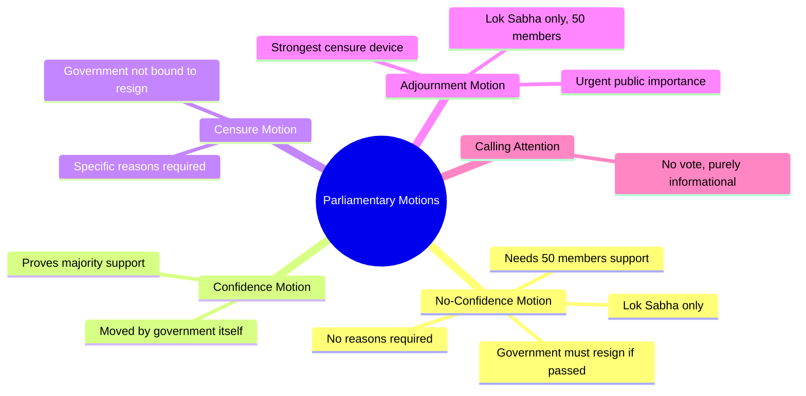

# NOTE — NO-CONFIDENCE MOTION & OTHER PARLIAMENTARY MOTIONS
**Section:** GK | **Category:** Polity | **Topic:** Parliamentary Motions | **Slug:** `polity-parliamentary-motions`
**Source:** 🔧 GENERAL KNOWLEDGE (constitutional/procedural text + standard polity reference; not yet cross-checked against PARMAR SSC reference excerpt)
**Status:** 🔧 DRAFT — awaiting AIR-91 verification before publish
**PYQ Frequency:** 🔥 High-frequency Polity topic, connects to [[polity-parliament-structure]] | **High Yield:** ✅

---

## 🎭 THE HOOK

A government in India can fall not through an election, not through a court ruling, but through a single procedural device available only in the Lok Sabha: the **No-Confidence Motion**. The Constitution itself doesn't even use this exact phrase — it's derived from the broader principle of **collective responsibility** under **Article 75(3)**, which states the Council of Ministers is collectively responsible to the Lok Sabha. From that one constitutional sentence grew an entire family of parliamentary motions, each with its own specific procedural rules, that together form the toolkit MPs use to hold the government accountable between elections.

---

## 📖 THE CORE

### No-Confidence Motion
- Can be moved ONLY in the **Lok Sabha** (NOT the Rajya Sabha), reflecting the principle that the Council of Ministers is responsible to the Lok Sabha alone (Article 75(3)) — see [[polity-parliament-structure]].
- Requires support of at least **50 MEMBERS** to be admitted for discussion.
- If passed by a **Simple Majority**, the Council of Ministers (the government) MUST resign.
- Doesn't need to specify particular reasons/grounds — can be a general expression of lack of confidence in the government.

### Confidence Motion
- Moved BY the government itself (typically the Prime Minister), to PROVE it has majority support, often when its majority is in doubt (e.g., after a coalition partner withdraws support, or after a hung-assembly election outcome).
- Essentially the MIRROR IMAGE of a No-Confidence Motion — initiated by the government to affirmatively demonstrate confidence, rather than by the opposition to challenge it.

### Censure Motion
- Can be moved against the COUNCIL OF MINISTERS or an INDIVIDUAL MINISTER, criticizing specific policies/actions.
- MUST state specific reasons/grounds (unlike a No-Confidence Motion, which doesn't require stated reasons).
- If passed, the government is NOT constitutionally required to resign (a key distinction from a No-Confidence Motion) — though politically embarrassing.

### Adjournment Motion
- Used to draw the House's attention to an URGENT MATTER of public importance, by adjourning the House's normal business.
- Considered the STRONGEST device for Parliament to express censure against the government for a specific lapse/failure.
- Requires support of at least **50 members** to be admitted.
- Can only be moved in the **Lok Sabha**, NOT the Rajya Sabha.

### Calling Attention Motion
- A device (NOT mentioned in the Rules of Procedure in the same formal category as the above, but a well-established practice) used by an MP to call the attention of a Minister to a matter of urgent public importance, and ask the Minister to make an official statement.
- Does NOT involve a vote or censure — purely informational, seeking a government response.

### Key Distinguishing Facts
- **No-Confidence Motion does NOT require stated reasons; Censure Motion DOES** — a frequently tested, easily reversed pair.
- **No-Confidence Motion's passage FORCES government resignation; Censure Motion's passage does NOT** — a key consequence-level distinction.
- **No-Confidence and Adjournment Motions can ONLY be moved in the Lok Sabha** — the Rajya Sabha has no equivalent mechanism, since the Council of Ministers is responsible to the Lok Sabha alone.

---

## 🧠 THE MIND MAP

---

## 🔑 THE MNEMONIC

**"No-Confidence needs no reason, Censure needs a specific one"** — the key procedural distinction between the two most-confused motions.

**"Only the Lok Sabha can fire the government"** — No-Confidence and Adjournment Motions are exclusively Lok Sabha tools.

---

## 📌 THE PYQ ANCHOR

🔥 Parliamentary Motions is a high-frequency Polity topic, connecting to [[polity-parliament-structure]] (Article 75(3)). 🔧 No literal Parliamentary Motions question confirmed in the 23/46-shift CGL-2025 sample reviewed earlier in this session — the No-Confidence vs. Censure Motion distinction and the 50-member admission threshold are textbook-standard SSC CGL Polity staples; recommend a dedicated archive cross-check.

---

## ⚠️ THE TRAP ALERT

- **A No-Confidence Motion does NOT require stated reasons; a Censure Motion DOES** — a frequently reversed pair of procedural rules.
- **If a Censure Motion passes, the government is NOT constitutionally bound to resign** — only a passed No-Confidence Motion forces resignation; don't conflate the two consequences.
- **Both the No-Confidence Motion and the Adjournment Motion require support of at least 50 members** to be admitted — and BOTH can only be moved in the Lok Sabha, not the Rajya Sabha.
- **A Confidence Motion is moved BY the government**, the opposite direction from a No-Confidence Motion (moved by the opposition/other members against the government).

---

## ✅ ACTIVE RECALL

1. In which House can a No-Confidence Motion be moved, and how many members' support is needed for it to be admitted?
2. What happens if a No-Confidence Motion passes?
3. What is the key procedural difference between a No-Confidence Motion and a Censure Motion?
4. Does a Censure Motion, if passed, force the government to resign?
5. What is an Adjournment Motion, and what threshold of support does it require?

*(Answers: 1–Only the Lok Sabha; at least 50 members must support it for admission | 2–The Council of Ministers (the government) must resign | 3–A No-Confidence Motion does not require stated reasons; a Censure Motion must state specific reasons/grounds | 4–No, the government is not constitutionally bound to resign if a Censure Motion passes | 5–A motion used to draw the House's attention to an urgent matter of public importance by adjourning normal business; requires support of at least 50 members, and can only be moved in the Lok Sabha)*
