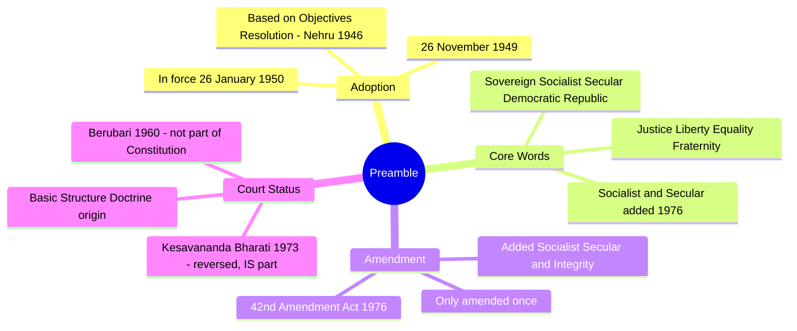

# NOTE — THE PREAMBLE
**Section:** GK | **Category:** Polity | **Topic:** Preamble | **Slug:** `polity-preamble`
**Source:** 🔧 GENERAL KNOWLEDGE (constitutional text + standard polity reference; not yet cross-checked against the PARMAR SSC reference excerpt — Polity section location in that 563-page document not yet located)
**Status:** 🔧 DRAFT — awaiting AIR-91 verification before publish
**PYQ Frequency:** 🔥 Official Phase-1 priority topic (GK_PRIORITY_TOPICS, Polity bucket) | **High Yield:** ✅

---

## 🎭 THE HOOK

A constitution doesn't usually introduce itself. India's does. Before a single article, before a single power is divided, the Constitution opens with one sentence that tells you exactly what kind of country it intends to build: **"WE, THE PEOPLE OF INDIA..."** Not "the Parliament," not "the Government" — the people, claiming ownership of the document before the document even gets to its first rule. The Preamble is the Constitution's mission statement, written in 1949, amended exactly once in 1976, and fought over in the Supreme Court more than almost any other part of the text — because the answer to "what does the Constitution allow Parliament to change?" runs straight through the Preamble's own status as Part of the Constitution or not.

---

## 📖 THE CORE

### Text & Origin
- The Preamble was adopted on **26 November 1949** (same day as the Constitution itself) and came into force on **26 January 1950**.
- It declares India to be a **SOVEREIGN, SOCIALIST, SECULAR, DEMOCRATIC REPUBLIC**, securing to all citizens **JUSTICE, LIBERTY, EQUALITY, and FRATERNITY**.
- The words **"SOCIALIST"** and **"SECULAR"** were NOT in the original 1949 text — they were inserted by the **42nd Constitutional Amendment Act, 1976**, along with the words **"and integrity"** added to "Unity of the Nation" (making it "Unity and Integrity of the Nation").
- Drafted based on the **Objectives Resolution** moved by **Jawaharlal Nehru** in December 1946 in the Constituent Assembly.

### Key Constitutional Values Listed
| Value | Meaning |
|---|---|
| **Justice** | Social, Economic, Political |
| **Liberty** | Of thought, expression, belief, faith, worship |
| **Equality** | Of status and of opportunity |
| **Fraternity** | Assuring the dignity of the individual and unity/integrity of the nation |

### Is the Preamble Part of the Constitution? (The Most-Tested Question)
- **Berubari Union case (1960):** Supreme Court held the Preamble is **NOT a part of the Constitution** and is not enforceable in a court of law.
- **Kesavananda Bharati case (1973):** Supreme Court **reversed** this position, holding the Preamble **IS part of the Constitution**, though still not directly enforceable (it cannot be used to challenge specific constitutional provisions, but can be used to interpret ambiguous ones).
- **Kesavananda Bharati is also where the "Basic Structure Doctrine" originated** — the Preamble can be amended under Article 368, but **NOT in a way that destroys the Constitution's "basic structure."**
- The Preamble has been amended **only once** — by the 42nd Amendment Act, 1976.

---

## 🧠 THE MIND MAP

---

## 🔑 THE MNEMONIC

**"SSDR-JLEF"** — Sovereign, Socialist, Democratic, Republic (state character) + Justice, Liberty, Equality, Fraternity (the four values) — covers the entire Preamble's content skeleton in one string.

**"Berubari said No, Kesavananda said Yes"** — Berubari (1960) denied Preamble's constitutional status; Kesavananda Bharati (1973) restored it.

---

## 📌 THE PYQ ANCHOR

🔥 Preamble is on the app's **official Phase-1 priority list** (GK_PRIORITY_TOPICS, Polity). 🔧 No literal Preamble question confirmed in the 23/46-shift CGL-2025 sample reviewed in this session — recommend cross-checking a multi-year archive; Polity Preamble questions ("which word was added by which amendment," "Preamble case law") are a textbook-standard SSC CGL Tier-1 GK staple.

---

## ⚠️ THE TRAP ALERT

- **"Socialist" and "Secular" were added in 1976 by the 42nd Amendment** — NOT present in the original 1949 Preamble. A very frequently tested date/word-addition trap.
- **The Preamble can be amended (it has been, once)** — but per the Basic Structure Doctrine (Kesavananda Bharati), Parliament cannot use that power to destroy the Constitution's basic structure. Don't assume "amended once" means "unamendable."
- **Berubari (1960) vs Kesavananda Bharati (1973) verdicts are opposite** — examiners test which case said what; Berubari said the Preamble is NOT part of the Constitution, Kesavananda Bharati reversed this.

---

## ✅ ACTIVE RECALL

1. On what date was the Preamble adopted, and when did it come into force?
2. Which two words were added to the Preamble by the 42nd Amendment Act, 1976?
3. Name the four values secured to citizens per the Preamble.
4. Which Supreme Court case first held the Preamble is NOT part of the Constitution, and which later case reversed this?
5. Which doctrine originated from the Kesavananda Bharati case, regarding the limits of Parliament's amending power?

*(Answers: 1–26 November 1949; in force 26 January 1950 | 2–Socialist and Secular (also "and integrity") | 3–Justice, Liberty, Equality, Fraternity | 4–Berubari Union case (1960) said NOT part; Kesavananda Bharati case (1973) reversed it | 5–The Basic Structure Doctrine)*
