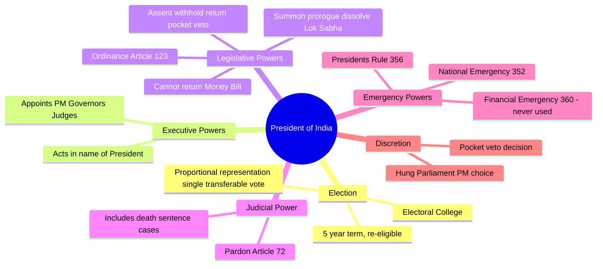

# NOTE — PRESIDENT OF INDIA: POWERS & FUNCTIONS
**Section:** GK | **Category:** Polity | **Topic:** President — Powers & Functions | **Slug:** `polity-president-powers`
**Source:** 🔧 GENERAL KNOWLEDGE (constitutional text + standard polity reference; not yet cross-checked against PARMAR SSC reference excerpt)
**Status:** 🔧 DRAFT — awaiting AIR-91 verification before publish
**PYQ Frequency:** 🔥 Official Phase-1 priority topic (GK_PRIORITY_TOPICS, Polity bucket) | **High Yield:** ✅

---

## 🎭 THE HOOK

On paper, the President of India holds more individual power than almost any head of state on Earth — command of the armed forces, the power to grant pardons even in death-penalty cases, the authority to dissolve Parliament, to impose President's Rule on an entire state, to suspend Fundamental Rights during an Emergency. In practice, the President exercises almost none of it independently. Article 74 quietly settles the entire question: there shall be a Council of Ministers, headed by the Prime Minister, to *aid and advise* the President — and after the 42nd and 44th Amendments fought it out, that advice became **binding**. The President is a constitutional head, not an executive one; real power lives with the Council of Ministers. But the gap between the President's paper powers and their actual discretion is exactly where SSC examiners like to live — because a handful of situations DO leave room for genuine presidential judgment.

---

## 📖 THE CORE

### Election & Tenure
- Elected by an **Electoral College** consisting of elected members of both Houses of Parliament AND elected members of State Legislative Assemblies (and, since the 70th Amendment, the Legislative Assemblies of Delhi and Puducherry).
- Election via **proportional representation by means of the single transferable vote**, voting by secret ballot.
- Term: **5 years**, eligible for re-election any number of times.
- Minimum age: **35 years**; must be qualified to be a Lok Sabha member.

### Executive Powers
- Appoints the **Prime Minister** (and other Ministers on PM's advice), the **Governors of States**, judges of the **Supreme Court and High Courts**, the **Attorney General**, **CAG**, **Election Commissioners**, and other key constitutional officers.
- All executive action of the Government of India is formally taken "in the name of the President."

### Legislative Powers
- Summons and prorogues Parliament; can dissolve the **Lok Sabha**.
- Addresses the first session of Parliament after each general election, and the first session of each year.
- Gives assent to bills; can **withhold assent**, **return** an ordinary bill once for reconsideration (a "suspensive veto"), or exercise a **"pocket veto"** (indefinitely withhold action, as Constitution sets no time limit for assent on ordinary bills — used notably by President Zail Singh on the Indian Post Office (Amendment) Bill, 1986).
- Cannot return a **Money Bill**.
- Can promulgate **Ordinances** (Article 123) when Parliament is not in session — has the force of law, but must be approved by Parliament within 6 weeks of reassembly.

### Judicial Powers
- Can grant **pardons, reprieves, respites, or remissions of punishment**, or suspend/remit/commute a sentence (Article 72) — including in death-sentence and court-martial cases. (Compare: Governors hold a similar but narrower power under Article 161, which does NOT extend to death sentences specifically as an exclusive power.)

### Emergency Powers (3 Types)
| Emergency | Article | Trigger |
|---|---|---|
| **National Emergency** | Article 352 | War, external aggression, or armed rebellion |
| **President's Rule (State Emergency)** | Article 356 | Failure of constitutional machinery in a state |
| **Financial Emergency** | Article 360 | Threat to financial stability/credit of India (never invoked to date) |

### Discretionary Powers (Where Real Judgment Applies)
- Choosing a Prime Minister when **no party has a clear majority** (hung Parliament).
- Dismissing a government that has **lost majority** but refuses to resign.
- Deciding whether to grant or withhold **pocket veto**.
- Seeking information from the Council of Ministers (Article 78).

---

## 🧠 THE MIND MAP

---

## 🔑 THE MNEMONIC

**"74 binds, 72 pardons, 123 ordains"** — Article 74 (binding ministerial advice), Article 72 (pardon power), Article 123 (Ordinance power) — three numbers, three core President facts.

**"352-356-360, in increasing article order: War, State, Money"** — National Emergency (352, war/aggression/rebellion), President's Rule (356, state machinery failure), Financial Emergency (360, financial stability — never invoked).

---

## 📌 THE PYQ ANCHOR

🔥 President's Powers is on the app's **official Phase-1 priority list** (GK_PRIORITY_TOPICS, Polity). 🔧 No literal President's-powers question confirmed in the 23/46-shift CGL-2025 sample reviewed — pardon power (Article 72), Ordinance power (Article 123), and the three Emergency types are textbook-standard SSC CGL Polity staples; recommend archive cross-check.

---

## ⚠️ THE TRAP ALERT

- **The President's pardon power (Article 72) extends to death sentences and court-martial cases; the Governor's pardon power (Article 161) does NOT cover court-martial and is more limited regarding death sentences** — a frequently tested President-vs-Governor power comparison.
- **The President CANNOT return a Money Bill** for reconsideration, but CAN return an ordinary bill once (suspensive veto) — don't apply the same veto rule to both bill types.
- **Financial Emergency (Article 360) has NEVER been invoked in India's history** — unlike National Emergency (invoked 3 times: 1962, 1971, 1975) and President's Rule (invoked over 100 times) — a commonly tested "which emergency has never been used" fact.
- **Council of Ministers' advice to the President is BINDING** (post-42nd/44th Amendments to Article 74) — the President is not free to act independently except in narrow discretionary situations.

---

## ✅ ACTIVE RECALL

1. How is the President of India elected, and what is the term of office?
2. Which Article makes the Council of Ministers' advice to the President binding?
3. Under which Article can the President grant pardons, and how does this differ from the Governor's pardon power?
4. Name the three types of Emergency and their triggering Articles. Which has never been invoked?
5. Can the President return a Money Bill for reconsideration?

*(Answers: 1–By an Electoral College (MPs + MLAs, via proportional representation/single transferable vote); 5-year term, re-eligible | 2–Article 74 | 3–Article 72; the President's pardon power extends to death sentences and court-martial cases, unlike the Governor's narrower Article 161 power | 4–National Emergency (Art. 352), President's Rule (Art. 356), Financial Emergency (Art. 360) — Financial Emergency has never been invoked | 5–No)*
