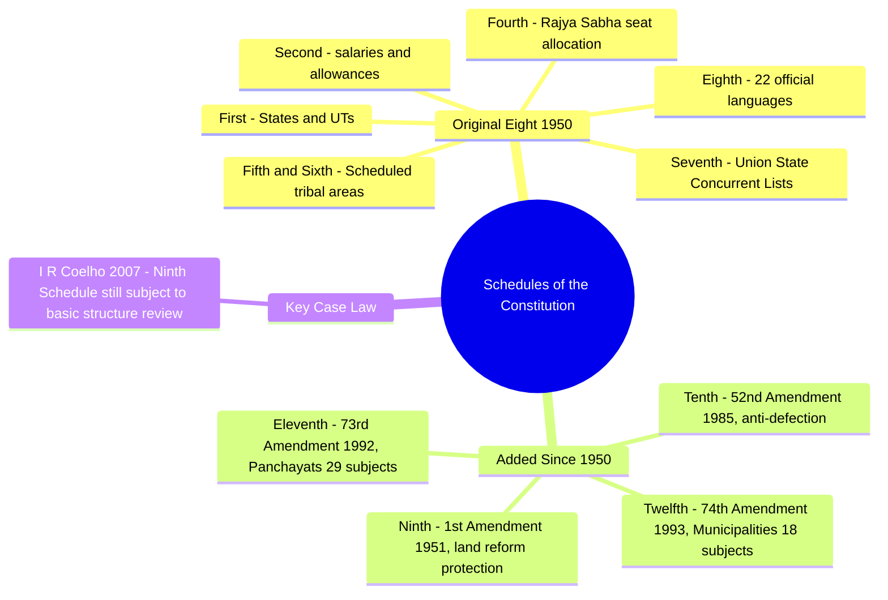

# NOTE — SCHEDULES OF THE CONSTITUTION
**Section:** GK | **Category:** Polity | **Topic:** Schedules of the Constitution | **Slug:** `polity-schedules-of-the-constitution`
**Source:** 🔧 GENERAL KNOWLEDGE (constitutional text + standard polity reference; not yet cross-checked against PARMAR SSC reference excerpt)
**Status:** 🔧 DRAFT — awaiting AIR-91 verification before publish
**PYQ Frequency:** 🔥 Very high-frequency Polity topic, connects to [[polity-panchayati-raj]] and [[polity-article-312]] | **High Yield:** ✅

---

## 🎭 THE HOOK

The original 1950 Constitution had **8 Schedules** — appendices that hold lists, tables, and forms too detailed to put in the main numbered Articles. Today there are **12**, and the four added since 1950 each tell a specific political story: the **Ninth Schedule** (1951) was created specifically to SHIELD land-reform laws from judicial review; the **Tenth Schedule** (1985) was created to STOP politicians from defecting between parties; the **Eleventh and Twelfth Schedules** (1992-93) were created to formally empower village and city governments. Schedules aren't just bureaucratic filing — each one is a snapshot of a specific constitutional crisis the framers (or later Parliament) felt needed its own dedicated appendix to solve.

---

## 📖 THE CORE

### The 12 Schedules (Full List)
| Schedule | Content | Added |
|---|---|---|
| **First** | Names of States and Union Territories, their territorial extent | Original (1950) |
| **Second** | Salaries/allowances of President, Governors, Speaker, Judges, CAG, etc. | Original (1950) |
| **Third** | Forms of OATHS/affirmations (for ministers, MPs, judges, etc.) | Original (1950) |
| **Fourth** | Allocation of seats in the **Rajya Sabha** to states/UTs | Original (1950) |
| **Fifth** | Administration of **Scheduled Areas and Scheduled Tribes** (non-Assam tribal areas) | Original (1950) |
| **Sixth** | Administration of **tribal areas in Assam, Meghalaya, Tripura, Mizoram** | Original (1950) |
| **Seventh** | The **Union List, State List, Concurrent List** (division of legislative powers) | Original (1950) |
| **Eighth** | List of **22 official languages** recognized by the Constitution | Original (1950), expanded over time |
| **Ninth** | Laws (mostly land reform) given protection from judicial review on Fundamental Rights grounds | Added by **1st Amendment, 1951** |
| **Tenth** | The **Anti-Defection Law** — provisions for disqualification of MPs/MLAs on grounds of defection | Added by **52nd Amendment, 1985** — see [[polity-anti-defection-law]] |
| **Eleventh** | **29 subjects** assigned to **Panchayats** (rural local government) | Added by **73rd Amendment, 1992** — see [[polity-panchayati-raj]] |
| **Twelfth** | **18 subjects** assigned to **Municipalities** (urban local government) | Added by **74th Amendment, 1993** — see [[polity-panchayati-raj]] |

### Key Distinguishing Facts
- **The Ninth Schedule** was created specifically via the **1st Constitutional Amendment, 1951** to protect land reform and zamindari-abolition laws from being struck down as violations of the Right to Property (then a Fundamental Right) — its scope has since been judicially narrowed (Supreme Court ruled in **I.R. Coelho v. State of Tamil Nadu, 2007** that Ninth Schedule laws are STILL subject to judicial review if they violate the Constitution's basic structure).
- **The Eighth Schedule** originally listed **14 languages** in 1950; it now lists **22**, expanded through subsequent constitutional amendments — a frequently tested "how many languages" number that has changed over time.
- **The Seventh Schedule's three Lists** (Union, State, Concurrent) are the constitutional foundation for India's federal division of legislative subjects — frequently paired with Article 246, which establishes this division.

---

## 🧠 THE MIND MAP

---

## 🔑 THE MNEMONIC

**"8 became 12: Ninth for land, Tenth for defection, Eleventh for villages, Twelfth for cities"** — the four post-1950 Schedules and what each one protects/governs.

**"Seventh splits power, Eighth speaks languages"** — the two most frequently tested original Schedules, by their defining function.

---

## 📌 THE PYQ ANCHOR

🔥 Schedules of the Constitution is a very high-frequency Polity topic, connecting to [[polity-panchayati-raj]] (11th/12th) and the Anti-Defection Law (10th). 🔧 No literal Schedules question confirmed in the 23/46-shift CGL-2025 sample reviewed earlier in this session — Schedule-number-to-content matching is a textbook-standard SSC CGL Polity staple; recommend a dedicated archive cross-check.

---

## ⚠️ THE TRAP ALERT

- **The original Constitution (1950) had 8 Schedules; today there are 12** — don't assume the count has always been 12; the four additions came via specific amendments at specific dates.
- **The Eighth Schedule originally listed 14 languages, now lists 22** — a frequently tested "how many languages" number that has CHANGED over time via amendments.
- **The Ninth Schedule's protection from judicial review is NOT absolute** — I.R. Coelho (2007) held that Ninth Schedule laws can still be struck down if they violate the Constitution's basic structure; don't assume blanket immunity.
- **Fifth Schedule covers non-Assam Scheduled Areas; Sixth Schedule specifically covers tribal areas in Assam, Meghalaya, Tripura, and Mizoram** — a frequently tested geographic-scope distinction between the two tribal-area Schedules.

---

## ✅ ACTIVE RECALL

1. How many Schedules did the original 1950 Constitution have, and how many are there today?
2. What does the Ninth Schedule protect, and which amendment added it?
3. What does the Tenth Schedule deal with, and which amendment added it?
4. How many languages does the Eighth Schedule currently list, and how many did it originally list in 1950?
5. What is the key difference in scope between the Fifth and Sixth Schedules?

*(Answers: 1–8 originally; 12 today | 2–Laws (mainly land reform) from judicial review on Fundamental Rights grounds; added by the 1st Amendment, 1951 | 3–The Anti-Defection Law; added by the 52nd Amendment, 1985 | 4–22 today; originally 14 in 1950 | 5–The Fifth Schedule covers Scheduled Areas/Tribes generally (outside Assam); the Sixth Schedule specifically covers tribal areas in Assam, Meghalaya, Tripura, and Mizoram)*
