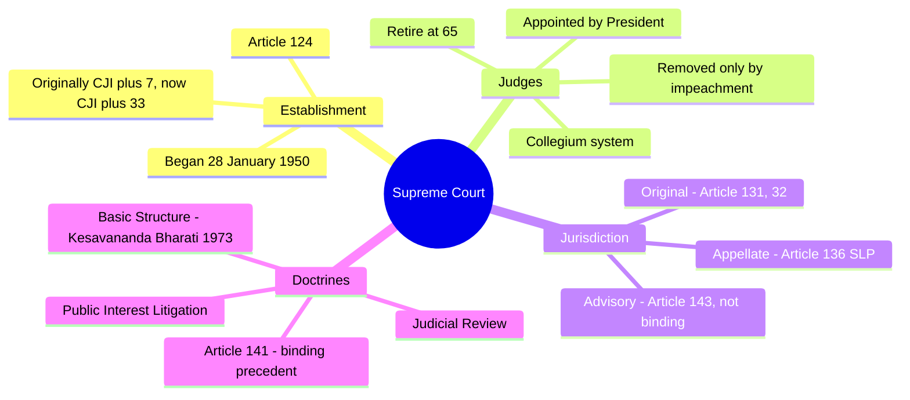

# NOTE — SUPREME COURT OF INDIA
**Section:** GK | **Category:** Polity | **Topic:** Supreme Court | **Slug:** `polity-supreme-court`
**Source:** 🔧 GENERAL KNOWLEDGE (constitutional text + standard polity reference; not yet cross-checked against PARMAR SSC reference excerpt)
**Status:** 🔧 DRAFT — awaiting AIR-91 verification before publish
**PYQ Frequency:** 🔥 Official Phase-1 priority topic (GK_PRIORITY_TOPICS, Polity bucket) | **High Yield:** ✅

---

## 🎭 THE HOOK

It opened its doors on **28 January 1950** — two days after the Constitution itself came into force — in a small chamber inside Parliament House, because India didn't even have a dedicated Supreme Court building yet. From that modest beginning, it has grown into arguably the most powerful constitutional court on Earth: it can strike down a constitutional amendment if it violates the "basic structure," it can create law where Parliament hasn't (via Public Interest Litigation), and its decisions bind every court in the country under Article 141. The Supreme Court of India isn't just the final court of appeal — it's the institution that decided, in Kesavananda Bharati (1973), that even Parliament's power to amend the Constitution has a ceiling it cannot break.

---

## 📖 THE CORE

### Establishment & Composition
- Established under **Article 124**; began functioning **28 January 1950**.
- Composed of the **Chief Justice of India (CJI)** and other judges — original sanctioned strength was 8 (CJI + 7), now expanded by Parliament to **34 (CJI + 33)**, the current maximum as of recent amendments.
- Judges appointed by the **President**, in consultation with the judiciary via the **Collegium system** (a judicially evolved practice, not explicitly written into the original constitutional text — established through the "Three Judges Cases" of 1981, 1993, and 1998).
- **Retirement age**: 65 years (compare: High Court judges retire at 62).

### Qualifications for a Supreme Court Judge
- Must be a citizen of India, and either:
  - A judge of a High Court (or two or more such courts in succession) for at least **5 years**, OR
  - An advocate of a High Court (or two or more) for at least **10 years**, OR
  - In the opinion of the President, a **distinguished jurist**.

### Removal
- Can be removed only by **impeachment** — a motion requiring a **special majority** (majority of total membership + two-thirds of members present and voting) in BOTH Houses of Parliament, on grounds of "proved misbehaviour or incapacity," as per Article 124(4).

### Jurisdiction (3 Main Types)
| Jurisdiction | Scope |
|---|---|
| **Original** | Disputes between Government of India and states, or between states (Article 131); also enforcement of Fundamental Rights via writs (Article 32). |
| **Appellate** | Appeals from High Court judgments in constitutional, civil, and criminal matters; via "Special Leave Petition" (Article 136), the Supreme Court can grant leave to appeal against ANY judgment/order/sentence from any court/tribunal in India. |
| **Advisory** | President can refer questions of law or public importance to the Supreme Court for its opinion (Article 143) — the Court's advisory opinion is NOT binding. |

### Landmark Doctrines & Powers
- **Basic Structure Doctrine** — originated in **Kesavananda Bharati v. State of Kerala (1973)**: Parliament's power to amend the Constitution (Article 368) cannot be used to alter its "basic structure" (e.g., supremacy of the Constitution, secularism, federalism, judicial review, free and fair elections).
- **Judicial Review** — power to examine the constitutional validity of legislative and executive actions.
- **Article 141** — law declared by the Supreme Court is binding on all courts within India.
- **Public Interest Litigation (PIL)** — judicially evolved practice allowing any public-spirited citizen to approach the Court on behalf of those whose rights are violated but who cannot approach the court themselves.

---

## 🧠 THE MIND MAP

---

## 🔑 THE MNEMONIC

**"124 builds it, 141 binds it, 143 advises (non-bindingly)"** — Article 124 (establishment), Article 141 (binding precedent on all courts), Article 143 (advisory jurisdiction, non-binding).

**"65 for Supreme, 62 for High"** — retirement ages: Supreme Court judges retire at 65, High Court judges at 62.

---

## 📌 THE PYQ ANCHOR

🔥 Supreme Court is on the app's **official Phase-1 priority list** (GK_PRIORITY_TOPICS, Polity). 🔧 No literal Supreme Court question confirmed in the 23/46-shift CGL-2025 sample reviewed — Basic Structure Doctrine, Article 32/136/141/143, and retirement age comparisons are textbook-standard SSC CGL Polity staples; recommend archive cross-check.

---

## ⚠️ THE TRAP ALERT

- **Supreme Court judges retire at 65; High Court judges retire at 62** — a very frequently tested numerical mix-up.
- **The Collegium system is NOT explicitly written in the original Constitution text** — it evolved through the Three Judges Cases (1981, 1993, 1998); don't assume it's a textual constitutional provision.
- **The Supreme Court's advisory jurisdiction (Article 143) gives a NON-BINDING opinion**, unlike its appellate/original jurisdiction rulings, which are binding under Article 141 — a frequently confused distinction.
- **Kesavananda Bharati (1973) is the Basic Structure Doctrine case** — don't confuse with Golaknath (1967, held Fundamental Rights cannot be amended at all — later modified by Kesavananda Bharati's more nuanced "basic structure" approach).

---

## ✅ ACTIVE RECALL

1. Under which Article was the Supreme Court established, and when did it begin functioning?
2. At what age do Supreme Court judges retire, compared to High Court judges?
3. How can a Supreme Court judge be removed, and what is the required majority in Parliament?
4. Which case originated the Basic Structure Doctrine, and what does it limit?
5. What is the difference between the Supreme Court's appellate jurisdiction and its advisory jurisdiction (Article 143) in terms of being binding?

*(Answers: 1–Article 124; began functioning 28 January 1950 | 2–65 years for Supreme Court judges; 62 years for High Court judges | 3–By impeachment, requiring a special majority (majority of total membership + two-thirds present and voting) in BOTH Houses of Parliament | 4–Kesavananda Bharati v. State of Kerala (1973); limits Parliament's power to amend the Constitution's "basic structure" | 5–Appellate jurisdiction rulings are binding on all courts (Article 141); advisory opinions under Article 143 are NOT binding)*
