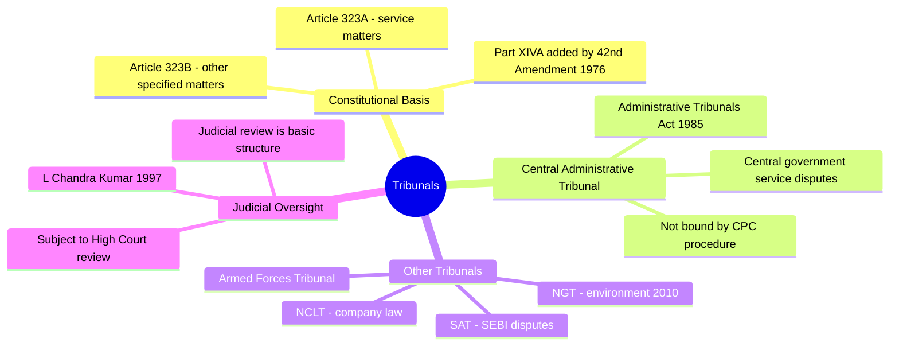

# NOTE — TRIBUNALS
**Section:** GK | **Category:** Polity | **Topic:** Tribunals | **Slug:** `polity-tribunals`
**Source:** 🔧 GENERAL KNOWLEDGE (constitutional text + standard polity reference; not yet cross-checked against PARMAR SSC reference excerpt)
**Status:** 🔧 DRAFT — awaiting AIR-91 verification before publish
**PYQ Frequency:** 🔥 High-frequency Polity topic, connects to [[polity-supreme-court]] | **High Yield:** ✅

---

## 🎭 THE HOOK

Ordinary courts in India can take years, sometimes over a decade, to resolve a single case — a backlog problem severe enough that the framers eventually decided some categories of disputes (especially service/administrative disputes involving government employees) needed a FASTER, more specialized resolution path entirely outside the normal court hierarchy. The **42nd Amendment Act, 1976** — the same sweeping amendment that touched the Preamble and Fundamental Duties — added an entirely new constitutional chapter creating **Tribunals**: quasi-judicial bodies designed to deliver faster, more technically specialized adjudication than overburdened regular courts, while still operating under the Supreme Court's ultimate supervisory authority.

---

## 📖 THE CORE

### Constitutional Basis
- **Part XIVA** ("Tribunals"), comprising **Articles 323A** and **323B**, was added by the **42nd Constitutional Amendment Act, 1976**.
- **Article 323A**: empowers Parliament to establish **Administrative Tribunals** for adjudicating disputes relating to recruitment and conditions of service of public servants (Centre, States, or both).
- **Article 323B**: empowers Parliament (and State Legislatures, for state-list matters) to establish tribunals for OTHER specified matters — taxation, land reforms, foreign exchange, industrial/labour disputes, elections, and several others.

### Central Administrative Tribunal (CAT)
- Established under the **Administrative Tribunals Act, 1985** (enacted pursuant to Article 323A).
- Adjudicates disputes related to recruitment and service conditions of CENTRAL government employees (and some other specified categories).
- Has the powers of a civil court but is NOT bound by the strict procedural rules of the Civil Procedure Code, allowing FASTER, more flexible adjudication.

### Other Major Tribunals (Frequently Tested)
| Tribunal | Domain |
|---|---|
| **National Green Tribunal (NGT)** | Environmental disputes — established 2010, under the National Green Tribunal Act, 2010 |
| **Income Tax Appellate Tribunal (ITAT)** | Income tax disputes |
| **National Company Law Tribunal (NCLT)** | Corporate/company law disputes, including insolvency matters |
| **Securities Appellate Tribunal (SAT)** | Disputes related to SEBI's orders — see [[eco-stock-market-and-sebi]] |
| **Armed Forces Tribunal (AFT)** | Disputes relating to service matters of armed forces personnel |
| **Telecom Disputes Settlement and Appellate Tribunal (TDSAT)** | Telecommunications sector disputes |

### Key Case Law & Judicial Oversight
- **L. Chandra Kumar v. Union of India (1997)**: a LANDMARK Supreme Court case holding that tribunal decisions are SUBJECT to judicial review by the High Courts (under Articles 226/227) — overturning an earlier position that had allowed tribunals to function as exclusive substitutes for High Court jurisdiction.
- This case is frequently tested as establishing that tribunals CANNOT fully oust the jurisdiction of High Courts and the Supreme Court — judicial review remains a part of the Constitution's "basic structure," even for matters assigned to specialized tribunals.

### Key Distinguishing Facts
- **Tribunals are QUASI-JUDICIAL bodies**, not regular courts — they have some court-like powers (summoning witnesses, examining evidence) but operate with more flexible, less formal procedures.
- **Article 323A is SPECIFICALLY about service/administrative matters; Article 323B covers a BROADER, separately-listed range of other subjects** — a frequently tested distinction between the two enabling Articles.

---

## 🧠 THE MIND MAP

---

## 🔑 THE MNEMONIC

**"323A for service, 323B for everything else"** — the clean split between the two Tribunal-enabling Articles.

**"Chandra Kumar 1997: tribunals can't escape the courts"** — the landmark case ensuring judicial review survives even for tribunal-assigned matters.

---

## 📌 THE PYQ ANCHOR

🔥 Tribunals is a high-frequency Polity topic, connecting to [[polity-supreme-court]] and [[eco-stock-market-and-sebi]] (via SAT). 🔧 No literal Tribunals question confirmed in the 23/46-shift CGL-2025 sample reviewed earlier in this session — Article 323A/323B, CAT, and the L. Chandra Kumar case are textbook-standard SSC CGL Polity staples; recommend a dedicated archive cross-check.

---

## ⚠️ THE TRAP ALERT

- **Tribunals were introduced via the 42nd Amendment, 1976**, the SAME amendment that touched the Preamble and Fundamental Duties — a frequently overlooked connection (see [[polity-42nd-amendment]]).
- **Article 323A covers ONLY service/administrative matters**; Article 323B covers a SEPARATE, broader range of subjects (taxation, land reforms, elections, etc.) — don't conflate the two enabling provisions.
- **Tribunal decisions are NOT immune from judicial review** — L. Chandra Kumar (1997) confirmed High Courts retain review power over tribunal decisions, overturning an earlier exclusive-jurisdiction approach.
- **Tribunals are QUASI-JUDICIAL, not full courts** — they have some court-like powers but more flexible procedures, distinct from the formal Civil Procedure Code-bound regular court system.

---

## ✅ ACTIVE RECALL

1. Which Amendment added Tribunals to the Constitution, and which Part/Articles cover them?
2. What is the difference between Article 323A and Article 323B?
3. Under which Act was the Central Administrative Tribunal (CAT) established?
4. What did the L. Chandra Kumar v. Union of India (1997) case establish?
5. Name three tribunals other than the CAT, and the domain each handles.

*(Answers: 1–The 42nd Amendment Act, 1976; Part XIVA, Articles 323A and 323B | 2–Article 323A covers service/administrative matters for public servants; Article 323B covers other specified matters like taxation, land reforms, and elections | 3–The Administrative Tribunals Act, 1985 | 4–That tribunal decisions are subject to judicial review by High Courts; tribunals cannot fully replace High Court jurisdiction | 5–Any three of: National Green Tribunal (environment), NCLT (company law), SAT (SEBI disputes), Armed Forces Tribunal (military service matters))*
