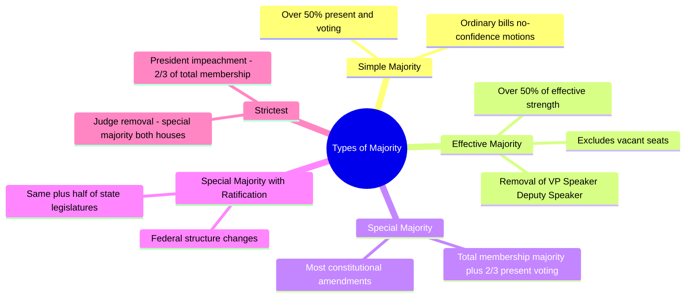

# NOTE — TYPES OF MAJORITY IN PARLIAMENT
**Section:** GK | **Category:** Polity | **Topic:** Types of Majority | **Slug:** `polity-types-of-majority`
**Source:** 🔧 GENERAL KNOWLEDGE (constitutional text + standard polity reference; not yet cross-checked against PARMAR SSC reference excerpt)
**Status:** 🔧 DRAFT — awaiting AIR-91 verification before publish
**PYQ Frequency:** 🔥 High-frequency Polity topic, connects to [[polity-42nd-amendment]] and [[polity-basic-structure-doctrine]] | **High Yield:** ✅

---

## 🎭 THE HOOK

Not every decision in Parliament requires the same level of agreement — passing an ordinary bill is deliberately EASIER than amending the Constitution, which is deliberately easier than removing a sitting judge from office. The Constitution builds this graduated difficulty directly into its voting-threshold rules, creating roughly FIVE distinct types of "majority" that mean different things depending on what's being decided — and one of SSC's favourite tricks is asking which TYPE of majority a specific constitutional action requires, since the terms ("absolute," "effective," "special," "simple") sound similar but have precisely different mathematical definitions.

---

## 📖 THE CORE

### Five Types of Majority (Frequently Tested Definitions)
| Type | Definition | Used For |
|---|---|---|
| **Simple Majority** | More than 50% of members PRESENT AND VOTING (i.e., excluding absentees and abstentions) | Most ordinary legislative business, passing ordinary bills, no-confidence motions |
| **Absolute Majority** | More than 50% of the TOTAL MEMBERSHIP of the House (regardless of how many are present/voting) | Rarely used as a standalone constitutional requirement; more common as a political/journalistic term (e.g., "absolute majority" in an election) |
| **Effective Majority** | More than 50% of the EFFECTIVE strength of the House (total membership MINUS vacant seats) | Removal of the Vice-President (Article 67(b)), removal of the Speaker/Deputy Speaker |
| **Special Majority (Article 368 type)** | Majority of the TOTAL MEMBERSHIP of each House, AND two-thirds of members PRESENT AND VOTING | Most Constitutional Amendments (Article 368) |
| **Special Majority (with State ratification)** | Same as above, PLUS ratification by at least HALF of all State Legislatures | Constitutional Amendments affecting FEDERAL provisions (e.g., changes to the Union-State legislative/judicial relationship, election of the President) |

### Where Each Type Applies (Frequently Tested Mapping)
- **Simple Majority**: ordinary bills, Money Bills, removal of a Minister via no-confidence motion, electing the Speaker/Deputy Speaker.
- **Effective Majority**: removing the Vice-President (who is also the Rajya Sabha Chairman) from office; removing the Speaker or Deputy Speaker of the Lok Sabha.
- **Special Majority (Article 368, no state ratification needed)**: amending most parts of the Constitution NOT affecting the federal structure (e.g., amending Fundamental Rights provisions in most cases).
- **Special Majority WITH State ratification**: amendments to provisions like the election of the President, the extent of Union/State executive power, representation of states in Parliament, or Article 368 itself.

### Key Distinguishing Facts
- **Impeachment of the President** requires a SPECIAL MAJORITY in EACH House SEPARATELY (two-thirds of TOTAL membership, not just those present and voting) — a uniquely STRICT threshold, even stricter than the standard Article 368 amendment formula in one respect (it's two-thirds of TOTAL membership, not just those voting).
- **Removal of a Supreme Court/High Court judge** also requires a SPECIAL MAJORITY (majority of total membership PLUS two-thirds of members present and voting) in BOTH Houses SEPARATELY.
- **"Effective strength"** EXCLUDES vacant seats — a frequently tested nuance distinguishing it from "total membership" (which counts the full sanctioned strength regardless of current vacancies).

---

## 🧠 THE MIND MAP

---

## 🔑 THE MNEMONIC

**"Simple is easy, Effective excludes vacancies, Special needs two-thirds, Special-plus needs the states too"** — the four-tier escalation of majority strictness.

**"Federal changes need the states' nod"** — the rule for when state-legislature ratification is additionally required.

---

## 📌 THE PYQ ANCHOR

🔥 Types of Majority is a high-frequency Polity topic, directly connecting to [[polity-42nd-amendment]] and [[polity-basic-structure-doctrine]] (Article 368 amendment process). 🔧 No literal Types-of-Majority question confirmed in the 23/46-shift CGL-2025 sample reviewed earlier in this session — the five-type classification and which majority applies to which constitutional action are textbook-standard SSC CGL Polity staples; recommend a dedicated archive cross-check.

---

## ⚠️ THE TRAP ALERT

- **"Simple Majority" is based on members PRESENT AND VOTING, NOT total membership** — a frequently tested base-population confusion.
- **"Effective Majority" specifically EXCLUDES vacant seats from the total** — distinct from "Absolute Majority," which is based on the FULL sanctioned strength regardless of vacancies.
- **Constitutional amendments affecting FEDERAL provisions require ADDITIONAL state-legislature ratification** (at least half the states) — don't assume all Article 368 amendments follow the identical simpler formula.
- **Removing the Vice-President uses EFFECTIVE majority; removing the President uses a STRICTER SPECIAL majority (two-thirds of TOTAL membership in each House)** — a frequently tested asymmetry between the two impeachment-style processes.

---

## ✅ ACTIVE RECALL

1. What is the difference between Simple Majority and Effective Majority?
2. What majority threshold applies to most Constitutional Amendments under Article 368?
3. When is state-legislature ratification additionally required for a constitutional amendment?
4. What majority is needed to remove the Vice-President, and what majority is needed to impeach the President?
5. What does "effective strength" of a House mean?

*(Answers: 1–Simple Majority is more than 50% of members present and voting; Effective Majority is more than 50% of the effective strength (total membership minus vacant seats) | 2–A majority of the total membership of each House, plus two-thirds of members present and voting | 3–When the amendment affects federal provisions (e.g., President's election, Union-State power balance, representation of states in Parliament, or Article 368 itself) — at least half the state legislatures must ratify | 4–Vice-President's removal: Effective Majority; President's impeachment: Special Majority (two-thirds of total membership) in each House separately | 5–The total membership of the House minus currently vacant seats)*
