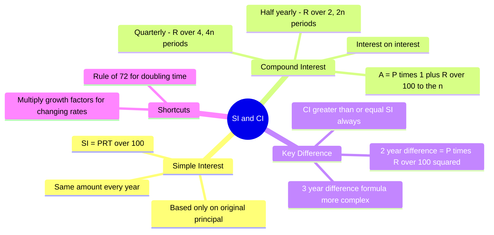

# NOTE — SIMPLE INTEREST & COMPOUND INTEREST (SI/CI)
**Section:** Quant | **Category:** Arithmetic | **Topic:** Simple Interest & Compound Interest | **Slug:** `quant-si-ci`
**Source:** 🔧 GENERAL KNOWLEDGE (standard quantitative aptitude reference; not yet cross-checked against PARMAR SSC reference excerpt)
**Status:** 🔧 DRAFT — awaiting AIR-91 verification before publish
**PYQ Frequency:** 🔥 Phase-2 backlog topic (from original CHANAKYA Smart Notes system doc) | **High Yield:** ✅

---

## 🎭 THE HOOK

Two people each invest ₹10,000 at 10% per year for 2 years. One earns Simple Interest, the other Compound Interest. They don't end up with the same amount — and the GAP between them isn't random, it follows an exact, predictable formula that SSC turns into one of the most reliable question types in the entire Quant section. Simple Interest treats every year identically: the same flat amount of interest, year after year, calculated only on the original principal. Compound Interest does something subtly different and far more powerful: each year's interest gets ADDED to the principal before the next year's interest is calculated — interest earning interest on itself. Over short periods the gap looks small. Compounded over decades, it's the entire mathematical engine behind how real wealth (and real debt) actually grows.

---

## 📖 THE CORE

### Simple Interest (SI)
- **Formula**: **SI = (P × R × T) / 100**, where P = Principal, R = Rate of interest per annum (%), T = Time (in years).
- **Amount (A) = P + SI**.
- SI is the SAME amount every year — calculated only on the original principal, never on accumulated interest.

### Compound Interest (CI)
- **Formula (annual compounding)**: **A = P × (1 + R/100)ⁿ**, where n = number of compounding periods (years, unless stated otherwise).
- **CI = A − P**.
- For **half-yearly compounding**: use **R/2** as the rate and **2n** as the number of periods.
- For **quarterly compounding**: use **R/4** as the rate and **4n** as the number of periods.
- Each period's interest is calculated on the PREVIOUS period's amount (principal + accumulated interest), not the original principal alone.

### The Critical Relationship: SI vs. CI for 2 Years
- For the SAME principal, rate, and time, **CI is always ≥ SI** (equal only when T = 1 year or R = 0; CI > SI for any T > 1 year).
- **Difference between CI and SI for 2 years** = **P × (R/100)²** — a frequently used shortcut formula, derived directly from the algebra of compounding.
- **Difference between CI and SI for 3 years** = **P × (R/100)² × (3 + R/100)** — a more complex but still memorizable shortcut.

### Key Shortcut Patterns (Frequently Tested)
- If a sum becomes **n times** in **T years** at simple interest, it becomes **(n−1) × 100/T** as the rate, OR conversely, time/rate can be derived using **SI = P(n−1)**, since Amount = P × n means SI = P(n-1).
- **Rule of 72** (approximate, for CI): time taken for a sum to DOUBLE ≈ **72 / R** (R = rate %) — a fast estimation shortcut, not exact, but very commonly used for quick approximation in exams.
- **CI compounded annually but rate changes each year** (e.g., 10% first year, 20% second year): calculate using **A = P × (1 + R₁/100) × (1 + R�2/100)...** — multiply successive growth factors, don't average the rates.

---

## 🧠 THE MIND MAP

---

## 🔑 THE MNEMONIC

**"SI is flat, CI compounds — same start, different math"** — SI stays constant each year; CI grows on top of itself.

**"2-year CI-SI gap = P times (R/100) squared"** — the single most commonly tested shortcut formula in this topic.

---

## 📌 THE PYQ ANCHOR

🔥 SI/CI was explicitly listed as a Phase-2 backlog topic in the original CHANAKYA Smart Notes system document. 🔧 No PYQ data from this session's CGL-2025 GK extraction applies here, since SI/CI is a Quant topic, not GK — Quant PYQ patterns were not part of this session's extraction scope. SI/CI (especially the CI-SI difference shortcut and half-yearly/quarterly compounding) is consistently one of the highest-frequency Arithmetic topics across SSC CGL Tier 1 and Tier 2 historically; recommend a dedicated Quant PYQ archive review.

---

## ⚠️ THE TRAP ALERT

- **For half-yearly/quarterly compounding, the RATE is divided AND the time period is multiplied** — e.g., half-yearly: R becomes R/2, n becomes 2n. A very common error is adjusting only one of the two.
- **CI for multi-year problems with DIFFERENT rates per year requires multiplying growth factors**, NOT averaging the rates — e.g., 10% then 20% is NOT the same as a flat 15% for 2 years.
- **The "2-year CI-SI difference = P(R/100)²" shortcut applies ONLY for annual compounding over exactly 2 years** — using it for half-yearly compounding or different time periods without adjustment gives a wrong answer.

---

## ✅ ACTIVE RECALL

1. State the formula for Simple Interest.
2. State the formula for the Amount under Compound Interest (annual compounding).
3. How do you adjust the CI formula for half-yearly compounding?
4. What is the shortcut formula for the difference between CI and SI over 2 years?
5. If a sum earns 10% in year one and 20% in year two under compound interest, how do you calculate the final amount — by averaging the rates or multiplying growth factors?

*(Answers: 1–SI = (P × R × T) / 100 | 2–A = P × (1 + R/100)ⁿ | 3–Use R/2 as the rate and 2n as the number of periods | 4–Difference = P × (R/100)² | 5–By multiplying growth factors: A = P × (1 + 10/100) × (1 + 20/100), NOT by averaging to a flat 15% rate)*
