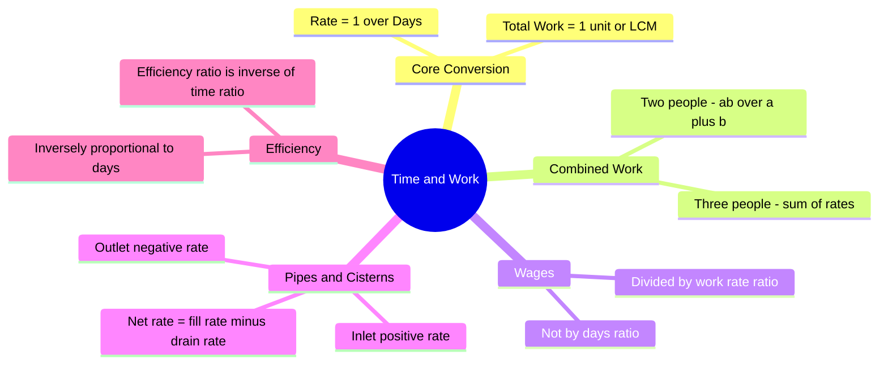

# NOTE — TIME AND WORK
**Section:** Quant | **Category:** Arithmetic | **Topic:** Time and Work | **Slug:** `quant-time-and-work`
**Source:** 🔧 GENERAL KNOWLEDGE (standard quantitative aptitude reference; not yet cross-checked against PARMAR SSC reference excerpt)
**Status:** 🔧 DRAFT — awaiting AIR-91 verification before publish
**PYQ Frequency:** 🔥 Phase-2 backlog topic (from original CHANAKYA Smart Notes system doc) | **High Yield:** ✅

---

## 🎭 THE HOOK

A worker who can finish a wall in 10 days isn't doing "10 days of work" — they're doing **1/10th of the wall every single day**, and that single reframe is the entire trick behind every Time and Work question SSC has ever asked. Once you stop thinking in "days to finish" and start thinking in "fraction of work done per day," two people working together simply ADD their daily fractions, three people add three fractions, and a person who quits halfway through just leaves behind whatever fraction is left for someone else to finish. The moment you assume "Total Work = 1 unit" (or some convenient LCM number) and convert every person's speed into a rate, Time and Work problems stop being word puzzles and become straightforward fraction arithmetic.

---

## 📖 THE CORE

### The Core Conversion
- If a person completes a job in **D days**, their **work rate = 1/D** (fraction of the job done per day).
- **Total Work is usually assumed = 1 unit**, OR for ease of calculation, assumed equal to the **LCM of all given time values** (e.g., if A takes 10 days and B takes 15 days, assume Total Work = LCM(10,15) = 30 units; A's rate = 3 units/day, B's rate = 2 units/day).

### Combined Work
- If A takes **a days** and B takes **b days** to complete a job alone, working TOGETHER they take: **(a × b) / (a + b)** days.
- For three people (A, B, C) with individual times a, b, c: combined rate = 1/a + 1/b + 1/c; combined time = 1 / (1/a + 1/b + 1/c).

### Work + Wages
- If multiple people work together and get paid based on their CONTRIBUTION, wages are divided in the **ratio of work done**, which equals the **ratio of their individual work rates** (NOT the ratio of days taken — a frequently inverted relationship).

### Pipes and Cisterns (A Special Case of Time & Work)
- An **inlet pipe** filling a tank is treated as **POSITIVE work** (+1/D); an **outlet pipe** (drain) emptying a tank is treated as **NEGATIVE work** (−1/D).
- If a tank is filled by Pipe A in **x hours** and emptied by Pipe B in **y hours**, and both are opened together: net rate = 1/x − 1/y; time to fill = 1 / (1/x − 1/y) — note this is only valid if x < y (i.e., filling is faster than emptying); otherwise the tank never fills.

### Efficiency-Based Problems
- "Efficiency" is INVERSELY proportional to the number of days taken — if A is twice as efficient as B, A takes HALF the days B takes.
- If the RATIO of efficiencies of A and B is given (e.g., A:B = 3:2), then the ratio of TIME taken is the INVERSE (i.e., Time A : Time B = 2:3) — a very frequently inverted relationship in MCQs.

---

## 🧠 THE MIND MAP

---

## 🔑 THE MNEMONIC

**"Rate is 1 over Days, work adds when teams combine"** — the foundational reframe that makes every Time and Work problem solvable.

**"Efficiency up, Days down — always inverse, never the same direction"** — the most commonly inverted relationship in this topic.

---

## 📌 THE PYQ ANCHOR

🔥 Time and Work was explicitly listed as a Phase-2 backlog topic in the original CHANAKYA Smart Notes system document. 🔧 No PYQ data from this session's CGL-2025 GK extraction applies here, since Time and Work is a Quant topic, not GK — Quant PYQ patterns were not part of this session's extraction scope. Time and Work (including Pipes & Cisterns as a sub-variant) is consistently one of the highest-frequency Arithmetic topics across SSC CGL Tier 1 and Tier 2 historically; recommend a dedicated Quant PYQ archive review.

---

## ⚠️ THE TRAP ALERT

- **Wages are divided in the ratio of WORK DONE (= work rate), NOT in the ratio of DAYS TAKEN** — a very frequently inverted relationship; the person who takes FEWER days has done MORE work per day and gets a LARGER share, not a smaller one.
- **Efficiency and time taken are INVERSELY proportional** — if A's efficiency is twice B's, A takes HALF the time, not double; ratio questions frequently exploit this inversion.
- **In Pipes & Cisterns problems, an outlet pipe's rate must be SUBTRACTED, not added** — forgetting to treat the outlet as negative work is the most common calculation error in this sub-topic.

---

## ✅ ACTIVE RECALL

1. If a person completes a job in D days, what is their work rate per day?
2. If A takes 'a' days and B takes 'b' days to complete a job alone, how long do they take working together?
3. How are wages divided among workers when they work together — by days taken or by work rate?
4. How is an outlet/drain pipe's rate treated in a combined Pipes & Cisterns calculation?
5. If A is three times as efficient as B, what is the ratio of the time each takes to complete the same job?

*(Answers: 1–1/D (fraction of the job per day) | 2–(a × b) / (a + b) days | 3–By the ratio of work rate (work done), NOT by days taken | 4–As negative work (subtracted from the combined rate) | 5–Time A : Time B = 1:3 (inverse of the efficiency ratio 3:1))*
