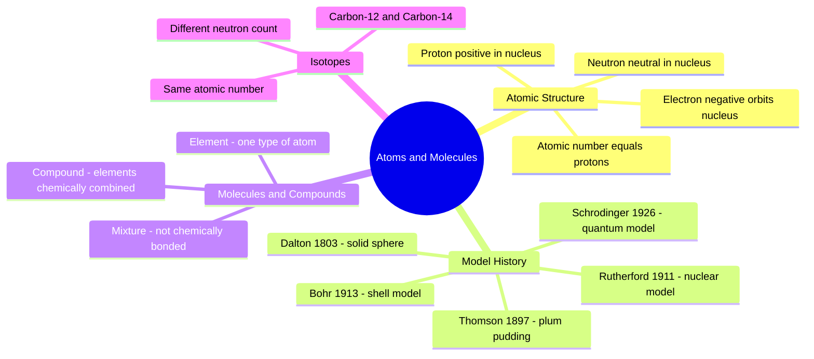

# NOTE — ATOMS & MOLECULES BASICS
**Section:** GK | **Category:** Science | **Topic:** Atoms & Molecules | **Slug:** `sci-atoms-and-molecules-basics`
**Source:** 🔧 GENERAL KNOWLEDGE (standard chemistry/physics reference; not yet cross-checked against PARMAR SSC reference excerpt)
**Status:** 🔧 DRAFT — awaiting AIR-91 verification before publish
**PYQ Frequency:** 🔥 Very high-frequency Science topic, connects to [[sci-periodic-table-and-chemical-bonding]] | **High Yield:** ✅

---

## 🎭 THE HOOK

Atomic theory's history is a story of constant revision — every "final answer" about what an atom looks like got overturned within a generation. **J.J. Thomson** (1897) proposed the **"Plum Pudding Model"**, picturing the atom as a uniform positive sphere studded with negative electrons, like fruit in a pudding. **Ernest Rutherford** (1911) blew that model apart — literally, with a gold-foil experiment that revealed atoms are mostly EMPTY SPACE, with all the positive charge and nearly all the mass concentrated in a tiny central **nucleus**. **Niels Bohr** (1913) then added the missing piece: electrons orbit the nucleus in FIXED, specific energy levels (shells), not anywhere they please. Each model wasn't just "more detailed" than the last — each one was forced into existence by an experiment that broke the previous model's predictions.

---

## 📖 THE CORE

### Atomic Structure
- **Atom** = the smallest unit of an element that retains the element's chemical properties.
- **Subatomic particles**:
  - **Proton**: positive charge, located in the nucleus, mass ≈ 1 atomic mass unit (amu).
  - **Neutron**: no charge (neutral), located in the nucleus, mass ≈ 1 amu.
  - **Electron**: negative charge, orbits the nucleus in shells/energy levels, mass negligible (~1/1836th of a proton's mass).
- **Atomic Number (Z)**: number of PROTONS in an atom — defines the element's identity.
- **Mass Number (A)**: number of PROTONS + NEUTRONS combined.
- **Isotopes**: atoms of the SAME element (same atomic number/proton count) with DIFFERENT numbers of neutrons (different mass numbers) — e.g., Carbon-12 and Carbon-14.

### History of Atomic Models (Frequently Tested Sequence)
| Scientist | Year | Model |
|---|---|---|
| **John Dalton** | 1803 | Atoms are indivisible, solid spheres ("billiard ball" model) — the first scientific atomic theory |
| **J.J. Thomson** | 1897 | "Plum Pudding Model" — positive sphere with embedded electrons; also DISCOVERED the electron |
| **Ernest Rutherford** | 1911 | Nuclear model — atom is mostly empty space, with a small, dense, positively-charged nucleus (via the famous gold-foil experiment) |
| **Niels Bohr** | 1913 | Planetary/shell model — electrons orbit the nucleus in fixed, quantized energy levels (shells) |
| **Erwin Schrödinger** | 1926 | Quantum mechanical model — electrons exist in probabilistic "clouds" (orbitals), not fixed paths — the current scientifically accepted model |

### Molecules & Compounds
- **Molecule**: two or more atoms chemically bonded together (e.g., O₂ — two oxygen atoms; H₂O — two hydrogen + one oxygen).
- **Element**: a substance made of only ONE type of atom (e.g., pure Oxygen, pure Gold).
- **Compound**: a substance made of TWO OR MORE different elements chemically combined in a fixed ratio (e.g., water, H₂O; carbon dioxide, CO₂).
- **Mixture**: a combination of substances NOT chemically bonded, in variable proportions, retaining their individual properties (e.g., air, salt water) — distinct from a compound.

### Key Distinguishing Facts
- **Atomic number defines WHICH element an atom is**; mass number can vary among isotopes of the same element.
- **Rutherford's gold-foil experiment** is the single most-cited experimental result in this topic — it disproved Thomson's "plum pudding" model by showing most alpha particles passed straight through gold foil, while a small fraction deflected sharply, revealing a small, dense, positively-charged nucleus.
- **The Bohr model is a SIMPLIFICATION** still commonly taught for its intuitive clarity, but the quantum mechanical (Schrödinger) model is the scientifically accurate CURRENT model.

---

## 🧠 THE MIND MAP

---

## 🔑 THE MNEMONIC

**"Dalton-Thomson-Rutherford-Bohr-Schrodinger: DTRBS, in order"** — the five-name historical sequence of atomic models.

**"Protons decide identity, neutrons decide isotopes"** — the atomic-number vs. mass-number distinction in one line.

---

## 📌 THE PYQ ANCHOR

🔥 Atoms & Molecules is a very high-frequency Science topic, connecting to [[sci-periodic-table-and-chemical-bonding]]. 🔧 No literal Atoms/Molecules question confirmed in the 23/46-shift CGL-2025 sample reviewed earlier in this session, since this topic wasn't separately tagged during PYQ extraction — the atomic model sequence and proton/neutron/electron facts are textbook-standard SSC CGL Science staples; recommend a dedicated archive cross-check.

---

## ⚠️ THE TRAP ALERT

- **Rutherford's experiment DISPROVED Thomson's model**, not Dalton's — examiners may test which scientist's model was overturned by the gold-foil experiment.
- **Atomic Number = number of PROTONS; Mass Number = protons + NEUTRONS** — a frequently confused pair; don't include electrons in the mass number.
- **Isotopes have the SAME atomic number but DIFFERENT mass numbers** (due to differing neutron counts) — don't assume isotopes are different elements; they're the same element, different "versions."
- **A compound has elements in a FIXED ratio chemically combined; a mixture has variable proportions, not chemically bonded** — a frequently tested compound-vs-mixture distinction.

---

## ✅ ACTIVE RECALL

1. What are the three subatomic particles, their charges, and their locations within an atom?
2. What is the difference between Atomic Number and Mass Number?
3. List the five major atomic models in chronological order, with their proposers.
4. What experiment disproved Thomson's "Plum Pudding" model, and what did it reveal?
5. What is the difference between a compound and a mixture?

*(Answers: 1–Proton (positive, nucleus), Neutron (neutral, nucleus), Electron (negative, orbits nucleus in shells) | 2–Atomic Number = number of protons; Mass Number = protons + neutrons combined | 3–Dalton (1803, solid sphere), Thomson (1897, plum pudding), Rutherford (1911, nuclear model), Bohr (1913, shell model), Schrödinger (1926, quantum mechanical model) | 4–Rutherford's gold-foil experiment; it revealed atoms are mostly empty space with a small, dense, positively-charged nucleus | 5–A compound has different elements chemically combined in a fixed ratio; a mixture has substances combined in variable proportions without chemical bonding)*
