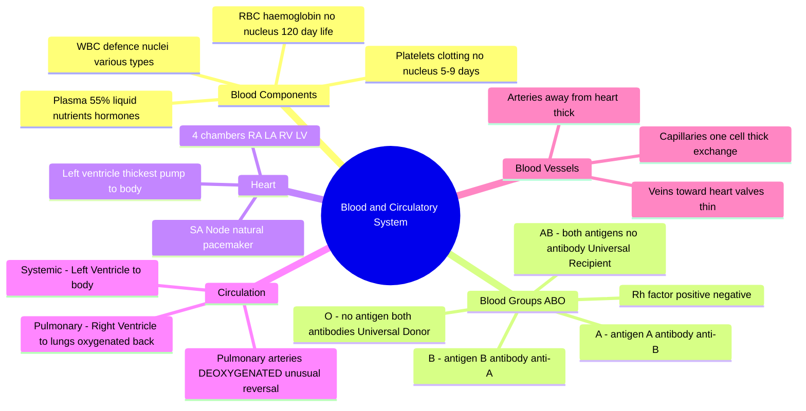

# NOTE — BLOOD & CIRCULATORY SYSTEM
**Section:** GK | **Category:** Science | **Topic:** Blood & Circulatory System | **Slug:** `sci-blood-and-circulatory-system`
**Source:** 🔧 GENERAL KNOWLEDGE (standard biology/medical-science reference; not yet cross-checked against PARMAR SSC reference excerpt)
**Status:** 🔧 DRAFT — awaiting AIR-91 verification before publish
**PYQ Frequency:** 🔥 Very high-frequency — blood groups, blood components, heart structure, and pulse rate are perennially tested SSC CGL Biology questions | **High Yield:** ✅

---

## 🎭 THE HOOK

Before Karl Landsteiner discovered blood groups in 1901, blood transfusions killed more patients than they saved — doctors didn't know why some transfers worked and some caused fatal clotting. Landsteiner's discovery of the ABO system explained it: blood type isn't one thing, it's four different things, determined by proteins on red blood cell surfaces. SSC CGL tests this history as science: the blood groups system, the universal donor and recipient, and the components that make blood what it is.

---

## 📖 THE CORE

### Blood — Composition

Human blood is composed of:
1. **Plasma** (~55% of blood volume): Liquid component; pale yellow; ~90% water + proteins (albumin, globulin, fibrinogen), hormones, enzymes, nutrients, CO₂, waste products
2. **Red Blood Cells / Erythrocytes** (~45%): Contain **haemoglobin** (iron-containing protein that carries O₂); LACK a nucleus when mature (unique among human cells); produced in red bone marrow; lifespan ~120 days
3. **White Blood Cells / Leukocytes** (<1%): Defence against pathogens; contain nuclei; lifespan varies (days to years); several types (neutrophils, lymphocytes, monocytes, eosinophils, basophils)
4. **Platelets / Thrombocytes**: Fragments of megakaryocyte cells; role in BLOOD CLOTTING (coagulation); LACK a nucleus; lifespan ~5-9 days

---

### Blood Groups — ABO System (Karl Landsteiner, 1901)

| Blood Group | Antigen on RBC | Antibody in Plasma | Can Donate To | Can Receive From |
|---|---|---|---|---|
| **A** | A | Anti-B | A, AB | A, O |
| **B** | B | Anti-A | B, AB | B, O |
| **AB** | A and B | NONE | AB only | **A, B, AB, O (Universal Recipient)** |
| **O** | NONE | Anti-A and Anti-B | **A, B, AB, O (Universal Donor)** | O only |

> **Universal Donor**: Blood Group **O** (no antigens on RBCs; can't trigger recipient's antibodies)  
> **Universal Recipient**: Blood Group **AB** (no antibodies in plasma; won't attack any donor's antigens)

### Rh Factor
- **Rh positive (Rh+)**: Has Rh antigen (D antigen) on RBCs; ~85% of humans
- **Rh negative (Rh−)**: Lacks Rh antigen; ~15% of humans
- **Erythroblastosis Fetalis (Haemolytic Disease of the Newborn)**: Occurs when an Rh− mother carries an Rh+ baby; mother's antibodies attack baby's RBCs; prevented by injecting anti-D immunoglobulin to the mother

---

### The Heart — Structure & Function

- **Location**: Left of center in thoracic cavity (slightly)
- **Chambers**: 4 — Left Atrium (LA), Right Atrium (RA), Left Ventricle (LV), Right Ventricle (RV)
- **Walls**: Left Ventricle has the THICKEST walls — it pumps blood to the ENTIRE body through the aorta (systemic circulation); requires highest pressure
- **Valves**:
  - **Mitral Valve (Bicuspid)**: Between Left Atrium and Left Ventricle
  - **Tricuspid Valve**: Between Right Atrium and Right Ventricle
  - **Aortic Valve**: Between Left Ventricle and Aorta
  - **Pulmonary Valve**: Between Right Ventricle and Pulmonary Artery

---

### Blood Circulation — Two Circuits

#### 1. Pulmonary Circulation (Heart → Lungs → Heart)
- Right Ventricle → Pulmonary Artery → Lungs (O₂ absorbed, CO₂ released) → Pulmonary Vein → Left Atrium
- **KEY REVERSAL**: Pulmonary ARTERIES carry DEOXYGENATED blood (to lungs); Pulmonary VEINS carry OXYGENATED blood (from lungs)
- This is the ONLY case where arteries carry deoxygenated blood and veins carry oxygenated blood

#### 2. Systemic Circulation (Heart → Body → Heart)
- Left Ventricle → Aorta → All body tissues (O₂ delivered, CO₂ collected) → Superior/Inferior Vena Cava → Right Atrium
- Arteries carry oxygenated blood; Veins carry deoxygenated blood (the standard rule)

---

### Blood Vessels — Key Distinctions

| Vessel | Carries | Direction | Wall |
|---|---|---|---|
| **Arteries** | Oxygenated blood (except pulmonary) | Away from Heart | THICK, elastic, muscular |
| **Veins** | Deoxygenated blood (except pulmonary) | Toward Heart | Thin; have VALVES to prevent backflow |
| **Capillaries** | Exchange of gases, nutrients, waste | Between arteries and veins in tissues | Single cell thick (one-cell layer) |

---

### Cardiac Metrics (Frequently Tested)

| Metric | Normal Value | Note |
|---|---|---|
| **Resting Heart Rate** | 60–100 beats per minute | <60 = bradycardia; >100 = tachycardia |
| **Blood Pressure (Normal)** | 120/80 mmHg | Systolic/Diastolic |
| **Blood Volume** | ~5–6 litres in adults |  |
| **Cardiac Output** | ~5 litres/minute at rest | Heart Rate × Stroke Volume |

---

### Key Blood-Related Facts

| Fact | Detail |
|---|---|
| **Haemoglobin** | Iron-containing protein in RBCs; carries O₂; its iron content gives blood the red colour; produced in red bone marrow |
| **Anaemia** | Condition of insufficient haemoglobin or RBCs; causes fatigue, pallor; often due to iron deficiency |
| **WBC (Normal Count)** | 4,000–11,000 per cubic millimeter of blood; elevated in infection (leukocytosis) |
| **Platelet Count (Normal)** | 1.5–4 lakh per cubic millimeter; low count = thrombocytopenia (seen in Dengue) |
| **Fibrinogen** | Plasma protein that converts to FIBRIN during clotting; Vitamin K required for clotting factors |
| **Serum** | Blood plasma WITHOUT clotting factors (fibrinogen) — plasma is serum + clotting factors |
| **Pacemaker of the Heart** | **SA Node (Sinoatrial Node)** — initiates the electrical impulse for heartbeat; called the natural pacemaker |
| **Lymph** | Fluid derived from plasma that leaks into tissues; collected by lymph vessels; part of immune system |

---

## 🧠 THE MIND MAP

---

## 🔑 THE MNEMONIC

**"O is the Only universal donor — no antigens; AB has All Blood — no antibodies, universal recipient"** — the blood group extremes.

**"Arteries Away from heart; Veins toward heart (VTV = Veins Toward)"** — blood vessel direction.

**"Pulmonary REVERSAL: pulmonary arteries carry DEoxygenated blood TO lungs"** — the only exception to the artery = oxygenated rule.

**"SA Node = Heart's Starter" — the Sinoatrial Node is the natural pacemaker**.

---

## 📌 THE PYQ ANCHOR

🔥 Universal donor (O) and universal recipient (AB), the pulmonary circulation reversal (pulmonary arteries carry deoxygenated blood), haemoglobin as the oxygen carrier, and the SA Node as the heart's pacemaker are perennially tested SSC CGL Biology facts. Blood group discovery by Karl Landsteiner (1901, Nobel 1930) is a named-scientist anchor connecting to [[sci-famous-scientists-and-discoveries]]. 🔧 No specific CGL 2025 PYQ confirmed from the 23/46-shift sample; recommend dedicated archive cross-check.

---

## ⚠️ THE TRAP ALERT

- **PULMONARY ARTERIES carry DEOXYGENATED blood** (to the lungs) and **PULMONARY VEINS carry OXYGENATED blood** (from the lungs back to the heart) — this is the ONLY exception to the "arteries = oxygenated, veins = deoxygenated" rule. Extremely frequently tested.
- **Blood Group O is the Universal DONOR** (no antigens, can't trigger reactions); **Blood Group AB is the Universal RECIPIENT** (no antibodies, can't reject anything) — the two are often deliberately swapped in MCQ wrong-answer choices.
- **RBCs (mature) have NO NUCLEUS** — unlike almost all other cells in the body; this is why they cannot divide or repair themselves.
- **Plasma ≠ Serum**: Plasma is blood minus the cells; Serum is plasma minus the clotting factors (fibrinogen). Both lack cells, but Serum additionally lacks clotting proteins.
- **Left Ventricle has the THICKEST walls** — not the right; the left ventricle pumps blood to the entire body and needs maximum pressure.
- **Dengue causes THROMBOCYTOPENIA** (dangerously low platelet count, leading to bleeding risk) — a medically important connection tested in disease-biology crossover questions.

---

## ✅ ACTIVE RECALL

1. Which blood group is the Universal Donor and which is the Universal Recipient? Why?
2. What is the pulmonary circulation reversal — what unexpected blood type do pulmonary ARTERIES carry?
3. What do mature Red Blood Cells lack that almost all other body cells have?
4. What is the name of the heart's natural pacemaker, and what does it do?
5. What is the difference between blood plasma and blood serum?

*(Answers: 1–Universal Donor: Group O (no antigens on RBCs, so won't trigger any recipient's immune response); Universal Recipient: Group AB (no antibodies in plasma, so won't attack any donor's RBCs) | 2–Pulmonary ARTERIES carry DEOXYGENATED blood (from the right ventricle TO the lungs to pick up oxygen) — the only arteries that carry deoxygenated blood | 3–A nucleus — mature RBCs (erythrocytes) have no nucleus, making them unable to divide or repair themselves | 4–The SA Node (Sinoatrial Node); it generates the electrical impulse that initiates each heartbeat, setting the rhythm (hence "pacemaker") | 5–Plasma = blood minus all blood cells (liquid portion with proteins including fibrinogen/clotting factors); Serum = plasma minus clotting factors/fibrinogen — so serum = plasma without the clotting proteins)*
