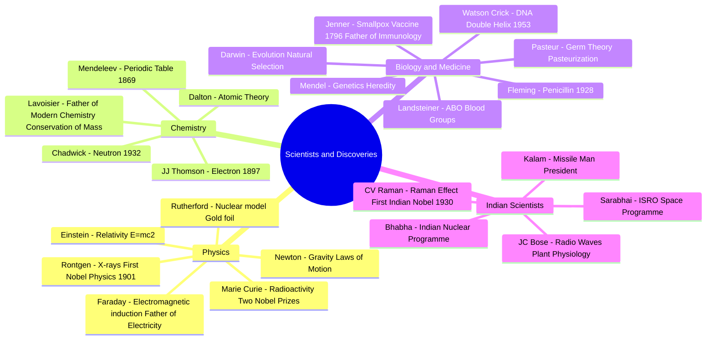

# NOTE — FAMOUS SCIENTISTS & DISCOVERIES
**Section:** GK | **Category:** Science | **Topic:** Famous Scientists & Discoveries | **Slug:** `sci-famous-scientists-and-discoveries`
**Source:** 🔧 GENERAL KNOWLEDGE (standard science-history reference; not yet cross-checked against PARMAR SSC reference excerpt)
**Status:** 🔧 DRAFT — awaiting AIR-91 verification before publish
**PYQ Frequency:** 🔥 Very high-frequency — scientist-discovery matching is a textbook SSC CGL Science staple | **High Yield:** ✅

---

## 🎭 THE HOOK

Every exam set has at least one question that begins "Who discovered...?" or "Which scientist is associated with...?" — and the trap is never the famous names (Newton, Einstein) but the second-tier ones that students skip because they seem obscure. Casimir Funk (vitamins), Alexander Fleming (penicillin), Karl Landsteiner (blood groups) — these are the ones that decide ranks. SSC treats science history the way it treats geography capitals: know the pairing, score the point.

---

## 📖 THE CORE

### Physics — Discoveries & Laws

| Scientist | Nationality | Discovery / Contribution | Key Phrase |
|---|---|---|---|
| **Isaac Newton** | British | Laws of Motion; Law of Universal Gravitation | "Apple fell, gravity was born" |
| **Albert Einstein** | German-Swiss | Theory of Relativity (Special 1905, General 1915); E=mc² | "Mass is energy in disguise" |
| **Galileo Galilei** | Italian | Telescope (improved); Law of Falling Bodies; heliocentrism support | "Father of Experimental Physics" |
| **Niels Bohr** | Danish | Atomic model (Bohr model — electrons in fixed orbits) | "Father of Quantum Mechanics" |
| **Ernest Rutherford** | New Zealander-British | Nuclear model of atom (proton-neutron nucleus); "Father of Nuclear Physics" | Gold foil experiment |
| **Max Planck** | German | Quantum Theory; Planck's constant (h) | Energy is quantized |
| **Michael Faraday** | British | Electromagnetic induction; Laws of Electrolysis | "Father of Electricity" |
| **James Clerk Maxwell** | Scottish | Electromagnetic theory (light as EM wave) | Unified electricity and magnetism |
| **Heinrich Hertz** | German | Radio waves (confirmed Maxwell's theory) | Unit 'Hertz' named after him |
| **Wilhelm Röntgen** | German | X-rays (1895) | First Nobel Prize in Physics (1901) |
| **Marie Curie** | Polish-French | Radioactivity; discovered Polonium and Radium | Only person to win Nobel in two sciences |

---

### Chemistry — Discoveries & Laws

| Scientist | Nationality | Discovery / Contribution |
|---|---|---|
| **Antoine Lavoisier** | French | Law of Conservation of Mass; named Oxygen and Hydrogen; "Father of Modern Chemistry" |
| **John Dalton** | British | Atomic Theory (matter made of atoms); Dalton's Law of Partial Pressures |
| **Dmitri Mendeleev** | Russian | Periodic Table of Elements (1869) — predicted undiscovered elements |
| **Henry Moseley** | British | Atomic number (protons define an element, not mass) |
| **J.J. Thomson** | British | Discovery of the Electron (1897) — cathode ray experiments |
| **James Chadwick** | British | Discovery of the Neutron (1932) |
| **Friedrich Wöhler** | German | Synthesis of Urea (1828) — disproved 'vital force' theory; bridged organic/inorganic |
| **Alfred Nobel** | Swedish | Dynamite; endowed the Nobel Prizes |

---

### Biology & Medicine — Discoveries

| Scientist | Nationality | Discovery / Contribution |
|---|---|---|
| **Charles Darwin** | British | Theory of Evolution by Natural Selection (*On the Origin of Species*, 1859) |
| **Gregor Mendel** | Austrian | Laws of Heredity (Genetics); "Father of Genetics"; pea plant experiments |
| **Louis Pasteur** | French | Germ Theory of Disease; pasteurization; rabies vaccine; "Father of Microbiology" |
| **Robert Koch** | German | Identified causative bacteria for TB (*M. tuberculosis*), Cholera (*V. cholerae*); Koch's Postulates |
| **Alexander Fleming** | Scottish | Penicillin (1928) — accidentally discovered antibiotic properties of *Penicillium* mold |
| **Edward Jenner** | British | Smallpox Vaccine (1796) — first vaccine in history; "Father of Immunology" |
| **William Harvey** | British | Circulation of blood; described heart as a pump (1628) |
| **Karl Landsteiner** | Austrian | ABO Blood Group System (Nobel 1930); also discovered Rh factor |
| **Casimir Funk** | Polish-British | Coined the term "vitamine" (1912); pioneered vitamin research |
| **James Watson & Francis Crick** | American / British | DNA Double Helix structure (1953) — with Rosalind Franklin's X-ray data |
| **Har Gobind Khorana** | Indian-American | Cracked the genetic code (codons); Nobel Prize 1968 |

---

### Indian Scientists — SSC-Specific High Yield

| Scientist | Contribution | Key Fact |
|---|---|---|
| **C.V. Raman** | Raman Effect (scattering of light) | First Indian Nobel Prize in Science (Physics, 1930) |
| **S. Ramanujan** | Mathematics — infinite series, number theory | Virtually self-taught; collaborated with G.H. Hardy |
| **J.C. Bose** | Radio waves (concurrent with Marconi); plant physiology | "Father of Radio Science" |
| **Homi J. Bhabha** | Indian nuclear programme; cosmic rays | "Father of Indian Nuclear Programme" |
| **Vikram Sarabhai** | Indian Space Programme (ISRO founding father) | "Father of Indian Space Programme" |
| **A.P.J. Abdul Kalam** | Ballistic missile development; PSLV programme | "Missile Man of India"; 11th President |
| **Yellapragada SubbaRow** | Discovery of folic acid; developed Methotrexate | 🔧 VERIFY: sometimes tested in Science-crossover questions |

---

### Nobel Prize in Science — Frequently Tested Firsts & Records

| Record | Person | Field | Year |
|---|---|---|---|
| **First Nobel Prize in Physics** | Wilhelm Röntgen (X-rays) | Physics | 1901 |
| **Only person with Nobel in two sciences** | Marie Curie (Physics 1903, Chemistry 1911) | Physics + Chemistry | 1903/1911 |
| **First Indian Nobel in Science** | C.V. Raman (Raman Effect) | Physics | 1930 |
| **First Nobel in Physiology/Medicine** | Emil von Behring (diphtheria antitoxin) | Medicine | 1901 |

---

## 🧠 THE MIND MAP

---

## 🔑 THE MNEMONIC

**"NEWTON-EINSTEIN-FARADAY-RÖNTGEN: the Physics Four"** — the four most-tested physics scientists with their signature discovery attached: Motion/Gravity, Relativity, Electromagnetic Induction, X-rays.

**"PASTEUR PASTEURIZED, FLEMING FOUND PENICILLIN, JENNER JABBED FIRST"** — the three biology/medicine firsts in order of discovery (Jenner 1796 → Pasteur 1880s → Fleming 1928).

**"CV RAMAN WON INDIA'S FIRST SCIENCE NOBEL IN 1930"** — single anchor for Indian science Nobel question; Raman Effect = scattering of light.

---

## 📌 THE PYQ ANCHOR

🔥 Scientist-to-discovery pairing is a staple of every SSC CGL Science set. Most frequently tested: C.V. Raman (Raman Effect + 1930 Nobel), Alexander Fleming (Penicillin), Edward Jenner (first vaccine = smallpox), Karl Landsteiner (blood groups), Mendeleev (Periodic Table), Einstein (E=mc²). 🔧 No specific CGL 2025 PYQ confirmed from the 23/46-shift sample; recommend dedicated archive cross-check for this category.

---

## ⚠️ THE TRAP ALERT

- **C.V. Raman won India's first Nobel in SCIENCE (Physics, 1930)** — Rabindranath Tagore won Nobel Literature 1913; Raman won Nobel Physics 1930. These are the only two pre-independence Indians with Nobel Prizes.
- **Marie Curie won Nobel in PHYSICS (1903) for radioactivity research AND Chemistry (1911) for Polonium/Radium isolation** — two separate prizes in two different sciences; she is the ONLY person to have won in two different scientific disciplines.
- **Röntgen won the FIRST Nobel Prize in Physics (1901)** for X-rays — not for any other discovery.
- **Edward Jenner created the FIRST vaccine (smallpox, 1796)** — Pasteur developed later vaccines and germ theory, but was NOT the first to create a vaccine.
- **Watson and Crick's DNA Double Helix (1953) was critically dependent on Rosalind Franklin's X-ray diffraction data (Photo 51)** — Franklin's contribution is a frequently highlighted historical point.
- **J.J. Thomson discovered the ELECTRON; Chadwick discovered the NEUTRON; Rutherford proposed the nuclear model** — all three contributed to atomic structure but in different roles.

---

## ✅ ACTIVE RECALL

1. Who discovered penicillin, and what was the discovery circumstance?
2. Who was the first Indian to win a Nobel Prize in Science, for what discovery, and in which year?
3. Marie Curie is associated with what scientific "first" regarding Nobel Prizes?
4. Who created the first vaccine, against which disease, and in what year?
5. What did Watson and Crick discover in 1953, and who provided the crucial X-ray data?

*(Answers: 1–Alexander Fleming (1928); he noticed that Penicillium mold had killed bacteria in a contaminated petri dish — an accidental discovery | 2–C.V. Raman, Raman Effect (scattering of light), 1930 Nobel Prize in Physics | 3–She is the ONLY person to have won Nobel Prizes in two different sciences (Physics 1903 for radioactivity; Chemistry 1911 for Polonium and Radium) | 4–Edward Jenner; smallpox vaccine; 1796 — the first vaccine in history | 5–DNA Double Helix structure; Rosalind Franklin provided the critical X-ray diffraction photograph (Photo 51))*
