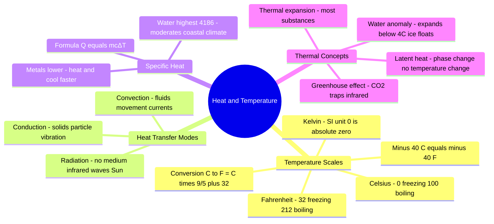

# NOTE — HEAT & TEMPERATURE
**Section:** GK | **Category:** Science | **Topic:** Heat & Temperature | **Slug:** `sci-heat-and-temperature`
**Source:** 🔧 GENERAL KNOWLEDGE (standard physics reference; not yet cross-checked against PARMAR SSC reference excerpt)
**Status:** 🔧 DRAFT — awaiting AIR-91 verification before publish
**PYQ Frequency:** 🔥 High-frequency — conversion formulas, modes of heat transfer, and specific heat capacity are standard SSC CGL Physics sub-topics | **High Yield:** ✅

---

## 🎭 THE HOOK

Heat and temperature sound like synonyms but they're describing two completely different things — and SSC CGL exploits that confusion every cycle. Temperature measures how hot something IS (the average kinetic energy of its particles). Heat is the ENERGY that transfers between objects at different temperatures. You feel cold metal more intensely than cold wood at the same temperature — because metal CONDUCTS heat away from your hand faster. This difference — between the property and the energy flow — is the entire conceptual foundation of this topic.

---

## 📖 THE CORE

### Temperature vs. Heat — The Key Distinction

| Concept | Definition | SI Unit |
|---|---|---|
| **Temperature** | Measure of average kinetic energy of particles in a substance | Kelvin (K) |
| **Heat** | Form of energy that flows from a hotter body to a cooler body | Joule (J) |

> **Critical rule**: Heat flows ALWAYS from higher temperature to lower temperature (NEVER the reverse, without work being done — 2nd Law of Thermodynamics).

---

### Temperature Scales & Conversions

| Scale | Freezing Point of Water | Boiling Point of Water | Absolute Zero |
|---|---|---|---|
| **Celsius (°C)** | 0°C | 100°C | −273.15°C |
| **Fahrenheit (°F)** | 32°F | 212°F | −459.67°F |
| **Kelvin (K)** | 273 K | 373 K | 0 K (absolute zero) |

#### Conversion Formulas
- **°C to °F**: F = (C × 9/5) + 32
- **°F to °C**: C = (F − 32) × 5/9
- **°C to K**: K = C + 273.15 (approximately C + 273)
- **Absolute zero**: −273.15°C = 0 K — the temperature at which all molecular motion theoretically stops

> **Trick**: At **−40°**, Celsius and Fahrenheit are EQUAL (−40°C = −40°F) — a frequently tested conversion curiosity.

---

### Specific Heat Capacity

- **Definition**: The amount of heat energy required to raise the temperature of **1 kg of a substance by 1°C (or 1 K)**.
- **Symbol**: c | **SI Unit**: J/kg·K (Joules per kilogram per Kelvin)
- **Formula**: Q = mcΔT (where Q = heat, m = mass, c = specific heat, ΔT = temperature change)

#### Key Specific Heat Values (Frequently Tested Comparisons)

| Substance | Specific Heat (J/kg·K) | Implication |
|---|---|---|
| **Water** | 4186 (highest among common substances) | Water heats and cools very slowly — reason for maritime climate moderation |
| **Iron** | ~450 | Heats and cools much faster than water |
| **Copper** | ~385 | Good thermal conductor; low specific heat |
| **Sand/Soil** | ~800 | Heats faster than water — explains hot deserts and cold nights |

> **Why seas moderate coastal climates**: Water's HIGH specific heat means oceans absorb vast heat in summer without getting very hot, and release it slowly in winter — keeping coastal temperatures mild.

---

### Modes of Heat Transfer

#### 1. Conduction
- Heat transfers THROUGH a material by particle-to-particle contact (vibration propagation)
- Occurs mainly in **SOLIDS** (metals especially)
- Metals are good CONDUCTORS; non-metals and gases are poor conductors (insulators)
- **Examples**: Spoon getting hot in soup; floor feeling cold in winter

#### 2. Convection
- Heat transfers through the MOVEMENT of the heated fluid (liquid or gas) itself
- Occurs in **LIQUIDS and GASES** (fluids)
- Heated fluid becomes less dense and rises; cooler fluid sinks — creating convection currents
- **Examples**: Boiling water circulation; sea breeze and land breeze; hot air balloons

#### 3. Radiation
- Heat transfers as ELECTROMAGNETIC WAVES (infrared radiation) — requires NO medium; can travel through vacuum
- All objects above absolute zero emit radiation
- **Examples**: Heat from the Sun reaching Earth; heat from a campfire felt at a distance; room feeling warm from a radiator without direct contact
- **Black surfaces** absorb and radiate heat BEST; **white/shiny surfaces** reflect radiation BEST — reason for wearing white in summer

---

### Key Thermal Concepts

#### Latent Heat
- Heat absorbed/released during a **change of state (phase change)** at CONSTANT TEMPERATURE
- **Latent Heat of Fusion**: Heat required to melt 1 kg of solid at its melting point (without temperature change)
- **Latent Heat of Vaporization**: Heat required to vaporize 1 kg of liquid at its boiling point (without temperature change)
- **Example**: Ice melts at 0°C absorbing latent heat without rising above 0°C; boiling water stays at 100°C while absorbing latent heat of vaporization

#### Thermal Expansion
- Most substances **EXPAND** when heated and **CONTRACT** when cooled
- **Gases** expand the most; **solids** expand the least
- **Water anomaly (4°C)**: Water expands as it COOLS below 4°C (unlike most substances) — this is why ice floats (ice is LESS dense than liquid water) and why aquatic life survives under frozen lakes
- **Applications**: Gaps in railway tracks, bridges, and concrete pavements to accommodate thermal expansion

#### Greenhouse Effect (Heat Retention by Atmosphere)
- Certain gases (CO₂, methane, water vapour, N₂O) trap outgoing infrared radiation from Earth's surface
- Responsible for warming Earth's surface ~33°C above what it would be without an atmosphere
- **Enhanced greenhouse effect** (from human CO₂ emissions) → **global warming**

---

## 🧠 THE MIND MAP

---

## 🔑 THE MNEMONIC

**"C to F: multiply by 9/5, add 32 — F to C: subtract 32, multiply by 5/9"** — the two conversion formulas in mirror form.

**"Conduction = Contact (solids), Convection = Currents (fluids), Radiation = Rays (no medium)"** — the three heat transfer modes with their key characteristics.

**"Water is WEIRD at 4°C — expands on cooling, so ice FLOATS"** — the water anomaly anchor.

**"Water's high specific heat = oceans = moderate coastal climate"** — practical connection for the exam.

---

## 📌 THE PYQ ANCHOR

🔥 Temperature conversion (especially the C/F formula and the −40° equivalence trick), modes of heat transfer (conduction/convection/radiation and their examples), the water-at-4°C anomaly (why ice floats), and specific heat capacity comparisons (water vs. metals) are consistently tested SSC CGL Physics sub-topics. 🔧 No specific CGL 2025 PYQ confirmed from the 23/46-shift sample; recommend dedicated archive cross-check.

---

## ⚠️ THE TRAP ALERT

- **Temperature's SI unit is KELVIN (K)**, NOT Celsius — see also [[sci-si-units-and-scientific-instruments]].
- **Heat flows from HIGHER to LOWER temperature, never the reverse without work** — refrigerators and air conditioners do external work to reverse this natural flow.
- **Water EXPANDS when cooled below 4°C** — unlike almost every other substance, which contracts on cooling. This is why ice is LESS dense than liquid water and FLOATS — a crucial ecological fact for aquatic life.
- **Radiation does NOT need a medium** — it is the ONLY mode of heat transfer that works in vacuum. This is why we receive heat from the Sun through space.
- **−40° is where Celsius and Fahrenheit scales are EQUAL** — a frequently tested conversion curiosity.
- **Black body absorbs and radiates heat MOST efficiently**; white/shiny surfaces REFLECT radiation — hence white is preferred in summer, black in winter.

---

## ✅ ACTIVE RECALL

1. Convert 100°C to Fahrenheit. Show the formula.
2. What are the three modes of heat transfer? Which one does NOT require a medium?
3. Why does ice float on water — what is the underlying physics principle?
4. Why do coastal areas experience more moderate temperatures than inland areas at the same latitude?
5. What is latent heat, and why does the temperature not rise while ice is melting at 0°C?

*(Answers: 1–F = (100 × 9/5) + 32 = 180 + 32 = 212°F | 2–Conduction, Convection, Radiation; Radiation does not require a medium (works in vacuum) | 3–Water expands when cooled below 4°C (anomalous expansion), making ice LESS dense than liquid water; less dense objects float | 4–Water has a very HIGH specific heat capacity (4186 J/kg·K), so oceans absorb and release heat slowly, buffering temperature extremes in coastal regions | 5–Latent heat is the energy absorbed/released during a phase change at constant temperature; while ice melts at 0°C, the heat energy goes into breaking intermolecular bonds (phase change) rather than raising temperature)*
