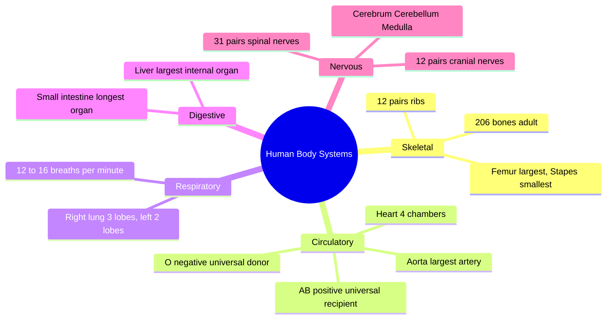

# NOTE — HUMAN BODY SYSTEMS
**Section:** GK | **Category:** Science | **Topic:** Human Body Systems | **Slug:** `sci-human-body-systems`
**Source:** 🔧 GENERAL KNOWLEDGE (standard biology reference; not yet cross-checked against PARMAR SSC reference excerpt)
**Status:** 🔧 DRAFT — awaiting AIR-91 verification before publish
**PYQ Frequency:** 🔥 Very high-frequency Science topic, connects to [[sci-mitochondria]] | **High Yield:** ✅

---

## 🎭 THE HOOK

The human body runs roughly a dozen distinct organ systems simultaneously, each doing one specialized job, and SSC's favourite way to test biology is to isolate a single number from each system — the number of bones, the number of chambers in the heart, the normal body temperature, the number of pairs of ribs — because these numbers are exact, unambiguous, and impossible to fudge. Get the number wrong, and there's no partial credit; that precision is exactly why "Human Body" questions reward focused memorization over general understanding.

---

## 📖 THE CORE

### Skeletal System
- Adult human skeleton: **206 bones** (a newborn has roughly 270, many of which fuse together during growth).
- **Largest bone**: **Femur** (thigh bone).
- **Smallest bone**: **Stapes** (in the middle ear, part of the "ossicles" — malleus, incus, stapes).
- **Ribs**: **12 pairs** (24 total); the last 2 pairs are called "floating ribs" (not attached to the sternum directly).
- **Vertebrae**: **33** (cervical 7, thoracic 12, lumbar 5, sacral 5 fused, coccygeal 4 fused).

### Circulatory System
- **Heart**: 4 chambers — 2 atria (upper), 2 ventricles (lower).
- **Blood**: average adult has roughly **5-6 litres**.
- **Blood components**: plasma, RBCs (erythrocytes, carry oxygen via hemoglobin, made in bone marrow, lack a nucleus in mature form), WBCs (leukocytes, immune defense), platelets (thrombocytes, clotting).
- **Blood groups**: ABO system (A, B, AB, O) + Rh factor; **O-negative** is the "universal donor," **AB-positive** is the "universal recipient" — a frequently tested pairing.
- **Normal pulse rate**: approximately **72 beats per minute** (resting adult average).
- **Normal blood pressure**: approximately **120/80 mmHg**.
- **Largest artery**: **Aorta**. **Largest vein**: **Inferior vena cava**.

### Respiratory System
- **Lungs**: right lung has **3 lobes**, left lung has **2 lobes** (smaller, to make room for the heart) — a frequently tested asymmetry.
- **Normal breathing rate**: approximately **12-16 breaths per minute** (resting adult).

### Digestive System
- **Longest organ/part**: **Small intestine** (~6-7 metres).
- **Liver**: the largest internal organ/gland in the human body.
- **Stomach pH**: highly acidic, approximately **1.5-3.5** (due to hydrochloric acid) — connects to [[sci-ph-scale]].

### Nervous System
- **Brain**: divided into **Cerebrum** (largest part, higher functions), **Cerebellum** (balance/coordination), **Medulla Oblongata** (autonomic functions — breathing, heart rate).
- **Cranial nerves**: **12 pairs**.
- **Spinal nerves**: **31 pairs**.

### Other Key Facts
- **Normal human body temperature**: approximately **37°C (98.6°F)**.
- **Largest organ overall (by size/weight)**: **Skin**.
- **Largest gland**: **Liver** (largest internal gland); among EXTERNAL glands, sometimes the question distinguishes liver (internal) vs. other contexts.
- **Smallest organ** (commonly cited): varies by source, sometimes cited as the **pineal gland**.

---

## 🧠 THE MIND MAP

---

## 🔑 THE MNEMONIC

**"206 bones, 4 chambers, 12 ribs pairs, 37 degrees"** — four foundational human-body numbers strung together for quick recall.

**"O-negative gives to all, AB-positive takes from all"** — the universal donor/recipient blood-group pairing.

---

## 📌 THE PYQ ANCHOR

🔥 Human Body Systems is a very high-frequency Science topic, connecting to [[sci-mitochondria]] (cell biology) and [[sci-ph-scale]] (stomach acidity). 🔧 No literal Human Body question confirmed in the 23/46-shift CGL-2025 sample reviewed earlier in this session, since this topic wasn't separately tagged during PYQ extraction — bone counts, blood groups, and organ superlatives are textbook-standard SSC CGL Science staples; recommend a dedicated archive cross-check.

---

## ⚠️ THE TRAP ALERT

- **The right lung has 3 lobes; the left lung has 2 lobes** (smaller, to accommodate the heart) — a frequently tested asymmetry, easy to assume both lungs are identical.
- **O-negative is the universal DONOR; AB-positive is the universal RECIPIENT** — don't reverse this pairing.
- **The Femur (largest bone) and the Stapes (smallest bone, in the ear) are frequently paired in matching questions** — don't confuse which is which.
- **Adults have 206 bones; newborns have around 270** — many bones fuse together during growth, so the number DECREASES with age, not increases.

---

## ✅ ACTIVE RECALL

1. How many bones does an adult human skeleton have, and how does this compare to a newborn?
2. Which is the largest bone in the human body, and which is the smallest?
3. How many chambers does the human heart have?
4. Which blood group is the "universal donor," and which is the "universal recipient"?
5. How do the right and left lungs differ in structure?

*(Answers: 1–206 bones; a newborn has around 270, many of which fuse together during growth | 2–Largest: Femur (thigh bone); Smallest: Stapes (in the ear) | 3–4 chambers (2 atria, 2 ventricles) | 4–O-negative is the universal donor; AB-positive is the universal recipient | 5–The right lung has 3 lobes; the left lung has 2 lobes (smaller, to make room for the heart))*
