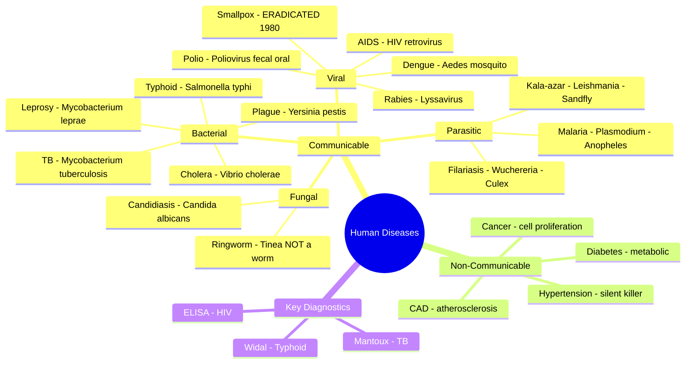

# NOTE — HUMAN DISEASES (COMMUNICABLE & NON-COMMUNICABLE)
**Section:** GK | **Category:** Science | **Topic:** Human Diseases | **Slug:** `sci-human-diseases`
**Source:** 🔧 GENERAL KNOWLEDGE (standard biology/medical-science reference; not yet cross-checked against PARMAR SSC reference excerpt)
**Status:** 🔧 DRAFT — awaiting AIR-91 verification before publish
**PYQ Frequency:** 🔥 Very high-frequency Science category — disease-pathogen-type matching is consistently tested | **High Yield:** ✅

---

## 🎭 THE HOOK

Every disease has a backstory: a bacterium hiding in food, a virus hitching a ride through a cough, a parasite in stagnant water, or a body slowly turning against itself. SSC CGL tests this category relentlessly — not because it's obscure, but because nearly every student forgets to distinguish the CAUSE (which pathogen?) from the TYPE (communicable or not?). The examiner's weapon: list three bacterial diseases and one viral one together and ask which is the odd one out. The student who MEMORIZED "malaria = fever" fails; the student who ENCODED "malaria = Plasmodium parasite + Anopheles mosquito" scores every time.

---

## 📖 THE CORE

### Classification: Communicable vs. Non-Communicable
- **Communicable (Infectious) Diseases**: caused by pathogens (bacteria, viruses, fungi, parasites) and TRANSMISSIBLE from one host to another.
- **Non-Communicable Diseases (NCDs)**: NOT transmitted from person to person; caused by lifestyle factors, genetics, environment, or organ dysfunction (e.g., diabetes, cancer, hypertension).

---

### COMMUNICABLE DISEASES — Master Table

#### Bacterial Diseases
| Disease | Causative Bacterium | Key Fact |
|---|---|---|
| **Tuberculosis (TB)** | *Mycobacterium tuberculosis* | Spread via air droplets; BCG vaccine provides protection |
| **Typhoid** | *Salmonella typhi* | Spread via contaminated food/water; Widal test for diagnosis |
| **Cholera** | *Vibrio cholerae* | Spread via contaminated water; "rice-water" stools are characteristic |
| **Plague** | *Yersinia pestis* | Spread via flea bites (from rats); Bubonic, Pneumonic, Septicemic forms |
| **Leprosy (Hansen's Disease)** | *Mycobacterium leprae* | Slowest-multiplying pathogen known; affects skin and peripheral nerves |
| **Tetanus (Lockjaw)** | *Clostridium tetani* | Toxin-mediated; from wound contamination with spores in soil |
| **Diphtheria** | *Corynebacterium diphtheriae* | DPT vaccine covers it; produces exotoxin damaging heart/nerves |
| **Whooping Cough (Pertussis)** | *Bordetella pertussis* | DPT vaccine covers it; violent coughing fits |

#### Viral Diseases
| Disease | Causative Virus | Key Fact |
|---|---|---|
| **Influenza** | Influenza virus (A/B/C) | "Flu"; spreads via respiratory droplets |
| **Dengue** | Dengue virus (Flavivirus) | Spread by *Aedes aegypti* mosquito; platelet count drops dangerously |
| **Malaria** (NOT viral — common trap) | — | See Parasitic section below |
| **AIDS** | HIV (Human Immunodeficiency Virus) | Retrovirus; attacks CD4+ T-lymphocytes; no cure, managed with ART |
| **Rabies** | Rabies virus (Lyssavirus) | Spread via bite of infected animal; near 100% fatal if untreated after symptoms |
| **Hepatitis B** | Hepatitis B virus (HBV) | Blood-borne; can cause liver cancer (hepatocellular carcinoma) |
| **Polio** | Poliovirus | Spread via fecal-oral route; targets motor neurons; Oral Polio Vaccine (OPV) |
| **COVID-19** | SARS-CoV-2 | RNA coronavirus; declared pandemic by WHO in March 2020 |
| **Smallpox** | Variola virus | ERADICATED globally in 1980 — the only human disease eradicated |
| **Chickenpox** | Varicella-zoster virus | Also causes shingles (Herpes zoster) in reactivation |

#### Parasitic Diseases
| Disease | Causative Parasite | Vector |
|---|---|---|
| **Malaria** | *Plasmodium* (P. falciparum, P. vivax, etc.) | *Anopheles* mosquito (female) |
| **Kala-azar (Leishmaniasis)** | *Leishmania donovani* | Sandfly (Phlebotomus) |
| **Filariasis (Elephantiasis)** | *Wuchereria bancrofti* | *Culex* mosquito |
| **Sleeping Sickness** | *Trypanosoma brucei* | Tsetse fly |
| **Amoebiasis** | *Entamoeba histolytica* | No vector — contaminated water/food |

#### Fungal Diseases
| Disease | Causative Fungus | Affected Area |
|---|---|---|
| **Ringworm** | *Tinea* (various species) | Skin; NOT caused by a worm — frequently tested trap |
| **Candidiasis (Thrush)** | *Candida albicans* | Mouth, throat, genitals |
| **Aspergillosis** | *Aspergillus* species | Lungs (especially in immunocompromised) |

---

### NON-COMMUNICABLE DISEASES — Key Examples

| Disease | Type | Key Note |
|---|---|---|
| **Diabetes Mellitus** | Metabolic | Type 1: insulin-absent; Type 2: insulin-resistant; Gestational: during pregnancy |
| **Cancer** | Cell proliferation disorder | Caused by mutation in cell-cycle regulation genes; tobacco = #1 preventable cause |
| **Hypertension** | Cardiovascular | "Silent killer" — no symptoms but damages arteries, heart, kidneys |
| **Coronary Artery Disease (CAD)** | Cardiovascular | Atherosclerosis (plaque in arteries) narrows coronary arteries |
| **Asthma** | Respiratory | Chronic airway inflammation; bronchospasm triggered by allergens |
| **Arthritis** | Musculoskeletal | Rheumatoid (autoimmune) vs. Osteoarthritis (wear and tear) |

---

### Key Vaccine Facts (Frequently Tested)
| Vaccine | Protects Against |
|---|---|
| **BCG** | Tuberculosis |
| **OPV / IPV** | Polio |
| **DPT** | Diphtheria, Pertussis, Tetanus |
| **MMR** | Measles, Mumps, Rubella |
| **Hepatitis B** | Hepatitis B virus |

---

### Diagnostic Tests (Frequently Tested)
- **Widal test** → Typhoid
- **ELISA / Western Blot** → HIV/AIDS
- **Mantoux test (Tuberculin test)** → Tuberculosis
- **Blood smear / Rapid Diagnostic Test (RDT)** → Malaria
- **PCR** → COVID-19 (SARS-CoV-2) and other viral diseases

---

## 🧠 THE MIND MAP

---

## 🔑 THE MNEMONIC

**"BAD BACTERIA: TB-Typhoid-Cholera-Plague-Leprosy-Tetanus"** — the six bacterial diseases to memorize first.

**"Mosquitoes MAKE you sick three ways: Malaria (Anopheles), Dengue (Aedes), Filariasis (Culex)"** — the three mosquito-borne diseases and their specific mosquito species.

**"Smallpox was the FIRST (and only) human disease fully eradicated — 1980"** — a single-fact anchor for eradication questions.

**"Ringworm has no worm; Sleeping Sickness has no sleepy virus — names mislead"** — the two trap-naming diseases.

---

## 📌 THE PYQ ANCHOR

🔥 Disease-pathogen-vector matching is one of the highest-frequency SSC CGL Science sub-categories. The most commonly tested angle: given a disease name, identify (a) the pathogen category (bacterial/viral/parasitic/fungal), (b) the specific organism, or (c) the transmission vector. Eradication question ("which disease has been eradicated globally?") is textbook SSC. Widal test = Typhoid is a repeat pick.

---

## ⚠️ THE TRAP ALERT

- **Malaria is NOT a viral or bacterial disease** — it is PARASITIC (caused by *Plasmodium* protozoa, transmitted by *Anopheles* mosquito). This is the single most-frequently-set trap in this category.
- **Ringworm is NOT caused by a worm** — it is a FUNGAL infection (*Tinea*). The name is entirely misleading.
- **Dengue is transmitted by *Aedes* mosquito, NOT *Anopheles*** — confusing Dengue with Malaria's vector is a standard wrong-answer choice.
- **Smallpox is the ONLY human infectious disease that has been globally ERADICATED** (declared in 1980 by WHO) — don't confuse it with polio (eliminated in many countries but not globally eradicated as of standard reference; 🔧 VERIFY: check latest WHO polio status).
- **HIV attacks CD4+ T-lymphocytes specifically** — not all white blood cells generally; precision matters in MCQs.

---

## ✅ ACTIVE RECALL

1. Name the pathogen causing Malaria and the mosquito that transmits it.
2. Which human infectious disease has been globally eradicated, and in what year was eradication declared?
3. What is Ringworm caused by? (What type of pathogen?)
4. Name the diagnostic test for Typhoid and for HIV/AIDS.
5. Which mosquito transmits Dengue, and which transmits Filariasis?

*(Answers: 1–*Plasmodium* (protozoan parasite); *Anopheles* mosquito (female) | 2–Smallpox (Variola virus); eradication declared by WHO in 1980 | 3–Fungus (*Tinea* species) — not a worm | 4–Widal test for Typhoid; ELISA and Western Blot for HIV/AIDS | 5–*Aedes aegypti* for Dengue; *Culex* mosquito for Filariasis)*
