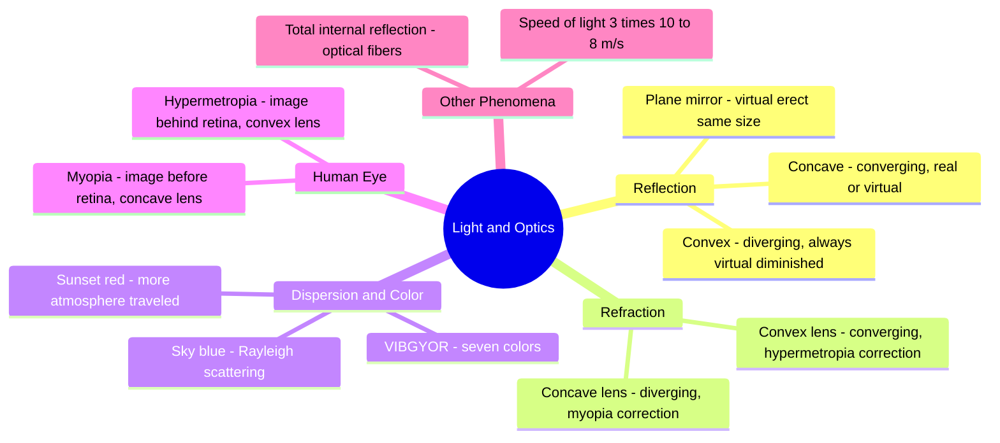

# NOTE — LIGHT & OPTICS
**Section:** GK | **Category:** Science | **Topic:** Light & Optics | **Slug:** `sci-light-and-optics`
**Source:** 🔧 GENERAL KNOWLEDGE (standard physics reference; not yet cross-checked against PARMAR SSC reference excerpt)
**Status:** 🔧 DRAFT — awaiting AIR-91 verification before publish
**PYQ Frequency:** 🔥 Very high-frequency Physics topic, connects to [[sci-newtons-laws-of-motion]] | **High Yield:** ✅

---

## 🎭 THE HOOK

Light travels at roughly **300,000 kilometres per SECOND** — fast enough to circle the Earth about 7.5 times in the time it takes you to blink — and that single staggering speed underlies an entire branch of physics built on how light bends, bounces, and splits. A mirror REFLECTS light; a lens REFRACTS it; a prism SPLITS white light into a rainbow of colours through differential refraction; and the reason the sky is blue, while sunsets turn red, comes down to the same underlying phenomenon — Rayleigh scattering — applied to two different viewing angles through the atmosphere.

---

## 📖 THE CORE

### Reflection (Mirrors)
- **Law of Reflection**: angle of incidence = angle of reflection.
- **Plane mirror**: produces a virtual, erect, laterally-inverted image of the same size as the object.
- **Concave mirror**: converging mirror (curves inward); used in torches, headlights, shaving/makeup mirrors, satellite dishes, solar cookers — can produce both real and virtual images depending on object distance.
- **Convex mirror**: diverging mirror (curves outward); used in vehicle rear-view/side mirrors and security mirrors (wider field of view) — always produces a virtual, diminished, erect image.

### Refraction (Lenses)
- **Refraction**: bending of light as it passes from one medium to another (due to a change in speed/density).
- **Convex lens** (converging): thicker at the center; used in magnifying glasses, microscopes, and to correct HYPERMETROPIA (far-sightedness/long-sightedness).
- **Concave lens** (diverging): thinner at the center; used to correct MYOPIA (near-sightedness/short-sightedness).
- **Refractive index**: a measure of how much a medium bends light, related to the speed of light in that medium versus a vacuum.

### Dispersion & Color
- **Dispersion**: splitting of white light into its constituent colors (VIBGYOR — Violet, Indigo, Blue, Green, Yellow, Orange, Red) by a prism, due to different wavelengths bending by different amounts.
- **Rainbow formation**: caused by dispersion AND internal reflection of sunlight within raindrops.
- **Why the sky is blue**: shorter wavelengths (blue/violet) are scattered MORE by atmospheric particles (Rayleigh scattering) than longer wavelengths (red), making the sky appear blue from most viewing angles during the day.
- **Why sunsets/sunrises are red/orange**: at low sun angles, light travels through MORE atmosphere, scattering away most of the blue light before it reaches the eye, leaving the longer-wavelength red/orange light dominant.

### The Human Eye (Frequently Tested as an Optical Instrument)
- **Lens of the eye**: a convex lens, focuses light onto the **retina**.
- **Myopia (near-sightedness)**: image forms IN FRONT of the retina; corrected with a CONCAVE lens.
- **Hypermetropia (far-sightedness)**: image forms BEHIND the retina; corrected with a CONVEX lens.
- **Presbyopia**: age-related loss of near-focus ability (the eye's lens loses flexibility) — corrected with bifocal lenses.

### Other Key Optical Phenomena
- **Total Internal Reflection**: occurs when light traveling from a denser to a rarer medium hits the boundary at an angle greater than the "critical angle," reflecting entirely back into the denser medium — the principle behind optical fibers.
- **Speed of light**: approximately **3 × 10⁸ m/s** (300,000 km/s) in a vacuum — the fastest speed in the universe per current physics.

---

## 🧠 THE MIND MAP

---

## 🔑 THE MNEMONIC

**"Concave converges, Convex diverges — for mirrors AND lenses alike, remember the curve direction"** — though note mirrors and lenses use the terms slightly differently in everyday phrasing, the core converging/diverging logic anchors both.

**"Myopia: Minus (concave) for near-sighted; Hyperopia: Plus (convex) for far-sighted"** — the lens-correction pairing for the two most common vision defects.

---

## 📌 THE PYQ ANCHOR

🔥 Light & Optics is a very high-frequency Physics topic, connecting to [[sci-newtons-laws-of-motion]] within the broader Science section. 🔧 No literal Light/Optics question confirmed in the 23/46-shift CGL-2025 sample reviewed earlier in this session, since this topic wasn't separately tagged during PYQ extraction — mirror/lens types, VIBGYOR, and myopia/hypermetropia corrections are textbook-standard SSC CGL Science staples; recommend a dedicated archive cross-check.

---

## ⚠️ THE TRAP ALERT

- **Myopia (near-sightedness) is corrected with a CONCAVE lens; Hypermetropia (far-sightedness) is corrected with a CONVEX lens** — a very frequently reversed pairing.
- **Convex mirrors are used in vehicle rear-view mirrors for their WIDER field of view**, NOT concave mirrors — don't confuse mirror type with the everyday application.
- **The sky is blue due to Rayleigh scattering of SHORTER (blue) wavelengths**, not longer (red) wavelengths — and sunsets appear red/orange because MORE atmosphere is traveled, scattering away the blue light before it reaches the eye.
- **VIBGYOR has SEVEN colors in a specific order** (Violet, Indigo, Blue, Green, Yellow, Orange, Red) — a frequently tested ordering, easy to scramble.

---

## ✅ ACTIVE RECALL

1. What is the Law of Reflection?
2. Which type of lens corrects myopia, and which corrects hypermetropia?
3. Why are convex mirrors used as vehicle rear-view mirrors?
4. Why does the sky appear blue, and why do sunsets appear red/orange?
5. What is Total Internal Reflection, and what technology relies on it?

*(Answers: 1–The angle of incidence equals the angle of reflection | 2–Myopia: concave lens; Hypermetropia: convex lens | 3–Because convex mirrors are diverging, producing a wider field of view despite a diminished image | 4–The sky is blue due to Rayleigh scattering of shorter (blue) wavelengths by atmospheric particles; sunsets appear red/orange because light travels through more atmosphere at low sun angles, scattering away most blue light before reaching the eye | 5–A phenomenon where light traveling from a denser to a rarer medium reflects entirely back when hitting the boundary beyond the critical angle; it is the principle behind optical fibers)*
