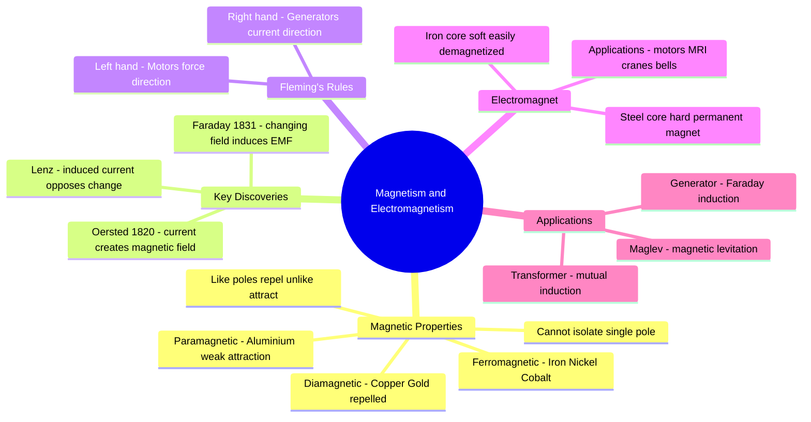

# NOTE — MAGNETISM & ELECTROMAGNETISM
**Section:** GK | **Category:** Science | **Topic:** Magnetism & Electromagnetism | **Slug:** `sci-magnetism-and-electromagnetism`
**Source:** 🔧 GENERAL KNOWLEDGE (standard physics reference; not yet cross-checked against PARMAR SSC reference excerpt)
**Status:** 🔧 DRAFT — awaiting AIR-91 verification before publish
**PYQ Frequency:** 🔥 High-frequency — magnetic properties, Faraday's law, Fleming's rules, and electromagnet applications are standard SSC CGL Physics questions | **High Yield:** ✅

---

## 🎭 THE HOOK

Every time a credit card gets swiped, an electric motor turns, a power plant generates electricity, or an MRI machine images a body — magnetism is doing the work. Magnetism and electricity were treated as separate forces for most of history, until Faraday showed in 1831 that a changing magnetic field GENERATES electricity — and Maxwell proved they were the same fundamental force viewed from different angles. SSC CGL tests this as a pattern-recognition topic: identify the rule, the law, the material, or the application.

---

## 📖 THE CORE

### Properties of Magnets

- A magnet has two poles: **North (N)** and **South (S)**
- **Like poles REPEL; Unlike poles ATTRACT** — a fundamental magnetic rule
- **Magnetic poles always exist in pairs** — you CANNOT isolate a single magnetic pole (unlike electric charges). If you cut a magnet in half, you get two magnets, each with N and S poles
- **Earth is a giant magnet**: Earth's geographic North Pole is a magnetic SOUTH pole (to attract the North poles of compass needles)

### Types of Magnetic Materials

| Type | Behavior | Examples | Key Note |
|---|---|---|---|
| **Ferromagnetic** | Strongly attracted to magnets; can be permanently magnetized | Iron, Nickel, Cobalt (the "Fe-Ni-Co" trio) | Used in permanent magnets and electromagnets |
| **Paramagnetic** | Weakly attracted to magnets; do NOT retain magnetism | Aluminium, Platinum, Oxygen |  |
| **Diamagnetic** | REPELLED by magnets (weakly) | Copper, Gold, Bismuth, Water, Superconductors | Bismuth is the strongest natural diamagnetic material |

> **Curie Temperature**: The temperature above which a ferromagnetic material LOSES its magnetic properties and becomes paramagnetic (e.g., iron's Curie temperature ≈ 770°C).

---

### Electromagnetism — Core Concepts

#### Oersted's Discovery (1820)
- **Hans Christian Oersted** discovered that a **current-carrying wire deflects a nearby compass needle** — proving that ELECTRIC CURRENT creates a MAGNETIC FIELD.
- This was the first experimental link between electricity and magnetism.

#### Faraday's Law of Electromagnetic Induction (1831)
- **Michael Faraday** discovered that a **changing magnetic field induces an EMF (electromotive force) / voltage** in a conductor.
- **Principle**: Electromagnetic induction — the basis of ALL electric generators
- **Formula (Faraday's Law)**: EMF = −N(dΦ/dt) — induced EMF is proportional to the RATE of change of magnetic flux
- **Practical application**: Electric generators (power plants), transformers, induction cooktops, dynamos

#### Lenz's Law
- The **direction** of induced current is such that it OPPOSES the change that caused it
- Expressed by the negative sign in Faraday's Law
- **Analogy**: Nature "resists" changes — inertia in electrical form

---

### Fleming's Left-Hand Rule (Motors)

Used to find the direction of **FORCE** on a current-carrying conductor in a magnetic field:
- **F**inger (Index) → direction of magnetic **F**ield
- **M**iddle finger → direction of **C**urrent
- **Th**umb → direction of **M**otion / Force (thrust on conductor)
- **Application**: **MOTORS** (electricity → mechanical motion)

> Memory: **"Left for Motors"** — F(orce), C(urrent), M(otion) on left hand

### Fleming's Right-Hand Rule (Generators)

Used to find the direction of **INDUCED CURRENT** in a conductor moving in a magnetic field:
- **F**inger (Index) → direction of magnetic **F**ield
- **Th**umb → direction of **M**otion of conductor
- **M**iddle finger → direction of **I**nduced Current
- **Application**: **GENERATORS** (mechanical motion → electricity)

> Memory: **"Right for Generators"**

---

### Electromagnets

- **Definition**: A temporary magnet created by passing electric current through a coil of wire (solenoid) wound around a ferromagnetic core (usually iron)
- **Properties**: Magnetic strength increases with (a) more current, (b) more turns of wire, (c) better ferromagnetic core
- **Iron is preferred** over steel for electromagnet CORES because iron is a SOFT magnetic material (easily magnetized and DEMAGNETIZED) — steel is a HARD magnet (retains magnetism, better for permanent magnets)
- **Applications**: Electric bells, cranes for lifting scrap metal, MRI machines, speakers, electric motors, solenoid valves

---

### Key Laws & Principles Summary Table

| Law / Principle | Scientist | Core Statement |
|---|---|---|
| **Magnetic poles always in pairs** | Universal | Cannot isolate a single magnetic pole |
| **Oersted's discovery** | Hans Christian Oersted (1820) | Current-carrying wire creates a magnetic field |
| **Faraday's Law** | Michael Faraday (1831) | Changing magnetic flux induces EMF |
| **Lenz's Law** | Heinrich Lenz | Induced current opposes the change causing it |
| **Fleming's Left-Hand Rule** | John Ambrose Fleming | Force direction in a motor (electricity → motion) |
| **Fleming's Right-Hand Rule** | John Ambrose Fleming | Current direction in a generator (motion → electricity) |
| **Ampere's Law** | André-Marie Ampère | Magnetic field around a conductor proportional to current |

---

### Applications of Magnetism & Electromagnetism (SSC-Tested)

| Application | Principle Used |
|---|---|
| **Electric Generator** | Faraday's Electromagnetic Induction |
| **Electric Motor** | Fleming's Left-Hand Rule / Electromagnetic force |
| **Transformer** | Mutual Electromagnetic Induction |
| **Loudspeaker** | Electromagnetic force on current-carrying coil in magnetic field |
| **MRI Machine** | Strong electromagnet aligning hydrogen nuclei |
| **Magnetic Compass** | Earth's magnetic field; needle aligns with field lines |
| **Credit Card Magnetic Strip** | Magnetic domains encoding data |
| **Maglev Train** | Magnetic levitation — repulsion between like poles |

---

## 🧠 THE MIND MAP

---

## 🔑 THE MNEMONIC

**"Left for Motors, Right for Generators"** — Fleming's Left-Hand Rule applies to motors (current → force/motion); Right-Hand Rule applies to generators (motion → current).

**"Fe-Ni-Co = FErrOmagnetics"** — Iron (Fe), Nickel (Ni), Cobalt (Co) are the three ferromagnetic elements — the trio that can be permanently magnetized.

**"Oersted found current makes magnets; Faraday found magnets make current"** — the two-way bridge between electricity and magnetism.

**"Soft iron for electromagnets (easily on/off); Steel for permanent magnets (stays on)"** — material choice for magnet applications.

---

## 📌 THE PYQ ANCHOR

🔥 Consistently tested: types of magnetic materials (ferromagnetic/paramagnetic/diamagnetic + examples), Fleming's rules (Left = motor, Right = generator), Faraday's law (basis of generators), and electromagnet applications. The Oersted discovery (1820 current-creates-magnetic-field) is a named-scientist anchor. 🔧 No specific CGL 2025 PYQ confirmed from the 23/46-shift sample; recommend dedicated archive cross-check.

---

## ⚠️ THE TRAP ALERT

- **CANNOT isolate a single magnetic pole** — cutting a magnet gives two magnets, each with N and S poles. There is no magnetic monopole (unlike electric charges, where + and − can be separated).
- **Left-Hand Rule for MOTORS (Force), Right-Hand Rule for GENERATORS (Current)** — these are almost always confused; "Left for Motor, Right for Generator" is the antidote.
- **Earth's geographic North Pole is magnetically a SOUTH pole** — it attracts the NORTH seeking end of a compass. A confusingly named fact.
- **Iron is used for ELECTROMAGNET cores, not steel** — iron is SOFT magnetically (easily switched on/off); steel is HARD magnetically (retains magnetism for permanent magnets).
- **Diamagnetic materials are REPELLED by magnets** (copper, gold, bismuth) — they are neither attracted nor neutral; they weakly repel. Superconductors are perfect diamagnets.
- **Oersted (1820) discovered current → magnetic field; Faraday (1831) discovered changing magnetic field → EMF** — two different discoveries in two different directions of the electricity-magnetism relationship.

---

## ✅ ACTIVE RECALL

1. Which hand rule applies to motors and which to generators? What do you identify with each?
2. Name the three ferromagnetic elements.
3. What did Faraday's Law (1831) establish? What does it power in the modern world?
4. Why is IRON preferred over STEEL for the core of an electromagnet?
5. What happens if you cut a bar magnet in half? Can you isolate a single magnetic pole?

*(Answers: 1–Left-Hand Rule for Motors (gives direction of force/motion); Right-Hand Rule for Generators (gives direction of induced current) | 2–Iron (Fe), Nickel (Ni), Cobalt (Co) | 3–A changing magnetic field induces an EMF/voltage in a conductor (electromagnetic induction); it powers all electric generators (power plants), transformers, and dynamos | 4–Iron is a SOFT magnetic material — it is easily magnetized when current flows and easily demagnetized when current stops, making it ideal for switching electromagnets on and off; steel is a HARD magnet that retains magnetism and is used for permanent magnets | 5–You get TWO smaller magnets, each with its own North and South pole — you cannot isolate a single magnetic pole; magnetic poles always exist in pairs)*
