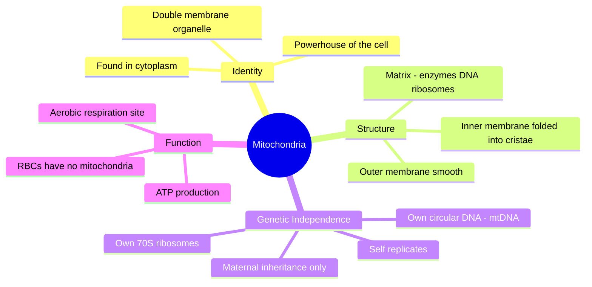

# NOTE — MITOCHONDRIA
**Section:** GK | **Category:** Science | **Topic:** Mitochondria | **Slug:** `sci-mitochondria`
**Source:** 🔧 GENERAL KNOWLEDGE (standard biology reference; not yet cross-checked against PARMAR SSC reference excerpt)
**Status:** 🔧 DRAFT — awaiting AIR-91 verification before publish
**PYQ Frequency:** 🔥 Official Phase-1 priority topic (GK_PRIORITY_TOPICS, Science bucket) | **High Yield:** ✅

---

## 🎭 THE HOOK

Roughly 1.5 to 2 billion years ago, one primitive cell swallowed a smaller bacterium — and instead of digesting it, kept it alive, working, inside itself forever. That bacterium became the mitochondria living in nearly every cell in your body today, and it never fully gave up its independence: it still carries its own tiny circular ring of DNA, completely separate from the DNA in your cell's nucleus, and it still reproduces on its own schedule, dividing independently of the rest of the cell. This origin story — the **Endosymbiotic Theory** — is why biology textbooks call the mitochondria "the powerhouse of the cell," but it's also why mitochondria are genetically stranger than almost any other part of you: you inherit your mitochondrial DNA exclusively from your mother, with zero contribution from your father, a fact genealogists and forensic scientists use to trace maternal lineage back centuries.

---

## 📖 THE CORE

### Structure & Identity
- **Mitochondria** = a double-membrane-bound organelle found in the **cytoplasm** of most eukaryotic cells.
- Famously nicknamed **"the powerhouse of the cell"** because it is the primary site of **ATP (adenosine triphosphate)** production via **cellular respiration** (specifically, the Krebs cycle and oxidative phosphorylation/electron transport chain occur here; glycolysis occurs in the cytoplasm, outside the mitochondria).
- Structure: **outer membrane** (smooth) + **inner membrane** (highly folded into **cristae**, increasing surface area for ATP-producing reactions) + **matrix** (the fluid interior, containing enzymes, mitochondrial DNA, and ribosomes).

### Genetic Independence
- Contains its own **circular DNA (mtDNA)**, separate from nuclear DNA — strong evidence for the **Endosymbiotic Theory** (mitochondria originated from free-living bacteria engulfed by an ancestral eukaryotic cell).
- Has its own **ribosomes** (70S type, similar to bacterial ribosomes, distinct from the 80S ribosomes found elsewhere in eukaryotic cells) — allowing it to synthesize some of its own proteins.
- Can **self-replicate** by division (binary fission-like process), independent of the cell's own division cycle.
- **Maternal inheritance**: mitochondrial DNA is passed almost exclusively from mother to offspring (the egg cell's mitochondria dominate; sperm mitochondria are typically destroyed after fertilization) — used in forensic and evolutionary genetics (e.g., "Mitochondrial Eve" studies).

### Function
- Primary role: **aerobic cellular respiration**, converting glucose-derived energy (via pyruvate from glycolysis) into **ATP**, the cell's main energy currency.
- Cell types with high energy demand (e.g., muscle cells, liver cells, cardiac cells) contain a much higher NUMBER of mitochondria than low-energy-demand cells (e.g., some skin cells) — a frequently tested "which cell has the most mitochondria" comparison.
- Mature human **red blood cells (RBCs) have NO mitochondria at all** — a very commonly tested exception.

---

## 🧠 THE MIND MAP

---

## 🔑 THE MNEMONIC

**"Mitochondria = Maternal, Membrane-bound, ATP Maker"** — three M's: maternal inheritance, double membrane, ATP production.

**"RBC has no mito, so it relies on glycolysis"** — the standout exception: mature red blood cells lack mitochondria entirely.

---

## 📌 THE PYQ ANCHOR

🔥 Mitochondria is on the app's **official Phase-1 priority list** (GK_PRIORITY_TOPICS, Science). 🔧 No literal Mitochondria question confirmed in the 23/46-shift CGL-2025 sample reviewed — "powerhouse of the cell" nickname, ATP production, and the RBC-exception fact are textbook-standard SSC CGL Science staples; recommend archive cross-check.

---

## ⚠️ THE TRAP ALERT

- **Mature human red blood cells have NO mitochondria** — a very frequently tested exception; don't assume all human cells contain mitochondria.
- **Mitochondrial DNA is inherited ONLY from the mother**, not the father — a frequently tested genetics fact, distinct from nuclear DNA inheritance (which comes from both parents).
- **Glycolysis happens in the cytoplasm, OUTSIDE the mitochondria** — only the Krebs cycle and electron transport chain/oxidative phosphorylation occur inside the mitochondria; don't attribute the entire respiration process to the mitochondria alone.

---

## ✅ ACTIVE RECALL

1. Why is the mitochondria nicknamed "the powerhouse of the cell"?
2. What evidence supports the Endosymbiotic Theory of mitochondrial origin?
3. From which parent is mitochondrial DNA inherited?
4. Which human cell type famously lacks mitochondria entirely?
5. Which stage of cellular respiration occurs OUTSIDE the mitochondria, in the cytoplasm?

*(Answers: 1–Because it is the primary site of ATP production via aerobic cellular respiration | 2–Its own circular DNA, its own 70S ribosomes, and its ability to self-replicate independently of the cell | 3–The mother (maternal inheritance only) | 4–Mature red blood cells (RBCs) | 5–Glycolysis)*
