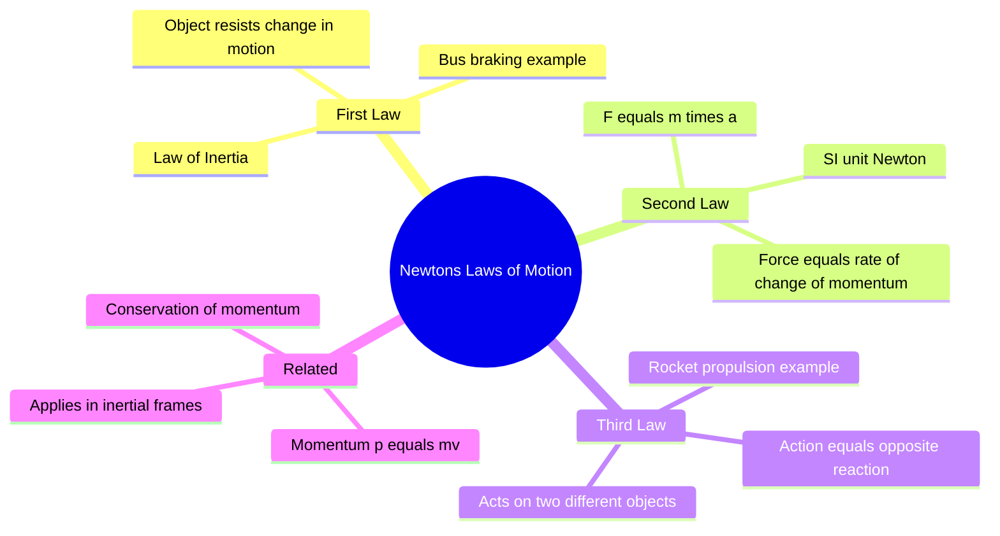

# NOTE — NEWTON'S LAWS OF MOTION
**Section:** GK | **Category:** Science | **Topic:** Newton's Laws of Motion | **Slug:** `sci-newtons-laws-of-motion`
**Source:** 🔧 GENERAL KNOWLEDGE (standard physics reference; not yet cross-checked against PARMAR SSC reference excerpt)
**Status:** 🔧 DRAFT — awaiting AIR-91 verification before publish
**PYQ Frequency:** 🔥 Very high-frequency Physics topic, connects to [[sci-ohms-law]] | **High Yield:** ✅

---

## 🎭 THE HOOK

In 1687, Isaac Newton published *Philosophiæ Naturalis Principia Mathematica* — and inside it were three deceptively short sentences that became the foundation of classical mechanics for the next 300+ years, unbroken until Einstein's relativity revealed their limits at extreme speeds and scales. But for everyday physics — cars braking, rockets launching, a ball bouncing — Newton's Three Laws still explain everything, and SSC tests them not as abstract philosophy but as everyday-life examples: why you lurch forward when a bus stops suddenly, why a rocket can move in the vacuum of space, why pushing a wall doesn't move the wall but does push YOU back slightly.

---

## 📖 THE CORE

### First Law — Law of Inertia
- **Statement**: An object at rest stays at rest, and an object in motion stays in motion at constant velocity, UNLESS acted upon by an external unbalanced force.
- **"Inertia"** = the tendency of an object to resist a change in its state of motion (or rest).
- **Inertia is proportional to MASS** — heavier objects have more inertia, requiring more force to change their state of motion.
- **Real-life example**: a passenger lurches FORWARD when a bus suddenly brakes (the passenger's body continues moving forward due to inertia, even though the bus has stopped) — a very frequently tested example.

### Second Law — Law of Acceleration (F = ma)
- **Statement**: The force acting on an object equals the object's mass multiplied by its acceleration: **F = m × a**.
- Equivalently: **Force = rate of change of momentum** (momentum = mass × velocity).
- **Implication**: for a GIVEN force, a heavier object accelerates LESS than a lighter object — explains why it's harder to push a loaded truck than an empty cart with the same force.
- **SI unit of Force**: **Newton (N)** — 1 Newton = the force required to accelerate a 1 kg mass at 1 m/s².

### Third Law — Action-Reaction
- **Statement**: For every action, there is an equal and opposite reaction.
- **Key clarification**: the action and reaction forces act on TWO DIFFERENT objects (not on the same object) — and therefore do NOT cancel each other out.
- **Real-life example**: a rocket expels gas downward/backward (action); the gas pushes the rocket upward/forward (reaction) — explains how rockets can move even in the vacuum of space, where there's no air to "push against."
- Another example: when you push against a wall, the wall pushes back on YOU with equal force (you feel resistance) — but you and the wall are different objects, so the forces don't cancel within a single system.

### Related Concepts (Frequently Tested)
- **Momentum (p) = mass × velocity (p = mv)** — a vector quantity.
- **Law of Conservation of Momentum**: in a closed system with no external forces, total momentum before a collision/interaction equals total momentum after — derived directly from Newton's Third Law.
- **Newton's laws apply strictly only in INERTIAL reference frames** (non-accelerating frames) — a more advanced nuance, occasionally tested at higher difficulty.

---

## 🧠 THE MIND MAP

---

## 🔑 THE MNEMONIC

**"Rest stays rest, F equals ma, every push gets pushed back"** — the three laws condensed into one sentence each.

**"Bus jerks you forward, rocket pushes you upward"** — the two most iconic real-life examples, for the First and Third Laws respectively.

---

## 📌 THE PYQ ANCHOR

🔥 Newton's Laws of Motion is a very high-frequency Physics topic, connecting to [[sci-ohms-law]] in the broader Science section. 🔧 No literal Newton's Laws question confirmed in the 23/46-shift CGL-2025 sample reviewed earlier in this session, since this topic wasn't separately tagged during PYQ extraction — the three laws and their real-life examples are textbook-standard SSC CGL Science staples; recommend a dedicated archive cross-check.

---

## ⚠️ THE TRAP ALERT

- **Action and reaction forces (Third Law) act on TWO DIFFERENT objects**, so they do NOT cancel each other out — a frequently tested misconception; if they acted on the same object, nothing would ever move.
- **A passenger lurches FORWARD when a bus suddenly STOPS** (not when it starts) — due to inertia keeping the body in motion; don't reverse the direction in this classic example.
- **Inertia is proportional to MASS, not weight or size directly** — a heavier (more massive) object has more inertia, regardless of its physical size.
- **F = ma means a GIVEN force produces LESS acceleration on a MORE massive object** — don't assume force and acceleration are independent of mass.

---

## ✅ ACTIVE RECALL

1. State Newton's First Law of Motion in your own words, and define "inertia."
2. State Newton's Second Law as a formula, and name the SI unit of force.
3. State Newton's Third Law, and clarify why action-reaction forces don't cancel out.
4. Why does a passenger lurch forward when a bus suddenly brakes?
5. How does a rocket move in the vacuum of space, where there's nothing to "push against"?

*(Answers: 1–An object at rest stays at rest, and an object in motion stays in motion at constant velocity, unless acted upon by an external unbalanced force; inertia is the tendency to resist a change in motion/rest state | 2–F = m × a; the SI unit of force is the Newton (N) | 3–For every action there is an equal and opposite reaction; they don't cancel because they act on two DIFFERENT objects | 4–Due to inertia — the passenger's body continues moving forward even as the bus stops | 5–The rocket expels gas backward (action), and the gas pushes the rocket forward (reaction) — this action-reaction pair works without needing external air/surface to push against)*
