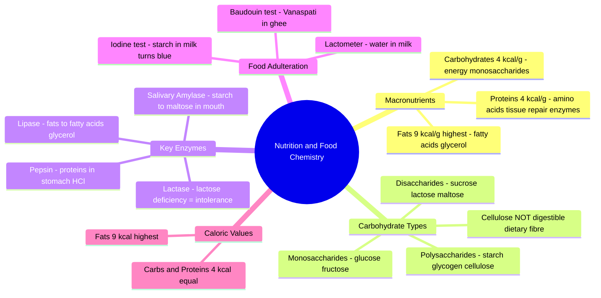

# NOTE — NUTRITION: MACRONUTRIENTS & FOOD CHEMISTRY
**Section:** GK | **Category:** Science | **Topic:** Nutrition — Macronutrients & Food Chemistry | **Slug:** `sci-nutrition-macronutrients-and-food-chemistry`
**Source:** 🔧 GENERAL KNOWLEDGE (standard biology/nutrition reference; not yet cross-checked against PARMAR SSC reference excerpt)
**Status:** 🔧 DRAFT — awaiting AIR-91 verification before publish
**PYQ Frequency:** 🔥 High-frequency — carbohydrate/protein/fat chemistry, caloric values, food adulteration tests, and enzyme functions are standard SSC CGL Biology/General Science questions | **High Yield:** ✅

---

## 🎭 THE HOOK

Every function your body performs — movement, thought, immunity, repair — runs on chemicals derived from food. But SSC CGL doesn't test nutrition the way a dietician thinks about it; it tests the CHEMISTRY behind food — what carbohydrates are made of at the molecular level, which nutrient provides 9 kcal per gram vs. 4 kcal per gram, what enzyme breaks down which molecule, and what simple test identifies an adulterated food. These aren't lifestyle questions; they're applied chemistry questions wearing the costume of nutrition.

---

## 📖 THE CORE

### The Three Macronutrients — Core Table

| Macronutrient | Building Blocks | Caloric Value | Primary Function | Key Sources |
|---|---|---|---|---|
| **Carbohydrates** | Monosaccharides (glucose, fructose, galactose) | **4 kcal/g** | Primary energy source; quick energy | Cereals, grains, sugars, potatoes, fruits |
| **Proteins** | Amino Acids (20 types; 8/9 essential — must come from diet) | **4 kcal/g** | Building and repair of tissues; enzymes, antibodies, haemoglobin | Meat, eggs, dairy, legumes, soya |
| **Fats (Lipids)** | Fatty Acids + Glycerol | **9 kcal/g** | Energy reserve; insulation; fat-soluble vitamin transport (A, D, E, K) | Oils, butter, nuts, fatty fish |

---

### Carbohydrates — Classification

| Category | Composition | Examples | Digestible? |
|---|---|---|---|
| **Monosaccharides** | Single sugar unit | Glucose, Fructose, Galactose | Yes |
| **Disaccharides** | Two sugar units | Sucrose (glucose+fructose), Lactose (glucose+galactose), Maltose (glucose+glucose) | Yes (after enzyme breakdown) |
| **Polysaccharides** | Many sugar units | Starch (plant storage), Glycogen (animal storage), Cellulose (plant cell wall — humans CANNOT digest) | Starch/Glycogen: yes; Cellulose: No |

> **Cellulose = Dietary Fibre** — not digestible by humans but essential for bowel function and gut health.

---

### Proteins — Key Facts

- **Essential Amino Acids**: 8 (adults) / 9 (children, including Histidine) — must be obtained from DIET (body cannot synthesize them)
- **Complete Proteins**: Contain ALL essential amino acids — eggs, meat, dairy, soya bean
- **Incomplete Proteins**: Missing one or more essential amino acids — most plant proteins (except soya)
- **Enzyme**: Biological catalyst made of PROTEIN; acts on specific substrates (lock-and-key model); named with "-ase" suffix

---

### Fats — Classification

| Type | Chemical Structure | Sources | Health Note |
|---|---|---|---|
| **Saturated Fats** | No double bonds; solid at room temperature | Animal products (butter, ghee, lard), coconut oil, palm oil | Linked to cardiovascular disease if consumed in excess |
| **Unsaturated Fats** | One or more double bonds; liquid at room temperature (oils) | Olive oil, nuts, fish (omega-3) | Generally healthier than saturated fats |
| **Trans Fats** | Artificially hydrogenated unsaturated fats; solid | Margarine, processed/fried foods | Most harmful to cardiovascular health; banned/restricted in many countries |

---

### Key Digestive Enzymes — SSC Favourites

| Enzyme | Substrate | Source | Product |
|---|---|---|---|
| **Salivary Amylase (Ptyalin)** | STARCH → Maltose | Salivary glands (mouth) | Maltose (begins carbohydrate digestion in mouth) |
| **Pepsin** | PROTEINS → Peptides | Stomach (activated by HCl) | Polypeptides |
| **Trypsin** | PROTEINS → Amino Acids | Pancreas | Smaller peptides/amino acids |
| **Lipase** | FATS → Fatty Acids + Glycerol | Pancreas; tongue; stomach | Fatty acids and glycerol |
| **Lactase** | LACTOSE → Glucose + Galactose | Small intestine | Glucose and Galactose; deficiency causes lactose intolerance |
| **Sucrase** | SUCROSE → Glucose + Fructose | Small intestine | Glucose and Fructose |

---

### Food Adulteration Tests (Frequently Tested)

| Food | Common Adulterant | Detection Test |
|---|---|---|
| **Milk** | Water; starch; urea | Lactometer (water dilution reduces density); Iodine test (starch turns blue-black) |
| **Honey** | Sugar syrup; water | Water test (pure honey settles, adulterated dissolves quickly) |
| **Ghee / Butter** | Vanaspati (hydrogenated fat) | Baudouin test (turns red with furfural + HCl if Vanaspati present) |
| **Turmeric** | Metanil Yellow (artificial dye) | Add HCl — Metanil Yellow turns pink/red in acid |
| **Chilli Powder** | Brick dust/Sudan Red dye | Water settlement (brick dust settles); Sudan Red is carcinogenic |
| **Mustard Seeds** | Argemone Seeds | Nitric acid turns Argemone seeds yellow |
| **Rice / Wheat** | Ergot (fungal contaminant) | Visual/chemical — Ergot causes grain to be purple-black |

---

### Caloric Values Summary (Most-Tested Comparison)

| Nutrient | Kcal per Gram |
|---|---|
| **Carbohydrates** | 4 kcal/g |
| **Proteins** | 4 kcal/g |
| **Fats** | **9 kcal/g** (highest) |
| **Alcohol (Ethanol)** | 7 kcal/g |
| **Dietary Fibre** | ~2 kcal/g (partially fermented by gut bacteria) |

> **Key fact**: Fats provide MORE THAN TWICE the energy per gram compared to carbohydrates or proteins.

---

### Food Preservation Methods

| Method | How It Works |
|---|---|
| **Pasteurization** | Heating to ~72°C for 15 seconds; kills pathogens without destroying nutrients; Louis Pasteur |
| **Refrigeration** | Slows microbial growth; does not kill bacteria |
| **Freezing** | Inhibits microbial activity; most effective preservation |
| **Dehydration (Drying)** | Removes water; prevents microbial growth (microbes need moisture) |
| **Adding Salt / Sugar** | Creates hypertonic environment; draws water out of microbes (osmosis), killing them |
| **Adding Vinegar (Pickling)** | Acidic environment inhibits most microbes |
| **Vacuum Packing** | Removes oxygen; inhibits aerobic bacteria and fungi |
| **Canning** | Hermetic sealing + heat treatment; long shelf life |

---

## 🧠 THE MIND MAP

---

## 🔑 THE MNEMONIC

**"FATS are FATTY rich — 9 kcal per gram; Carbs and Proteins are POOR COUSINS at 4 kcal each"** — the caloric value anchor.

**"Salivary Amylase Starts Starch digestion in the Mouth"** — the first digestive enzyme and its location.

**"Iodine turns BLUE-BLACK with STARCH"** — the most-tested food adulteration test (milk + iodine).

**"Essential Amino Acids are ones the body CAN'T MAKE — must EAT"** — essential = dietary requirement.

---

## 📌 THE PYQ ANCHOR

🔥 Caloric values (especially fats = 9 kcal/g vs carbohydrates/proteins = 4 kcal/g), digestive enzyme-substrate pairing (especially Salivary Amylase for starch), the iodine-starch adulteration test, and essential amino acid definition are consistently tested SSC CGL General Science facts. The distinction between saturated, unsaturated, and trans fats is also increasingly tested. 🔧 No specific CGL 2025 PYQ confirmed from the 23/46-shift sample; recommend dedicated archive cross-check.

---

## ⚠️ THE TRAP ALERT

- **Fats provide 9 kcal/g — MORE THAN TWICE the energy of carbohydrates or proteins (both 4 kcal/g)** — not "fat is fattening because it's less nutritious," but because it is calorie-DENSE; a standard MCQ trap asks which provides most energy per gram.
- **Cellulose (dietary fibre) is NOT digestible by humans** — despite being a carbohydrate (polysaccharide), humans lack the enzyme cellulase; don't assume all polysaccharides are digestible.
- **Salivary Amylase (Ptyalin) digests STARCH in the MOUTH** — carbohydrate digestion begins in the mouth, NOT the stomach (stomach is for protein digestion via Pepsin).
- **Essential Amino Acids CANNOT be synthesized by the body** — they MUST come from diet; there are 8 essential amino acids for adults (9 for children); "essential" means dietary-essential, not physiologically important.
- **Iodine test turns BLUE-BLACK with STARCH** — used to detect starch adulteration in milk; the same test can confirm presence of starch in food generally.
- **Trans fats (artificial hydrogenation)** are the MOST harmful fat type — more harmful than even saturated fats in terms of cardiovascular risk; many countries have legally restricted or banned them.

---

## ✅ ACTIVE RECALL

1. Which macronutrient provides the most energy per gram, and what is that value?
2. What is the function and location of Salivary Amylase?
3. What is the difference between saturated and unsaturated fats (at the chemical level)?
4. How do you test for starch adulteration in milk?
5. What are essential amino acids, and why are they called "essential"?

*(Answers: 1–Fats (Lipids) — 9 kcal per gram; compared to Carbohydrates and Proteins (each 4 kcal/g), fats provide more than twice the energy per gram | 2–Salivary Amylase (Ptyalin) digests STARCH into Maltose; it is produced by the salivary glands and acts in the MOUTH — beginning carbohydrate digestion before food reaches the stomach | 3–Saturated fats have NO double bonds in their fatty acid chains; they are solid at room temperature and mostly from animal sources. Unsaturated fats have ONE or MORE double bonds; they are liquid at room temperature and mostly from plant/fish sources | 4–Add IODINE solution to the milk sample — if starch is present (used as an adulterant), the solution turns BLUE-BLACK | 5–Essential amino acids are amino acids the human body CANNOT synthesize itself and must obtain from dietary sources; there are 8 for adults (9 for children including Histidine); "essential" refers to dietary indispensability, not just biological importance)*
