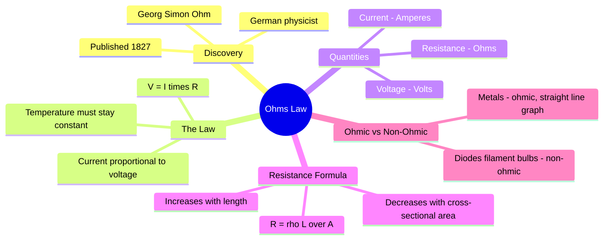

# NOTE — OHM'S LAW
**Section:** GK | **Category:** Science | **Topic:** Ohm's Law | **Slug:** `sci-ohms-law`
**Source:** 🔧 GENERAL KNOWLEDGE (standard physics reference; not yet cross-checked against PARMAR SSC reference excerpt)
**Status:** 🔧 DRAFT — awaiting AIR-91 verification before publish
**PYQ Frequency:** 🔥 Official Phase-1 priority topic (GK_PRIORITY_TOPICS, Science bucket) | **High Yield:** ✅

---

## 🎭 THE HOOK

In 1827, a German physicist named **Georg Simon Ohm** published a relationship so simple it fits on a t-shirt, and so fundamental that nearly every circuit, every appliance, every piece of electronics built since depends on it. He found that the current flowing through a conductor is directly proportional to the voltage across it — push harder, and more current flows, in a perfectly predictable straight-line ratio, as long as temperature and other physical conditions stay constant. The catch: when Ohm first published this in 1827, almost nobody cared. German physics journals largely ignored it, and Ohm spent years in obscurity before the scientific community caught up to what he'd found. Today, the unit of electrical resistance — the **Ohm**, symbol **Ω** (the Greek letter Omega) — carries his name as recognition that came decades too late for him to fully enjoy.

---

## 📖 THE CORE

### The Law
- **Ohm's Law** states: at constant temperature, the **current (I)** flowing through a conductor is **directly proportional** to the **potential difference (voltage, V)** across its ends, provided physical conditions (especially temperature) remain unchanged.
- Mathematically: **V = I × R**, where:
  - **V** = voltage / potential difference, measured in **Volts (V)**
  - **I** = current, measured in **Amperes (A)**
  - **R** = resistance, measured in **Ohms (Ω)**
- Discovered/published by **Georg Simon Ohm**, a German physicist, in **1827**.

### Key Derived Relationships
- **R = V / I** (resistance = voltage ÷ current)
- **I = V / R** (current = voltage ÷ resistance)
- Resistance (R) is a property of the conductor itself — depends on the material, length, cross-sectional area, and temperature of the conductor (not on V or I directly under ideal/ohmic conditions).
- **Resistance formula**: R = ρL/A, where ρ (rho) is **resistivity** (a material-specific constant), L is length, and A is cross-sectional area. Resistance INCREASES with length, and DECREASES with greater cross-sectional area.

### Ohmic vs. Non-Ohmic Conductors
- **Ohmic conductors** (e.g., most metals like copper, at constant temperature) obey Ohm's Law — their V-I graph is a straight line through the origin.
- **Non-ohmic conductors** (e.g., diodes, transistors, filament bulbs at very high temperatures, electrolytes) do NOT obey Ohm's Law — their V-I relationship is non-linear, often because resistance itself changes with current/temperature/voltage.

### Unit & Symbol
- SI unit of resistance: **Ohm (Ω)** — named after Georg Simon Ohm.
- 1 Ohm = the resistance through which 1 Volt produces a current of 1 Ampere.

---

## 🧠 THE MIND MAP

---

## 🔑 THE MNEMONIC

**"VIR"** — V = I × R; remember it as a triangle: V on top, I and R on the bottom — cover the one you want to find, and the remaining two show the operation (V on top means I × R; covering I or R means divide V by the other).

**"1827, Ohm, but ignored till later"** — the discovery year and the historical irony of initial neglect.

---

## 📌 THE PYQ ANCHOR

🔥 Ohm's Law is on the app's **official Phase-1 priority list** (GK_PRIORITY_TOPICS, Science). 🔧 No literal Ohm's Law question confirmed in the 23/46-shift CGL-2025 sample reviewed — the V=IR formula, SI units, and ohmic-vs-non-ohmic distinction are textbook-standard SSC CGL Science staples; recommend archive cross-check.

---

## ⚠️ THE TRAP ALERT

- **Ohm's Law requires temperature (and other physical conditions) to remain CONSTANT** — if temperature changes significantly (e.g., in a filament bulb at high heat), the conductor becomes non-ohmic and the law no longer strictly applies.
- **Resistance INCREASES with length and DECREASES with cross-sectional area** — a frequently tested directional relationship (R = ρL/A); don't reverse these.
- **Not all conductors are "ohmic"** — diodes, transistors, and electrolytes are common non-ohmic exceptions; don't assume Ohm's Law applies universally to all electrical components.

---

## ✅ ACTIVE RECALL

1. Who discovered Ohm's Law, and in what year was it published?
2. State Ohm's Law mathematically, and define each variable with its SI unit.
3. What condition must remain constant for Ohm's Law to hold?
4. How does resistance change with the length and cross-sectional area of a conductor?
5. Name two examples of "non-ohmic" conductors that do not obey Ohm's Law.

*(Answers: 1–Georg Simon Ohm; published in 1827 | 2–V = I × R; V (voltage) in Volts, I (current) in Amperes, R (resistance) in Ohms | 3–Temperature (and other physical conditions of the conductor) | 4–Resistance increases with length, and decreases with greater cross-sectional area | 5–Any two of: diodes, transistors, filament bulbs at high temperature, electrolytes)*
