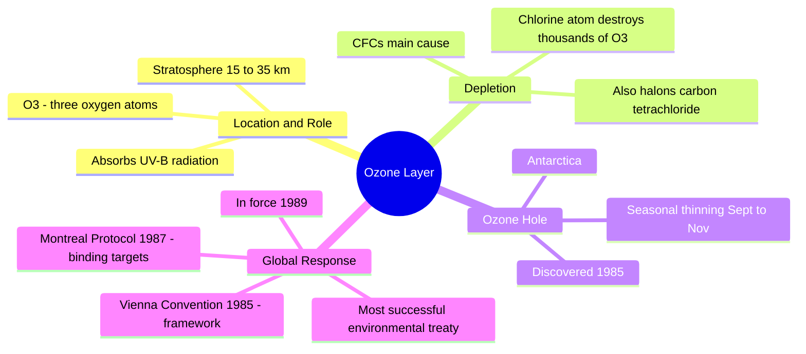

# NOTE — OZONE LAYER
**Section:** GK | **Category:** Science | **Topic:** Ozone Layer | **Slug:** `sci-ozone-layer`
**Source:** 🔧 GENERAL KNOWLEDGE (standard environmental science reference; not yet cross-checked against PARMAR SSC reference excerpt)
**Status:** 🔧 DRAFT — awaiting AIR-91 verification before publish
**PYQ Frequency:** 🔥 Official Phase-1 priority topic (GK_PRIORITY_TOPICS, Science bucket) | **High Yield:** ✅

---

## 🎭 THE HOOK

In 1985, British scientists working in Antarctica reported something the world had never confirmed before: a massive, seasonal hole in the layer of the atmosphere that protects all life on Earth from the sun's most dangerous radiation. The culprit, scientists soon proved, was a class of chemicals so chemically stable and seemingly harmless that they'd been used for decades in refrigerators, spray cans, and air conditioners — **Chlorofluorocarbons (CFCs)**. Each chlorine atom released from a broken-down CFC molecule could destroy **thousands of ozone molecules** before it finally became inert, year after year, slowly tearing a hole over Antarctica that would eventually exceed the size of the continent itself. The global response — the **Montreal Protocol of 1987** — became one of the most successful international environmental treaties ever signed, and it's the textbook example SSC exams reach for whenever they test "which treaty actually worked."

---

## 📖 THE CORE

### What & Where
- **Ozone (O₃)** is a molecule made of three oxygen atoms — a pale blue gas that is toxic at ground level but protective in the upper atmosphere.
- The **Ozone Layer** is concentrated in the **Stratosphere**, roughly **15–35 km above Earth's surface** (the stratosphere itself spans roughly 12-50 km).
- Function: absorbs most of the Sun's harmful **ultraviolet (UV-B) radiation**, preventing it from reaching the Earth's surface in damaging quantities.

### Formation & Depletion Mechanism
- Formed naturally when UV radiation splits oxygen molecules (O₂) into individual oxygen atoms, which then combine with other O₂ molecules to form O₃ — a continuous natural creation-destruction cycle.
- **Depletion cause**: **Chlorofluorocarbons (CFCs)**, along with **halons, carbon tetrachloride, and methyl chloroform**, release **chlorine** and **bromine** atoms when broken down by UV radiation in the stratosphere.
- Each chlorine atom acts as a **catalyst**, destroying thousands of ozone molecules before becoming inactive — making CFCs disproportionately destructive relative to their atmospheric concentration.

### The Ozone Hole
- First scientifically confirmed over **Antarctica in 1985** by British Antarctic Survey scientists (Joseph Farman and colleagues).
- "Ozone hole" refers to a severe seasonal THINNING (not a literal hole) of the ozone layer, occurring primarily over Antarctica during the Southern Hemisphere spring (September-November), due to unique polar stratospheric cloud chemistry.

### Global Response — Montreal Protocol
- The **Montreal Protocol on Substances that Deplete the Ozone Layer**, signed in **1987**, came into force in **1989** — an international treaty under the UN to phase out the production and consumption of ozone-depleting substances (ODS), including CFCs.
- Widely regarded as the **most successful international environmental agreement** to date — nearly universal ratification, and the ozone layer is on a documented path to recovery (projected full recovery by mid-21st century in most regions).
- Built on the earlier **Vienna Convention for the Protection of the Ozone Layer (1985)**, which provided the framework but no binding targets — Montreal Protocol added the binding phase-out schedule.

---

## 🧠 THE MIND MAP

---

## 🔑 THE MNEMONIC

**"Vienna framed it, Montreal fixed it"** — Vienna Convention (1985) provided the framework; Montreal Protocol (1987) added binding phase-out targets.

**"One chlorine, thousands gone"** — captures the catalytic, disproportionate destructive power of a single chlorine atom from a broken-down CFC molecule.

---

## 📌 THE PYQ ANCHOR

🔥 Ozone Layer is on the app's **official Phase-1 priority list** (GK_PRIORITY_TOPICS, Science). 🔧 No literal Ozone Layer question confirmed in the 23/46-shift CGL-2025 sample reviewed — Montreal Protocol year, CFC's role, and the stratosphere location are textbook-standard SSC CGL Science/Environment staples; recommend archive cross-check.

---

## ⚠️ THE TRAP ALERT

- **The Ozone Layer is in the STRATOSPHERE, not the troposphere** — don't confuse it with ground-level ("bad") ozone, which is a pollutant; stratospheric ("good") ozone is protective.
- **The Montreal Protocol (1987) is often confused with the Vienna Convention (1985)** — Vienna provided the framework with no binding targets; Montreal added the actual binding phase-out schedule. Examiners may ask which treaty had binding commitments.
- **CFCs act CATALYTICALLY** — a single chlorine atom destroys THOUSANDS of ozone molecules before becoming inactive, not just one-for-one; this disproportionate effect is a frequently tested detail.

---

## ✅ ACTIVE RECALL

1. In which layer of the atmosphere is the ozone layer located, and what does it protect against?
2. What class of chemicals is primarily responsible for ozone depletion?
3. Where and when was the "ozone hole" first scientifically confirmed?
4. What is the difference between the Vienna Convention (1985) and the Montreal Protocol (1987)?
5. Why is the Montreal Protocol considered one of the most successful international environmental treaties?

*(Answers: 1–The Stratosphere; protects against harmful UV-B radiation from the Sun | 2–Chlorofluorocarbons (CFCs), along with halons, carbon tetrachloride, and methyl chloroform | 3–Over Antarctica, in 1985, by British Antarctic Survey scientists | 4–Vienna Convention (1985) provided a framework with no binding targets; Montreal Protocol (1987) added a binding phase-out schedule for ozone-depleting substances | 5–Near-universal ratification and a documented, measurable recovery of the ozone layer on track for the mid-21st century)*
