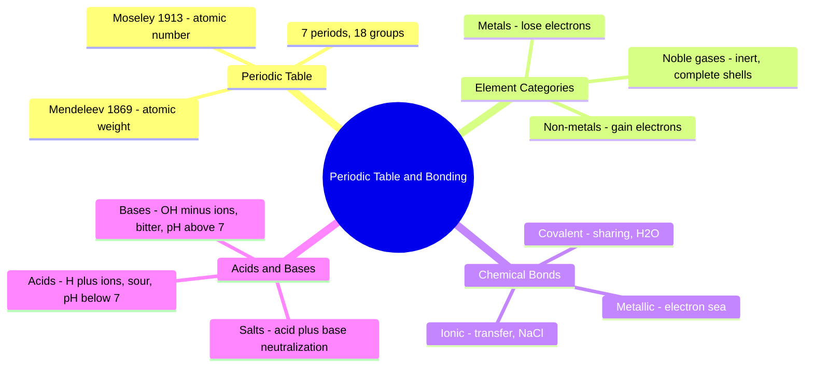

# NOTE — PERIODIC TABLE & CHEMICAL BONDING BASICS
**Section:** GK | **Category:** Science | **Topic:** Periodic Table & Chemical Bonding | **Slug:** `sci-periodic-table-and-chemical-bonding`
**Source:** 🔧 GENERAL KNOWLEDGE (standard chemistry reference; not yet cross-checked against PARMAR SSC reference excerpt)
**Status:** 🔧 DRAFT — awaiting AIR-91 verification before publish
**PYQ Frequency:** 🔥 Very high-frequency Chemistry topic, connects to [[sci-ph-scale]] | **High Yield:** ✅

---

## 🎭 THE HOOK

In 1869, Russian chemist **Dmitri Mendeleev** arranged all known elements into a table organized by atomic weight and recurring chemical properties — and then did something audacious: he left GAPS in the table for elements that hadn't been discovered yet, correctly predicting their properties in advance. When those elements (gallium, germanium, scandium) were later discovered and matched his predictions almost exactly, the Periodic Table went from a clever organizational chart to one of science's most validated predictive tools. Today's table is organized by **atomic number** (not weight, a refinement made later by Henry Moseley), but the core insight — that chemical behavior repeats in predictable PERIODIC patterns — remains Mendeleev's enduring contribution.

---

## 📖 THE CORE

### Periodic Table Basics
- Modern Periodic Table organized by **atomic number** (number of protons), proposed by **Henry Moseley** (1913) — a refinement of Mendeleev's original atomic-weight-based version (1869).
- **Periods**: horizontal rows (7 total) — elements in the same period have the same number of electron shells.
- **Groups**: vertical columns (18 total) — elements in the same group have the same number of valence (outermost) electrons, giving them SIMILAR chemical properties.
- **Periodic trends**: atomic size generally DECREASES across a period (left to right) and INCREASES down a group; electronegativity and ionization energy generally INCREASE across a period and DECREASE down a group.

### Element Categories
- **Metals**: majority of elements; good conductors of heat/electricity, malleable, ductile, lustrous; tend to LOSE electrons (form positive ions/cations).
- **Non-metals**: poor conductors (except graphite); brittle if solid; tend to GAIN electrons (form negative ions/anions).
- **Metalloids**: intermediate properties (e.g., Silicon, Germanium, Boron) — used heavily in semiconductors.
- **Noble Gases** (Group 18): chemically INERT/unreactive due to complete outer electron shells (Helium, Neon, Argon, Krypton, Xenon, Radon).

### Chemical Bonding Basics
| Bond Type | Mechanism | Example |
|---|---|---|
| **Ionic Bond** | Complete TRANSFER of electrons from a metal to a non-metal, forming oppositely charged ions held by electrostatic attraction | NaCl (table salt) — Na loses an electron, Cl gains it |
| **Covalent Bond** | SHARING of electron pairs between non-metal atoms | H₂O (water), O₂, CO₂ |
| **Metallic Bond** | A "sea" of delocalized (free-moving) electrons shared among a lattice of metal cations | Copper, Iron, all metals |

### Acids, Bases & Salts (Connects to [[sci-ph-scale]])
- **Acids**: release H⁺ ions in solution, taste sour, turn blue litmus RED, pH < 7.
- **Bases**: release OH⁻ ions in solution, taste bitter/soapy, turn red litmus BLUE, pH > 7.
- **Salts**: formed from the NEUTRALIZATION reaction between an acid and a base (Acid + Base → Salt + Water).
- **Common acid/base examples**: Hydrochloric acid (HCl, stomach acid), Sulfuric acid (H₂SO₄, "king of chemicals," widely used industrially), Sodium hydroxide (NaOH, caustic soda), Ammonia (NH₃, a common weak base).

---

## 🧠 THE MIND MAP

---

## 🔑 THE MNEMONIC

**"Mendeleev guessed by weight, Moseley fixed it by number"** — the historical refinement from atomic weight to atomic number ordering.

**"Metals lose, non-metals gain, ionic bonds are the exchange"** — the electron-transfer logic behind ionic bonding.

---

## 📌 THE PYQ ANCHOR

🔥 Periodic Table & Chemical Bonding is a very high-frequency Chemistry topic, connecting to [[sci-ph-scale]]. 🔧 No literal Periodic Table question confirmed in the 23/46-shift CGL-2025 sample reviewed earlier in this session, since this topic wasn't separately tagged during PYQ extraction — Mendeleev/Moseley's contributions, periods/groups, and bond-type identification are textbook-standard SSC CGL Science staples; recommend a dedicated archive cross-check.

---

## ⚠️ THE TRAP ALERT

- **Mendeleev organized the table by ATOMIC WEIGHT (1869); Moseley refined it to ATOMIC NUMBER (1913)** — the MODERN table uses atomic number; don't attribute the current ordering principle to Mendeleev.
- **Periods are horizontal ROWS; Groups are vertical COLUMNS** — a frequently reversed pair; elements in the same GROUP share similar chemical properties (same valence electrons), not elements in the same period.
- **Metals LOSE electrons (cations); non-metals GAIN electrons (anions)** — don't reverse this in ionic bonding contexts.
- **Acids turn blue litmus RED; bases turn red litmus BLUE** — a frequently swapped color-reaction pair.

---

## ✅ ACTIVE RECALL

1. Who organized the original Periodic Table, and on what basis? Who later refined it, and to what basis?
2. What is the difference between a Period and a Group in the Periodic Table?
3. What is the difference between an ionic bond and a covalent bond?
4. Do metals tend to lose or gain electrons in ionic bonding? What about non-metals?
5. How does litmus paper indicate whether a solution is acidic or basic?

*(Answers: 1–Dmitri Mendeleev (1869), based on atomic weight; Henry Moseley (1913) refined it based on atomic number | 2–A Period is a horizontal row (same number of electron shells); a Group is a vertical column (same number of valence electrons, similar chemical properties) | 3–An ionic bond involves complete transfer of electrons between a metal and non-metal; a covalent bond involves sharing of electron pairs between non-metals | 4–Metals lose electrons (form cations); non-metals gain electrons (form anions) | 5–Acids turn blue litmus red; bases turn red litmus blue)*
