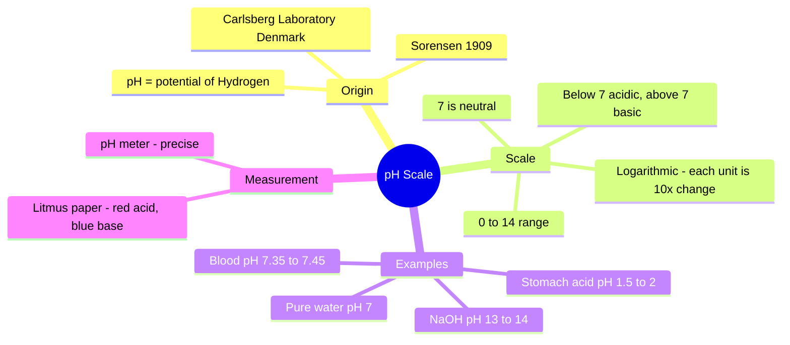

# NOTE — pH SCALE
**Section:** GK | **Category:** Science | **Topic:** pH Scale | **Slug:** `sci-ph-scale`
**Source:** 🔧 GENERAL KNOWLEDGE (standard chemistry reference; not yet cross-checked against PARMAR SSC reference excerpt)
**Status:** 🔧 DRAFT — awaiting AIR-91 verification before publish
**PYQ Frequency:** 🔥 Official Phase-1 priority topic (GK_PRIORITY_TOPICS, Science bucket) | **High Yield:** ✅

---

## 🎭 THE HOOK

In 1909, a Danish biochemist named **Søren Sørensen**, working at the Carlsberg Laboratory — yes, the beer company — needed a simpler way to express how acidic or basic a solution was for brewing purposes. Instead of writing out unwieldy hydrogen-ion concentration numbers, he invented a logarithmic shorthand: **pH**, short for "potential of Hydrogen" (or "power of Hydrogen"). The scale he built runs from **0 to 14**, but the cleverest part is what the numbers actually represent: each whole step isn't a simple +1 change in acidity — it's a **10-fold (logarithmic) jump**. A solution with pH 3 isn't "a little more acidic" than one with pH 4 — it's **ten times** more acidic. That single fact, buried in the math behind a beer-brewing shortcut, is one of the most consistently tested numerical traps in SSC Science.

---

## 📖 THE CORE

### Definition & Origin
- **pH** = "potential of Hydrogen" (or "power of Hydrogen") — a measure of the **hydrogen ion (H⁺) concentration** in a solution.
- Invented by **Søren Peter Lauritz Sørensen**, a Danish chemist, in **1909**, while working at the **Carlsberg Laboratory**.
- Formula: **pH = −log₁₀[H⁺]** (negative logarithm, base 10, of hydrogen ion concentration).

### The Scale
- Ranges from **0 to 14**.
- **pH 7** = **neutral** (e.g., pure water).
- **pH < 7** = **acidic** — the LOWER the number, the MORE acidic (more H⁺ ions).
- **pH > 7** = **basic/alkaline** — the HIGHER the number, the MORE basic (fewer H⁺ ions, more OH⁻ ions).
- The scale is **logarithmic**: each unit change represents a **10-fold change** in H⁺ ion concentration (e.g., pH 4 is 10× more acidic than pH 5, and 100× more acidic than pH 6).

### Common pH Values (Frequently Tested)
| Substance | Approx. pH |
|---|---|
| Gastric/stomach acid (HCl) | ~1.5 – 2 |
| Lemon juice | ~2 |
| Vinegar | ~2.5 |
| Black coffee | ~5 |
| Human blood | ~7.35 – 7.45 (slightly alkaline) |
| Pure water | 7 (neutral) |
| Sea water | ~8 |
| Baking soda (sodium bicarbonate) solution | ~9 |
| Milk of magnesia | ~10.5 |
| Household ammonia | ~11 – 12 |
| Bleach | ~12.5 |
| Sodium hydroxide (NaOH, strong base) | ~13 – 14 |

### Measurement
- Measured using a **pH meter** (electronic, precise) or **pH/litmus indicator paper** (color-change based, approximate) — **litmus turns red in acid, blue in base**, but litmus paper alone gives only a rough acid/base/neutral indication, not a precise numerical pH value (a universal indicator solution/paper is needed for a numeric estimate).

---

## 🧠 THE MIND MAP

---

## 🔑 THE MNEMONIC

**"7 is the fence, low jumps acid, high jumps base"** — pH 7 is the neutral dividing line; below = acidic, above = basic.

**"Each step is a 10x leap, not a 1-point creep"** — the logarithmic nature of the pH scale, the most commonly tested numerical trap.

---

## 📌 THE PYQ ANCHOR

🔥 pH Scale is on the app's **official Phase-1 priority list** (GK_PRIORITY_TOPICS, Science). 🔧 No literal pH Scale question confirmed in the 23/46-shift CGL-2025 sample reviewed — pH of common substances (stomach acid, blood, milk) and the Sørensen/Carlsberg origin fact are textbook-standard SSC CGL Science staples; recommend archive cross-check.

---

## ⚠️ THE TRAP ALERT

- **The pH scale is LOGARITHMIC, not linear** — a difference of 1 pH unit means a 10-FOLD change in H⁺ concentration, not a small incremental change. This is the single most-tested conceptual trap.
- **Human blood is SLIGHTLY ALKALINE (pH ~7.35–7.45), not neutral or acidic** — a commonly mis-recalled fact; many aspirants assume blood is neutral like water.
- **Lower pH = MORE acidic** (more H⁺ ions) — don't reverse the direction; pH 1 is far more acidic than pH 6, even though "6" is the larger number.

---

## ✅ ACTIVE RECALL

1. Who invented the pH scale, and in what year?
2. What does "pH" stand for, and what does it measure?
3. What is the pH range, and what value represents neutral?
4. Is the pH scale linear or logarithmic? What does this mean for the difference between pH 4 and pH 5?
5. Approximately what is the pH of human blood?

*(Answers: 1–Søren Sørensen, in 1909, at the Carlsberg Laboratory | 2–"Potential/power of Hydrogen"; measures hydrogen ion (H⁺) concentration in a solution | 3–0 to 14; pH 7 is neutral | 4–Logarithmic; pH 4 is 10 times more acidic than pH 5 | 5–Approximately 7.35-7.45 (slightly alkaline))*
