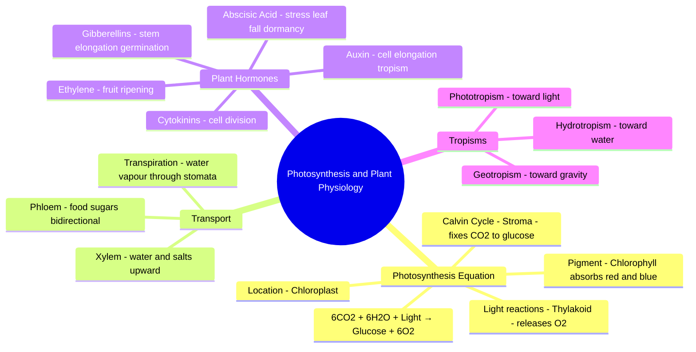

# NOTE — PHOTOSYNTHESIS & PLANT PHYSIOLOGY
**Section:** GK | **Category:** Science | **Topic:** Photosynthesis & Plant Physiology | **Slug:** `sci-photosynthesis-and-plant-physiology`
**Source:** 🔧 GENERAL KNOWLEDGE (standard biology reference; not yet cross-checked against PARMAR SSC reference excerpt)
**Status:** 🔧 DRAFT — awaiting AIR-91 verification before publish
**PYQ Frequency:** 🔥 High-frequency — photosynthesis equation, chlorophyll, plant hormones, and transpiration are recurring SSC CGL Biology questions | **High Yield:** ✅

---

## 🎭 THE HOOK

Every atom of carbon in your body was once CO₂ in the air — pulled into a plant's leaf, split by sunlight, and assembled into sugar. Photosynthesis is the single most important chemical process on Earth: it produces essentially all the oxygen in the atmosphere and essentially all the food on the planet. SSC CGL tests this not because it's complicated, but because it's a source of precise, testable facts — the equation, the pigments, the organelle, the products. Get the inputs and outputs right, and you're safe.

---

## 📖 THE CORE

### Photosynthesis — The Master Equation

**6CO₂ + 6H₂O + Light Energy → C₆H₁₂O₆ (Glucose) + 6O₂**

- **Reactants**: Carbon dioxide (CO₂), Water (H₂O), Light energy (from sunlight)
- **Products**: Glucose (C₆H₁₂O₆) and Oxygen (O₂)
- **Location**: CHLOROPLASTS (specifically in cells of leaves and green plant parts)
- **Pigment required**: CHLOROPHYLL (the green pigment that absorbs light energy)

#### The Two Stages of Photosynthesis
1. **Light-Dependent Reactions (Light Reactions)**: Occur in the THYLAKOID membranes; require sunlight; split water molecules (photolysis); produce ATP, NADPH, and O₂ (oxygen is released HERE as a byproduct)
2. **Light-Independent Reactions (Calvin Cycle / Dark Reactions)**: Occur in the STROMA of the chloroplast; use ATP and NADPH from light reactions to fix CO₂ into glucose; do NOT directly require light but use its products

---

### Chlorophyll & Pigments

| Pigment | Colour | Wavelength Absorbed Most | Role |
|---|---|---|---|
| **Chlorophyll-a** | Blue-green | Red and Blue (reflects green) | PRIMARY photosynthetic pigment; direct role in photochemical reactions |
| **Chlorophyll-b** | Yellow-green | Blue (accessory) | Accessory pigment; widens light absorption spectrum |
| **Carotenoids (Carotene + Xanthophyll)** | Orange-yellow | Blue-violet | Accessory pigments; also protect chlorophyll from excess light; responsible for autumn leaf colours |
| **Phycoerythrin** | Red | Green light | Present in RED ALGAE; enables photosynthesis in deeper water where red/blue light doesn't penetrate |

> **Why leaves are GREEN**: Chlorophyll absorbs red and blue light most efficiently; GREEN light is REFLECTED — so leaves appear green.

> **Why leaves turn red/orange in autumn**: As chlorophyll breaks down, CAROTENOIDS (which were always present but masked) become visible.

---

### Key Plant Processes

#### Transpiration
- **Definition**: Loss of water vapour from plant leaves through tiny pores called **STOMATA**
- Regulated by **guard cells** that control stomata opening/closing
- **Functions**: 
  - Creates a pulling force (transpiration pull) that draws water upward from roots through xylem — main mechanism of water transport
  - Cools the plant surface
  - Helps in mineral salt absorption from soil
- **Guttation**: Drops of liquid water (not vapour) appearing at leaf edges — different from transpiration; occurs when stomata are closed (usually at night)

#### Water Transport in Plants (Xylem)
- **Xylem**: Transports water and dissolved mineral SALTS from roots UPWARD to leaves
- Driving force: transpiration pull (cohesion-tension theory)

#### Food Transport in Plants (Phloem)
- **Phloem**: Transports FOOD (sugars produced by photosynthesis) from leaves to ALL PARTS of the plant (including roots) — this is called TRANSLOCATION
- Bidirectional movement (unlike xylem, which is only upward)

#### Respiration vs. Photosynthesis
| Feature | Photosynthesis | Cellular Respiration |
|---|---|---|
| **Location** | Chloroplast | Mitochondria |
| **Reactants** | CO₂ + H₂O + Light | Glucose + O₂ |
| **Products** | Glucose + O₂ | CO₂ + H₂O + Energy (ATP) |
| **Purpose** | Food production (anabolic) | Energy release (catabolic) |
| **Occurs in** | Green plants (autotrophs) | All living organisms |

---

### Plant Hormones (Phytohormones) — SSC Favourites

| Hormone | Main Function | Key Application |
|---|---|---|
| **Auxin (IAA)** | Promotes cell ELONGATION; regulates tropism (directional growth); apical dominance | Phototropism (bending toward light); rooting in cuttings |
| **Gibberellins (GA)** | Promotes STEM ELONGATION; seed germination; breaking dormancy | Used to produce seedless grapes; increases crop height |
| **Cytokinins** | Promotes CELL DIVISION (cytokinesis); delays leaf senescence (ageing) | Tissue culture; delaying ageing of stored vegetables |
| **Abscisic Acid (ABA)** | "Stress hormone" — promotes LEAF FALL (abscission), seed dormancy; closes stomata under drought | Plant response to water stress |
| **Ethylene** | Promotes FRUIT RIPENING; leaf fall; flowering in some plants | Artificial ripening of fruits |

---

### Plant Tropisms (Directional Growth Responses)

| Tropism | Stimulus | Direction of Growth |
|---|---|---|
| **Phototropism** | Light | Toward light (positive) — controlled by AUXIN redistribution |
| **Geotropism (Gravitropism)** | Gravity | Roots toward gravity (positive); Shoot away from gravity (negative) |
| **Hydrotropism** | Water | Toward water (roots) |
| **Thigmotropism** | Touch | Toward/around object (tendril plants: peas, beans) |

---

## 🧠 THE MIND MAP

---

## 🔑 THE MNEMONIC

**"6 CO₂ + 6 H₂O + LIGHT → C₆H₁₂O₆ + 6 O₂ — SIX in, SIX out, GLUCOSE in the middle"** — the photosynthesis equation as a counting pattern.

**"XYLEM carries X-water (going up); PHLOEM carries Food (going everywhere)"** — the X/F mnemonic for vascular tissue function.

**"Auxin AIMS toward light; Ethylene ENDS fruit (ripening); ABA ABANDONS leaves (fall)"** — three hormone-action pairs.

**"Why leaves are GREEN: chlorophyll ABSORBS red + blue, REFLECTS green"** — the reflection logic for leaf colour.

---

## 📌 THE PYQ ANCHOR

🔥 The photosynthesis equation (reactants, products, organelle), chlorophyll's role and why leaves appear green, xylem vs. phloem functions, and ethylene for fruit ripening are consistent SSC CGL Biology sub-topics. The distinction between respiration (mitochondria) and photosynthesis (chloroplast) is a standard MCQ contrast. 🔧 No specific CGL 2025 PYQ confirmed from the 23/46-shift sample; recommend dedicated archive cross-check.

---

## ⚠️ THE TRAP ALERT

- **Oxygen released during photosynthesis comes from SPLITTING OF WATER (photolysis)**, NOT from CO₂ — an often-counterintuitive fact. The CO₂ is used to build glucose, not to produce O₂.
- **XYLEM carries water UPWARD; PHLOEM carries food in BOTH directions** — Phloem is bidirectional; Xylem is strictly upward. Don't reverse these.
- **Chlorophyll ABSORBS red and blue light, REFLECTS green** — this is why leaves look green. Students confuse "absorbs green" with leaf colour.
- **Abscisic Acid (ABA) is an INHIBITORY hormone** — it promotes dormancy, leaf fall, and stomatal closure under stress; it does NOT promote growth.
- **Ethylene is a GAS, not a liquid or solid hormone** — it's the ONLY gaseous plant hormone; used commercially for artificial fruit ripening.
- **Guttation ≠ Transpiration**: Guttation releases liquid water from leaf edges; transpiration releases water VAPOUR through stomata.

---

## ✅ ACTIVE RECALL

1. Write the complete photosynthesis equation with reactants, products, and the organelle where it occurs.
2. Why do leaves appear green? What does chlorophyll actually absorb?
3. What is the difference between Xylem and Phloem in terms of what they transport and in which direction?
4. Which plant hormone is responsible for fruit ripening? What type of molecule is it?
5. Where does the oxygen released during photosynthesis come from — CO₂ or H₂O?

*(Answers: 1–6CO₂ + 6H₂O + Light Energy → C₆H₁₂O₆ (Glucose) + 6O₂; occurs in CHLOROPLASTS | 2–Leaves appear green because chlorophyll ABSORBS red and blue wavelengths of light and REFLECTS green light; the reflected green light is what we see | 3–Xylem transports water and mineral salts UPWARD from roots to leaves; Phloem transports food (sugars) BIDIRECTIONALLY from leaves to all plant parts including roots | 4–Ethylene; it is a GAS — the only gaseous plant hormone | 5–The oxygen released during photosynthesis comes from the splitting of WATER (H₂O) during the light-dependent reactions (photolysis), NOT from CO₂)*
