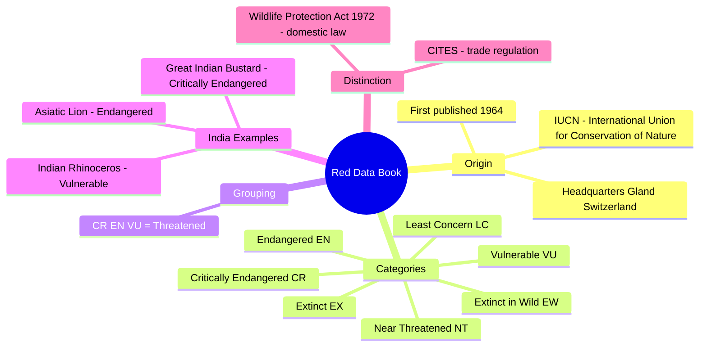

# NOTE — RED DATA BOOK
**Section:** GK | **Category:** Science | **Topic:** Red Data Book | **Slug:** `sci-red-data-book`
**Source:** 🔧 GENERAL KNOWLEDGE (standard environmental science reference; not yet cross-checked against PARMAR SSC reference excerpt)
**Status:** 🔧 DRAFT — awaiting AIR-91 verification before publish
**PYQ Frequency:** 🔥 Official Phase-1 priority topic (GK_PRIORITY_TOPICS, Science bucket) | **High Yield:** ✅

---

## 🎭 THE HOOK

Red, in this context, isn't a colour scheme — it's a warning signal, chosen deliberately by an international conservation body in 1964 to mean exactly what red means everywhere else: danger, stop, pay attention. The **Red Data Book** (also called the **Red List**) is the world's most authoritative inventory of species standing on the edge of extinction, compiled and continuously updated by the **International Union for Conservation of Nature (IUCN)**, headquartered in **Gland, Switzerland**. It isn't a single static publication — it's a living, constantly revised global database, sorting every assessed species into a precise hierarchy of risk, from "doing fine" all the way down to "gone forever." For India specifically, species like the Asiatic Lion, the Bengal Tiger, and the Great Indian Bustard sit inside this list's most urgent categories — a fact SSC examiners frequently pair with India-specific conservation status questions.

---

## 📖 THE CORE

### Origin & Maintaining Body
- The **Red Data Book** (formally the **IUCN Red List of Threatened Species**) was first published in **1964** by the **International Union for Conservation of Nature (IUCN)**.
- IUCN headquarters: **Gland, Switzerland**.
- It is the world's most comprehensive inventory of the global conservation status of biological species, continuously updated (not a one-time publication).

### IUCN Red List Categories (Risk Hierarchy, Highest to Lowest Risk)
| Category | Meaning |
|---|---|
| **Extinct (EX)** | No known individuals remaining anywhere. |
| **Extinct in the Wild (EW)** | Survives only in captivity/cultivation, or as a naturalized population well outside its native range. |
| **Critically Endangered (CR)** | Extremely high risk of extinction in the wild. |
| **Endangered (EN)** | Very high risk of extinction in the wild. |
| **Vulnerable (VU)** | High risk of extinction in the wild. |
| **Near Threatened (NT)** | Likely to qualify for a threatened category soon. |
| **Least Concern (LC)** | Widespread and abundant; lowest risk. |
| **Data Deficient (DD)** | Not enough data to assess risk. |
| **Not Evaluated (NE)** | Not yet assessed against the criteria. |

- **CR, EN, and VU together** are collectively called **"Threatened"** species — the most commonly tested grouping.

### India-Specific Examples (Frequently Tested)
- **Critically Endangered**: Great Indian Bustard, Gharial, Bengal Florican, Sumatran Rhinoceros (regionally), Pygmy Hog.
- **Endangered**: Asian Elephant, Bengal Tiger, Red Panda, Snow Leopard (technically Vulnerable per most recent assessments — verify current status), Asiatic Lion (Endangered).
- **Vulnerable**: Indian Rhinoceros (One-horned Rhino), Sloth Bear.

### Distinction from Other Conservation Lists
- Red Data Book/Red List (IUCN, global, scientific assessment) is DIFFERENT from:
  - **CITES** (Convention on International Trade in Endangered Species) — regulates international trade, not a risk-assessment list per se.
  - **Wildlife Protection Act, 1972 (India)** — domestic legal protection schedules (Schedule I, II, etc.) for species within India, administratively separate from IUCN categories though often correlated.

---

## 🧠 THE MIND MAP

---

## 🔑 THE MNEMONIC

**"EX-EW-CR-EN-VU-NT-LC"** — the IUCN Red List hierarchy from most to least at risk, in order.

**"Red Data = IUCN's global report card, not India's law"** — distinguishes the Red Data Book (global, IUCN) from India's own Wildlife Protection Act schedules (domestic law).

---

## 📌 THE PYQ ANCHOR

🔥 Red Data Book is on the app's **official Phase-1 priority list** (GK_PRIORITY_TOPICS, Science). 🔧 No literal Red Data Book question confirmed in the 23/46-shift CGL-2025 sample reviewed — IUCN categories and India-specific endangered species classifications are textbook-standard SSC CGL Science/Environment staples; recommend archive cross-check.

---

## ⚠️ THE TRAP ALERT

- **The Red Data Book is maintained by IUCN, an international body, NOT by the Indian government** — don't confuse it with India's domestic Wildlife Protection Act, 1972 schedules, which are a separate legal framework.
- **"Threatened" is a collective term for Critically Endangered + Endangered + Vulnerable** — not a separate category of its own; a frequently tested grouping question.
- **Species conservation statuses CHANGE over time** with reassessment (e.g., a species can move from Endangered to Vulnerable, or vice versa) — always flag specific current-status claims for verification, as this is one of the most frequently updated areas of science GK.

---

## ✅ ACTIVE RECALL

1. Who publishes and maintains the Red Data Book, and where is this organization headquartered?
2. In which year was the Red Data Book first published?
3. List the IUCN Red List categories from highest to lowest extinction risk (at least 5).
4. Which three categories are collectively called "Threatened" species?
5. How does the Red Data Book differ from India's Wildlife Protection Act, 1972?

*(Answers: 1–The International Union for Conservation of Nature (IUCN); headquartered in Gland, Switzerland | 2–1964 | 3–Extinct, Extinct in the Wild, Critically Endangered, Endangered, Vulnerable, Near Threatened, Least Concern (any 5 in correct relative order) | 4–Critically Endangered, Endangered, and Vulnerable | 5–The Red Data Book is a global, IUCN-maintained scientific risk assessment; the Wildlife Protection Act, 1972 is India's own domestic legal framework for protecting species, administratively separate from IUCN categories)*
