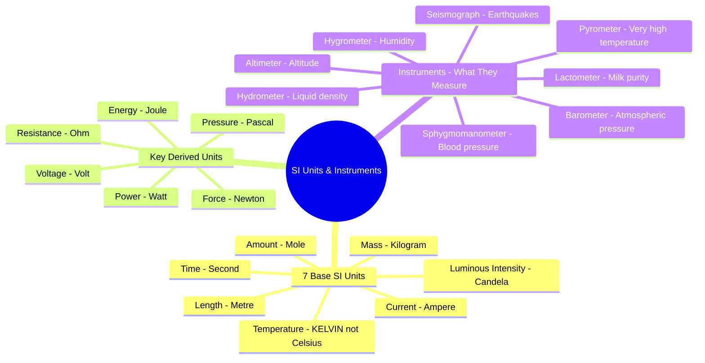

# NOTE — SI UNITS & SCIENTIFIC INSTRUMENTS
**Section:** GK | **Category:** Science | **Topic:** SI Units & Scientific Instruments | **Slug:** `sci-si-units-and-scientific-instruments`
**Source:** 🔧 GENERAL KNOWLEDGE (standard physics/measurement reference; not yet cross-checked against PARMAR SSC reference excerpt)
**Status:** 🔧 DRAFT — awaiting AIR-91 verification before publish
**PYQ Frequency:** 🔥 Very high-frequency — SI unit identification and instrument-measurement matching are textbook SSC CGL staples | **High Yield:** ✅

---

## 🎭 THE HOOK

Science is measurement. Every measurement has a unit, and every unit belongs to the SI system — the *Système International d'Unités*, the world's agreed-upon standard since 1960. SSC CGL tests this in exactly two ways: give you a quantity and ask for its SI unit, or give you a scientific instrument and ask what it measures. The examiner's trap is always the same — units that LOOK right but aren't (e.g., "temperature = Celsius" instead of "Kelvin"), or instruments with confusingly similar names (Barometer vs. Hygrometer). Nail these tables cold and you never drop a question here.

---

## 📖 THE CORE

### The 7 SI Base Units (Entire System Built on These)

| Physical Quantity | SI Unit | Symbol |
|---|---|---|
| **Length** | Metre | m |
| **Mass** | Kilogram | kg |
| **Time** | Second | s |
| **Electric Current** | Ampere | A |
| **Temperature** | **Kelvin** | K |
| **Amount of Substance** | Mole | mol |
| **Luminous Intensity** | Candela | cd |

> **Key trap**: Temperature's SI unit is **Kelvin (K)**, NOT Celsius (°C). Celsius is a derived/practical scale, not an SI base unit.

---

### Important Derived SI Units (Frequently Tested)

| Quantity | SI Unit | Symbol | In Base Units |
|---|---|---|---|
| **Force** | Newton | N | kg·m/s² |
| **Pressure** | Pascal | Pa | N/m² |
| **Energy / Work** | Joule | J | N·m |
| **Power** | Watt | W | J/s |
| **Electric Charge** | Coulomb | C | A·s |
| **Electric Potential** | Volt | V | J/C |
| **Resistance** | Ohm | Ω | V/A |
| **Frequency** | Hertz | Hz | cycles/s |
| **Magnetic Flux** | Weber | Wb | V·s |
| **Magnetic Field** | Tesla | T | Wb/m² |
| **Capacitance** | Farad | F | C/V |

---

### Scientific Instruments — Master Table (SSC Favourite)

| Instrument | What It Measures | Key Note |
|---|---|---|
| **Barometer** | Atmospheric PRESSURE | Mercury or aneroid type; weather forecasting |
| **Thermometer** | TEMPERATURE | Mercury/alcohol/digital; clinical vs. lab types |
| **Hygrometer** | Relative HUMIDITY (moisture content of air) | Weather stations; sling psychrometer variant |
| **Anemometer** | Wind SPEED | Rotating cups on weather masts |
| **Rain Gauge (Pluviometer)** | Rainfall / precipitation |  |
| **Seismograph** | Earthquake intensity (SEISMIC WAVES) | Richter scale associated but not the instrument |
| **Galvanometer** | Small ELECTRIC CURRENT | Deflection type; moving coil design |
| **Ammeter** | Electric CURRENT (A) | Connected in SERIES in a circuit |
| **Voltmeter** | Electric POTENTIAL DIFFERENCE / Voltage (V) | Connected in PARALLEL in a circuit |
| **Ohmmeter** | Electrical RESISTANCE (Ω) |  |
| **Manometer** | Gas/Fluid PRESSURE |  |
| **Lactometer** | Purity of MILK (density) | Measures specific gravity of milk |
| **Hydrometer** | Specific gravity / density of LIQUIDS | Used for battery acid, alcohol content |
| **Altimeter** | ALTITUDE (height above sea level) | Used in aircraft |
| **Tachometer** | Rotational SPEED (RPM) | Engines, turbines |
| **Odometer** | Distance TRAVELLED by vehicle | Vehicle dashboard |
| **Speedometer** | Speed of vehicle (km/h or mph) |  |
| **Calorimeter** | HEAT content / calorific value |  |
| **Spectrometer** | Wavelengths of LIGHT / spectrum |  |
| **Microscope** | Magnification of tiny OBJECTS | Optical vs. electron |
| **Telescope** | Distant OBJECTS in space | Refracting vs. reflecting |
| **Stethoscope** | Heart and lung SOUNDS | Medical; auscultation |
| **Sphygmomanometer** | BLOOD PRESSURE | Medical; the cuff and gauge device |
| **ECG (Electrocardiograph)** | Heart's electrical activity (HEARTBEAT pattern) | Cardiology |
| **EEG (Electroencephalograph)** | Brain's electrical activity (BRAIN WAVES) |  |
| **Pyrometer** | Very HIGH TEMPERATURES (>600°C) | Furnaces, molten metal; non-contact |
| **Photometer** | Light INTENSITY / illuminance |  |
| **Sonometer** | Frequency of SOUND WAVES | String/vibration experiments |
| **Audiometer** | Hearing acuity (SOUND PERCEPTION) | Clinical hearing tests |
| **Periscope** | Viewing objects around CORNERS / above obstacles | Submarines |
| **Endoscope** | Viewing inside BODY CAVITIES | Medical internal examination |
| **Polygraph (Lie Detector)** | Physiological responses (BP, pulse, respiration) | Forensic use |

---

### Non-SI Units Still in Use (Frequently Tested)

| Unit | Used For | Equivalent |
|---|---|---|
| **Light Year** | Astronomical DISTANCE | Distance light travels in 1 year ≈ 9.46 × 10¹⁵ m |
| **Parsec** | Astronomical DISTANCE (larger scale) | 1 parsec ≈ 3.26 light years |
| **Angstrom (Å)** | Atomic/molecular DISTANCE | 1 Å = 10⁻¹⁰ m |
| **Astronomical Unit (AU)** | Earth-Sun DISTANCE | 1 AU ≈ 1.496 × 10¹¹ m |
| **Bar / Atmosphere** | Atmospheric PRESSURE | 1 atm ≈ 101,325 Pa |
| **Calorie** | HEAT energy (food/nutrition) | 1 kcal = 4184 J |
| **Decibel (dB)** | Sound INTENSITY level | Logarithmic scale |
| **Knot** | Ship/aircraft SPEED | 1 knot = 1 nautical mile/hour |

---

## 🧠 THE MIND MAP

---

## 🔑 THE MNEMONIC

**"7 SI bases: LMTITLA — Length Metre, Mass Kg, Time Second, I (Current) Ampere, Temperature Kelvin, Luminous Candela, Amount Mole"** — covers all 7 base quantities and units together.

**"Baro = Pressure (Bar), Hygro = Humidity (Hydro), Lacto = Milk (Lactose), Speedo = Speed"** — instrument names contain their subject: 'baro' for pressure, 'hygro' for humidity, 'lacto' for dairy, 'speedo' for speed.

**"Temperature's OFFICIAL SI unit is KELVIN — Celsius is for cooking, Kelvin is for physics"** — the Kelvin trap antidote.

---

## 📌 THE PYQ ANCHOR

🔥 SI unit identification (especially temperature = Kelvin, and Newton for force) and instrument-measurement matching (especially Barometer vs. Hygrometer, Lactometer, Seismograph) are consistent SSC CGL Science staples. The Sphygmomanometer (blood pressure) and Pyrometer (high temperature measurement) are frequent MCQ subjects as unusual/technical instrument names. 🔧 No specific CGL 2025 PYQ confirmed from the 23/46-shift sample for this note; recommend dedicated archive cross-check.

---

## ⚠️ THE TRAP ALERT

- **Temperature's SI unit is KELVIN (K)**, NOT Celsius (°C) — Celsius is practical but not the SI base unit. This is the most commonly set SI unit trap.
- **Barometer measures ATMOSPHERIC PRESSURE**, NOT humidity — Hygrometer measures humidity. These two are the most swapped instrument pair in MCQs.
- **Hydrometer measures LIQUID DENSITY / specific gravity**, NOT humidity — Hygrometer is for humidity; Hydrometer is for density. Almost-identical names, entirely different functions.
- **Lactometer measures MILK PURITY** (density/specific gravity of milk to detect adulteration with water) — not temperature, not fat content alone.
- **Ammeter is in SERIES, Voltmeter is in PARALLEL** — a circuit-connection fact frequently tested alongside unit identification.
- **Altimeter measures ALTITUDE**, NOT speed — Speedometer measures speed; Tachometer measures rotational speed (RPM), not linear speed.

---

## ✅ ACTIVE RECALL

1. What is the SI unit of temperature, and why is Celsius incorrect as an answer?
2. What does a Hygrometer measure? What does a Hydrometer measure?
3. Name the instrument used to measure atmospheric pressure and the one used to measure earthquake intensity.
4. What does a Lactometer measure, and what is its practical purpose?
5. How are Ammeter and Voltmeter connected differently in an electrical circuit?

*(Answers: 1–Kelvin (K); Celsius is a practical/derived scale, not an SI base unit | 2–Hygrometer measures relative humidity (moisture in air); Hydrometer measures specific gravity/density of liquids | 3–Barometer measures atmospheric pressure; Seismograph measures earthquake intensity (seismic waves) | 4–Lactometer measures the specific gravity/density of milk; its practical purpose is detecting adulteration (addition of water to milk, which lowers its density) | 5–Ammeter is connected in SERIES in a circuit; Voltmeter is connected in PARALLEL)*
