# NOTE — SOLAR SYSTEM & UNIVERSE
**Section:** GK | **Category:** Science | **Topic:** Solar System & Universe | **Slug:** `sci-solar-system-and-universe`
**Source:** 🔧 GENERAL KNOWLEDGE (standard astronomy/geography reference; not yet cross-checked against PARMAR SSC reference excerpt)
**Status:** 🔧 DRAFT — awaiting AIR-91 verification before publish
**PYQ Frequency:** 🔥 High-frequency — planetary order, moon counts, largest/smallest planet, and space facts are standard SSC CGL fare | **High Yield:** ✅

---

## 🎭 THE HOOK

The universe contains approximately 2 trillion galaxies, each with billions of stars, and SSC CGL asks you about the one solar system in it that matters for the exam — ours. The questions are surprisingly narrow: which planet is largest? Which has the most moons? Which is closest to the sun? Which rotates backwards? These aren't random trivia — they're anchor facts that establish your knowledge of planetary classification. Learn the table, memorise the superlatives, and you've permanently solved this topic.

---

## 📖 THE CORE

### The Solar System — Planet Order (Increasing Distance from Sun)

**My Very Educated Mother Just Served Us Noodles**
→ **M**ercury | **V**enus | **E**arth | **M**ars | **J**upiter | **S**aturn | **U**ranus | **N**eptune

> **Note:** Pluto was reclassified as a DWARF PLANET by the International Astronomical Union (IAU) in 2006. The solar system now has 8 planets (not 9).

---

### Planet Key Facts Table

| Planet | Key Facts | Moons |
|---|---|---|
| **Mercury** | Smallest planet; closest to Sun; no atmosphere; extreme temperature swings; no moons | 0 |
| **Venus** | Hottest planet (dense CO₂ atmosphere + greenhouse effect); brightest in night sky; rotates EAST to WEST (retrograde — opposite to most planets); slowest rotation | 0 |
| **Earth** | Only planet with confirmed life; only planet with liquid water on surface; one natural satellite (Moon) | 1 (Moon) |
| **Mars** | "Red Planet" (iron oxide / rust on surface); two moons (Phobos and Deimos); Olympus Mons (tallest volcano in solar system); Valles Marineris (longest canyon in solar system) | 2 |
| **Jupiter** | Largest planet; Great Red Spot (persistent storm); most moons (🔧 VERIFY: ~95 confirmed as of 2023); fastest rotation | 95+ |
| **Saturn** | Rings (mainly ice and rock); second largest; least dense planet (could float on water); Titan is its largest moon (only moon with thick atmosphere) | 146+ |
| **Uranus** | Rotates on its SIDE (axial tilt ~98°); also has retrograde rotation; seventh planet; appears blue-green (methane atmosphere) | 28 |
| **Neptune** | Farthest planet; strongest winds in solar system; Triton is its largest moon; appears blue (methane) | 16 |

---

### Superlatives (Most-Tested SSC Anchor Facts)

| Superlative | Answer | Note |
|---|---|---|
| **Largest planet** | Jupiter | By mass and volume |
| **Smallest planet** | Mercury | After Pluto's reclassification |
| **Hottest planet** | Venus | Despite not being closest to Sun — due to greenhouse effect |
| **Coldest planet** | Neptune | Farthest from Sun |
| **Closest planet to Sun** | Mercury | |
| **Farthest planet from Sun** | Neptune | After Pluto's reclassification |
| **Planet with most moons** | Jupiter | 95+ confirmed (🔧 VERIFY: count updated regularly) |
| **Planet with rings** | All four gas giants (Jupiter, Saturn, Uranus, Neptune) — **but Saturn's rings are most prominent/famous** | |
| **Fastest rotating planet** | Jupiter | ~10-hour rotation |
| **Slowest rotating planet** | Venus | ~243 Earth days for one rotation |
| **Planet rotating East to West (retrograde)** | Venus (and Uranus on its side) | |
| **Only planet with life** | Earth | |
| **Tallest mountain in solar system** | Olympus Mons (Mars) | ~21 km high — taller than Everest |
| **Largest volcano in solar system** | Olympus Mons (Mars) | |
| **Brightest object in night sky** | Moon | |
| **Brightest planet in night sky** | Venus | "Morning Star" / "Evening Star" |

---

### The Moon — Key Facts

- Earth's only natural satellite; average distance from Earth ≈ **384,400 km**
- Moon's surface gravity ≈ **1/6th of Earth's**
- The Moon is **tidally locked** — the same side always faces Earth
- **Neil Armstrong** was the first human to walk on the Moon (Apollo 11, **20 July 1969**)
- Moon has no atmosphere; hence no weather, extreme temperature variation (−173°C to +127°C)
- The Moon causes **tides** on Earth through gravitational pull

---

### The Universe — Key Concepts

| Concept | Fact |
|---|---|
| **Big Bang Theory** | The universe began ~13.8 billion years ago in a massive expansion from a singularity; Georges Lemaître (Belgian priest-scientist) proposed it first; Fred Hoyle (who opposed it) accidentally coined "Big Bang" |
| **Milky Way Galaxy** | Our solar system's galaxy; barred spiral galaxy; diameter ~100,000 light years; Sun is about 26,000 light years from center |
| **Light Year** | Distance light travels in one year ≈ 9.46 × 10¹⁵ m; unit of DISTANCE, not time |
| **Nearest star to Earth (after Sun)** | Proxima Centauri (~4.24 light years away) |
| **Nearest galaxy to Milky Way** | Andromeda Galaxy (M31) — ~2.5 million light years away |
| **Black Hole** | Region of spacetime with gravity so strong nothing (not even light) can escape; predicted by Einstein's General Relativity; first image captured in 2019 (M87 galaxy's black hole, Event Horizon Telescope) |
| **Comet** | Icy body orbiting the Sun; glowing tail visible when near Sun; Halley's Comet appears every ~76 years (visible 1986; next ~2061) |
| **Asteroid Belt** | Located between Mars and Jupiter; composed of rocky/metallic bodies; Ceres is the largest asteroid (also classified as a dwarf planet) |

---

### Space Agencies & Key Missions (Frequently Tested)

| Agency | Country | Notable Mission |
|---|---|---|
| **NASA** | USA | Apollo (Moon), Voyager, Hubble Telescope, Mars Rovers (Curiosity, Perseverance) |
| **ISRO** | India | Chandrayaan-1 (2008 — discovered water on Moon), Chandrayaan-2 (2019), Chandrayaan-3 (2023 — soft-landed near south pole), Mangalyaan/MOM (2014 — first Asian Mars mission) |
| **ESA** | Europe | Rosetta mission (Comet 67P landing) |
| **JAXA** | Japan | Hayabusa asteroid sample return |
| **Roscosmos** | Russia | Sputnik-1 (1957 — first satellite), Vostok-1 (1961 — Yuri Gagarin, first human in space) |

### India-Specific Space Firsts
- **First Indian in space**: Rakesh Sharma (1984, aboard Soviet Soyuz T-11)
- **Chandrayaan-3** (2023): India became the FIRST country to soft-land near the lunar south pole
- **Mangalyaan/MOM** (Mars Orbiter Mission, 2014): India became the FIRST Asian nation to reach Mars orbit AND the first to succeed on a maiden attempt

---

## 🧠 THE MIND MAP

```mermaid
mindmap
  root((Solar System & Universe))
    Planets Order Sun outward
      Mercury - smallest closest
      Venus - hottest brightest retrograde
      Earth - life water
      Mars - Red Planet Olympus Mons
      Jupiter - largest fastest most moons
      Saturn - rings least dense Titan
      Uranus - rotates on side
      Neptune - farthest strongest winds
    Superlatives
      Hottest - Venus not Mercury greenhouse
      Largest - Jupiter
      Smallest - Mercury
      Most moons - Jupiter
      Rings famous - Saturn
    Universe
      Big Bang 13.8 billion years ago
      Milky Way barred spiral 100000 ly
      Light Year = distance not time
      Black Hole - nothing escapes even light
      Halley's Comet - 76 year cycle
    India Space
      Chandrayaan-3 - first south pole landing 2023
      Mangalyaan - first Asian Mars mission 2014
      Rakesh Sharma - first Indian in space 1984
```

---

## 🔑 THE MNEMONIC

**"My Very Educated Mother Just Served Us Noodles"** — Mercury, Venus, Earth, Mars, Jupiter, Saturn, Uranus, Neptune: the 8-planet order from the Sun outward.

**"Venus is the HOTTEST because it HOLDS heat (greenhouse), not because it's closest"** — the trap antidote for the hottest-planet question.

**"Jupiter is the BIGGEST and FASTEST with the MOST moons"** — three Jupiter superlatives in one anchor.

**"Chandrayaan-3: India, 2023, FIRST south pole lunar landing"** — the single most recent ISRO anchor fact.

---

## 📌 THE PYQ ANCHOR

🔥 Planet-order, hottest/largest/smallest superlatives, and India space missions (especially Chandrayaan and Mangalyaan) are consistent SSC CGL staples. The Venus = hottest-not-closest trap is particularly favoured. "Light year is a unit of DISTANCE, not time" is also a classic one-liner trap. 🔧 No specific CGL 2025 PYQ confirmed from the 23/46-shift sample for this note; recommend dedicated archive cross-check.

---

## ⚠️ THE TRAP ALERT

- **Venus is the HOTTEST planet, NOT Mercury** — Mercury is closest to the Sun, but has no atmosphere; Venus's dense CO₂ atmosphere creates a runaway greenhouse effect that traps heat, making its surface temperature (~465°C) consistently higher.
- **Pluto is NOT a planet** — it was reclassified as a DWARF PLANET by the IAU in 2006; the solar system has 8 planets.
- **A LIGHT YEAR is a unit of DISTANCE, not time** — it is the distance light travels in one year (≈9.46×10¹⁵ m). This is a classic trap.
- **All four gas giants have rings**, not just Saturn — but Saturn's rings are the most prominent and are the ones associated with rings in common usage.
- **Jupiter has the MOST moons**, not Saturn — although Saturn's moon count has recently grown with new discoveries; always verify current counts.
- **Neil Armstrong walked on the Moon on 20 JULY 1969** (Apollo 11) — the year 1969 and mission name Apollo 11 are both tested.

---

## ✅ ACTIVE RECALL

1. Which planet is the hottest in the solar system, and why is it NOT the planet closest to the Sun?
2. Give the order of the 8 planets from the Sun outward.
3. What was special about India's Chandrayaan-3 mission (2023)?
4. A "light year" — is it a unit of time or distance? What does it measure?
5. What is Olympus Mons, and on which planet is it located?

*(Answers: 1–Venus; despite Mercury being closer, Venus's dense CO₂ atmosphere creates a greenhouse effect that traps heat and raises surface temperature to ~465°C | 2–Mercury, Venus, Earth, Mars, Jupiter, Saturn, Uranus, Neptune ("My Very Educated Mother Just Served Us Noodles") | 3–Chandrayaan-3 made India the first country to successfully soft-land near the lunar south pole (August 2023) | 4–Distance — it is the distance light travels in one year (≈9.46×10¹⁵ m); not a unit of time | 5–Olympus Mons is the tallest volcano and tallest mountain in the solar system (~21 km); it is located on Mars)*
