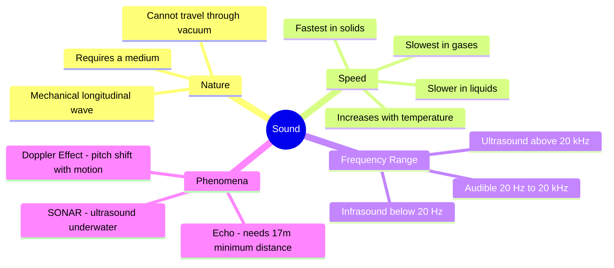

# NOTE — SOUND
**Section:** GK | **Category:** Science | **Topic:** Sound | **Slug:** `sci-sound`
**Source:** 🔧 GENERAL KNOWLEDGE (standard physics reference; not yet cross-checked against PARMAR SSC reference excerpt)
**Status:** 🔧 DRAFT — awaiting AIR-91 verification before publish
**PYQ Frequency:** 🔥 High-frequency Physics topic, connects to [[sci-light-and-optics]] | **High Yield:** ✅

---

## 🎭 THE HOOK

Sound and light both travel as waves, but they have one fundamental difference that decides everything about how each behaves: light can travel through the vacuum of space, but sound CANNOT — sound is a mechanical wave that absolutely requires a MEDIUM (solid, liquid, or gas) to propagate, because it travels by physically vibrating particles, one bumping into the next. That single requirement explains why space is silent, why sound travels FASTER through denser media (more particles packed tighter, transmitting vibration faster) rather than slower, and why astronauts in a vacuum can't simply shout to communicate.

---

## 📖 THE CORE

### Nature of Sound
- Sound is a **MECHANICAL (longitudinal) wave**, produced by the vibration of an object, requiring a MEDIUM to travel — CANNOT travel through a vacuum (a frequently tested contrast with light, which is an electromagnetic wave and CAN travel through vacuum).
- **Longitudinal wave**: particles of the medium vibrate PARALLEL to the direction of wave travel (compressions and rarefactions) — distinct from light, a TRANSVERSE wave (particles/field vibrate PERPENDICULAR to wave direction).

### Speed of Sound
- Speed of sound is FASTEST in SOLIDS, slower in LIQUIDS, and SLOWEST in GASES — the OPPOSITE intuition many people have; denser/more tightly-packed particle arrangements transmit vibrational energy faster.
- Approximate speed of sound in AIR at room temperature: **~343 m/s** (~1,235 km/h).
- Speed of sound INCREASES with temperature (in a given medium) — warmer air molecules move faster, transmitting vibrations more quickly.

### Frequency, Pitch, and the Audible Range
- **Frequency**: number of vibrations per second, measured in **Hertz (Hz)**.
- **Human audible range**: approximately **20 Hz to 20,000 Hz (20 kHz)**.
- **Infrasound**: sound BELOW 20 Hz (inaudible to humans) — used by some animals (elephants, whales) for long-distance communication.
- **Ultrasound**: sound ABOVE 20,000 Hz (inaudible to humans) — used in medical imaging (ultrasound scans), SONAR, and by animals like bats and dolphins for echolocation.
- **Pitch** is determined by FREQUENCY (higher frequency = higher pitch); **Loudness** is determined by AMPLITUDE (greater amplitude = louder sound) — a frequently tested distinction.

### Key Phenomena
- **Echo**: reflection of sound off a hard surface, heard as a distinct repeated sound — requires the reflecting surface to be at LEAST 17 metres away (for an average adult to perceive a distinct echo, given sound's speed and the human ear's ability to distinguish sounds separated by ~0.1 seconds).
- **SONAR** (Sound Navigation and Ranging): uses ultrasound to detect underwater objects/measure depth, based on the time delay of reflected sound waves.
- **Doppler Effect**: the apparent change in frequency/pitch of a sound as the SOURCE and OBSERVER move relative to each other — pitch appears HIGHER as a source approaches, LOWER as it moves away (e.g., an ambulance siren's changing pitch as it passes).

---

## 🧠 THE MIND MAP

---

## 🔑 THE MNEMONIC

**"Solid fastest, gas slowest — opposite of what you'd guess"** — the speed-of-sound-by-medium ordering, flagged as counterintuitive.

**"Pitch is frequency, loudness is amplitude"** — the clean distinction between the two most-confused sound properties.

---

## 📌 THE PYQ ANCHOR

🔥 Sound is a high-frequency Physics topic, connecting to [[sci-light-and-optics]] within the broader Science section. 🔧 No literal Sound question confirmed in the 23/46-shift CGL-2025 sample reviewed earlier in this session, since this topic wasn't separately tagged during PYQ extraction — the audible range, speed-by-medium ordering, and pitch/loudness distinction are textbook-standard SSC CGL Science staples; recommend a dedicated archive cross-check.

---

## ⚠️ THE TRAP ALERT

- **Sound travels FASTEST in solids and SLOWEST in gases** — many aspirants intuitively guess the opposite (assuming "thinner" media transmit sound faster); the correct order is solid > liquid > gas.
- **Sound CANNOT travel through a vacuum**, unlike light — a frequently tested fundamental distinction between sound (mechanical wave) and light (electromagnetic wave).
- **Pitch is determined by FREQUENCY; loudness is determined by AMPLITUDE** — a frequently swapped pair of sound properties.
- **Ultrasound is ABOVE 20,000 Hz; infrasound is BELOW 20 Hz** — both are inaudible to humans but for opposite reasons (too high vs. too low); don't reverse which is which.

---

## ✅ ACTIVE RECALL

1. What type of wave is sound, and what does it require to travel?
2. In which medium does sound travel fastest: solid, liquid, or gas?
3. What is the human audible frequency range, and what are sounds above/below this range called?
4. What determines pitch, and what determines loudness?
5. What is the Doppler Effect, with a real-life example?

*(Answers: 1–A mechanical (longitudinal) wave; requires a medium (solid, liquid, or gas) to travel, and cannot travel through a vacuum | 2–Solids (fastest), then liquids, then gases (slowest) | 3–20 Hz to 20,000 Hz; below 20 Hz is infrasound, above 20,000 Hz is ultrasound | 4–Pitch is determined by frequency; loudness is determined by amplitude | 5–The apparent change in pitch of a sound as the source and observer move relative to each other — e.g., an ambulance siren sounds higher-pitched as it approaches and lower-pitched as it moves away)*
