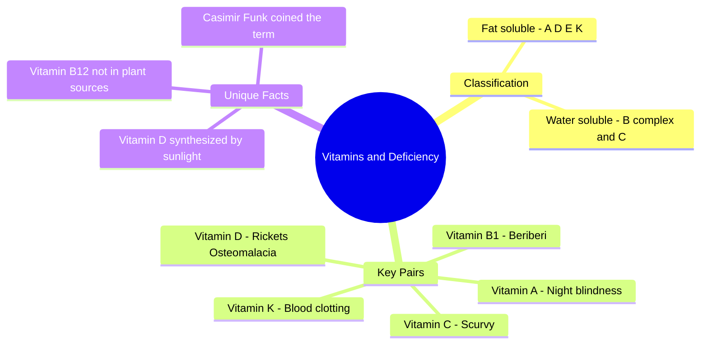

# NOTE — VITAMINS & DEFICIENCY DISEASES
**Section:** GK | **Category:** Science | **Topic:** Vitamins & Deficiency Diseases | **Slug:** `sci-vitamins-and-deficiency-diseases`
**Source:** 🔧 GENERAL KNOWLEDGE (standard biology reference; not yet cross-checked against PARMAR SSC reference excerpt)
**Status:** 🔧 DRAFT — awaiting AIR-91 verification before publish
**PYQ Frequency:** 🔥 Very high-frequency Science category, connects to [[sci-human-body-systems]] | **High Yield:** ✅

---

## 🎭 THE HOOK

For centuries, sailors on long voyages died mysteriously of a disease that turned out to have an absurdly simple cure: citrus fruit. That disease — **scurvy** — is now understood as a **Vitamin C deficiency**, and it's the single most famous entry in a category of illness defined not by an infection or a genetic flaw, but by the simple ABSENCE of one specific nutrient. Vitamins are labeled by LETTER rather than by chemical name in common usage precisely because they were DISCOVERED before their exact chemistry was understood — and SSC's favourite way to test this entire category is the same every time: name the vitamin, name its deficiency disease, in either direction.

---

## 📖 THE CORE

### The Vitamin-Deficiency Table (Frequently Tested Core List)
| Vitamin | Chemical Name | Deficiency Disease | Source |
|---|---|---|---|
| **Vitamin A** | Retinol | **Night blindness** (Xerophthalmia) | Carrots, liver, dairy, leafy vegetables |
| **Vitamin B1** | Thiamine | **Beriberi** | Whole grains, legumes |
| **Vitamin B2** | Riboflavin | **Ariboflavinosis** (cracked lips, skin lesions) | Milk, eggs, green vegetables |
| **Vitamin B3** | Niacin | **Pellagra** (dermatitis, diarrhoea, dementia) | Meat, fish, whole grains |
| **Vitamin B6** | Pyridoxine | Anemia, dermatitis | Meat, bananas, whole grains |
| **Vitamin B7** | Biotin | Hair loss, skin issues | Egg yolk, nuts |
| **Vitamin B9** | Folic Acid | Anemia (especially in pregnancy, linked to neural tube defects in fetus) | Leafy greens, legumes |
| **Vitamin B12** | Cobalamin | **Pernicious anemia** | Meat, dairy, eggs (NOT found in plant sources — a key vegan-diet concern) |
| **Vitamin C** | Ascorbic Acid | **Scurvy** (bleeding gums, joint pain) | Citrus fruits, amla, guava |
| **Vitamin D** | Calciferol | **Rickets** (children), **Osteomalacia** (adults) | Sunlight exposure, fish oil, dairy |
| **Vitamin E** | Tocopherol | Infertility, muscle weakness | Vegetable oils, nuts, seeds |
| **Vitamin K** | Phylloquinone | Poor BLOOD CLOTTING (excessive bleeding) | Green leafy vegetables |

### Fat-Soluble vs. Water-Soluble Vitamins (Frequently Tested Classification)
- **Fat-soluble**: A, D, E, K — stored in body fat, do NOT need to be consumed daily, but can accumulate to TOXIC levels if over-consumed (hypervitaminosis).
- **Water-soluble**: B-complex and C — NOT stored significantly in the body, must be consumed regularly through diet, EXCRETED in urine if consumed in excess (toxicity risk is much lower).

### Key Discovery Facts
- **Vitamin discovery is credited largely to Casimir Funk** (coined the term "vitamine" in 1912, based on the belief these compounds were "vital amines" — later shortened to "vitamin" once it was found not all vitamins are amines).
- **Vitamin D is UNIQUE** among vitamins — it can be SYNTHESIZED by the human body itself upon sun exposure (via UV radiation on skin), unlike all other vitamins, which must be obtained from diet.
- **Vitamin B12 is the ONLY vitamin not found in plant sources** — a critical concern for strict vegan diets, frequently requiring supplementation.

### Key Distinguishing Facts
- **Vitamin A deficiency causes NIGHT BLINDNESS**, NOT general blindness — a frequently tested specificity.
- **Vitamin C deficiency causes SCURVY**; Vitamin D deficiency causes **RICKETS** (in children) — a frequently confused pair, since both involve bone/connective tissue symptoms.
- **Vitamin K is specifically linked to BLOOD CLOTTING**, a frequently tested unique functional association distinguishing it from other vitamins.

---

## 🧠 THE MIND MAP

---

## 🔑 THE MNEMONIC

**"A for night-sight, B1 for Beriberi, C for Scurvy, D for bones, K for clotting"** — five vitamin-deficiency pairs in one line.

**"Fat-soluble ADEK stays stored, water-soluble B-and-C flows out"** — the storage/toxicity-risk distinction between the two vitamin classes.

---

## 📌 THE PYQ ANCHOR

🔥 Vitamins & Deficiency Diseases is a very high-frequency Science category, connecting to [[sci-human-body-systems]]. 🔧 No literal Vitamins question confirmed in the 23/46-shift CGL-2025 sample reviewed earlier in this session, since this topic wasn't separately tagged during PYQ extraction — vitamin-to-deficiency-disease matching is one of the most consistently tested SSC CGL Science categories across every cycle; recommend a dedicated archive cross-check.

---

## ⚠️ THE TRAP ALERT

- **Vitamin A deficiency causes NIGHT BLINDNESS specifically**, not total blindness — a frequently tested precision trap.
- **Vitamin C (Scurvy) and Vitamin D (Rickets) are frequently confused** — both involve connective-tissue/bone symptoms, but Scurvy is about collagen/gum health, Rickets is about bone mineralization.
- **Vitamin D is the ONLY vitamin the body can synthesize itself** (via sunlight) — don't assume all vitamins must come exclusively from diet.
- **Vitamin B12 is the ONLY vitamin absent from plant sources** — a frequently tested dietary-planning fact, especially relevant to vegan nutrition.

---

## ✅ ACTIVE RECALL

1. What deficiency disease results from a lack of Vitamin A, and what is its distinguishing symptom?
2. Which vitamin deficiency causes Scurvy, and which causes Rickets?
3. What is the key difference between fat-soluble and water-soluble vitamins in terms of storage and toxicity risk?
4. Which vitamin can the human body synthesize on its own, and how?
5. Which vitamin is notably absent from plant-based foods?

*(Answers: 1–Night blindness (Xerophthalmia); distinguished by poor vision specifically in low light | 2–Vitamin C deficiency causes Scurvy; Vitamin D deficiency causes Rickets (in children) or Osteomalacia (in adults) | 3–Fat-soluble vitamins (A, D, E, K) are stored in body fat and can reach toxic levels if over-consumed; water-soluble vitamins (B-complex, C) are not significantly stored and are excreted in excess | 4–Vitamin D; synthesized in the skin upon exposure to sunlight (UV radiation) | 5–Vitamin B12)*
